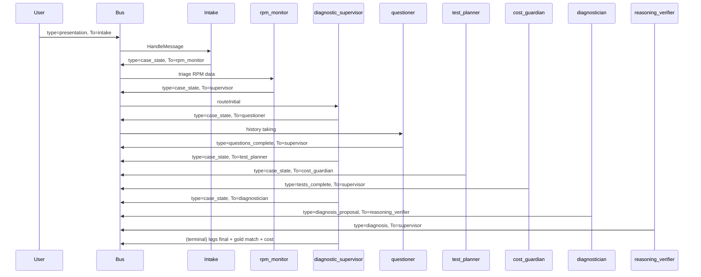
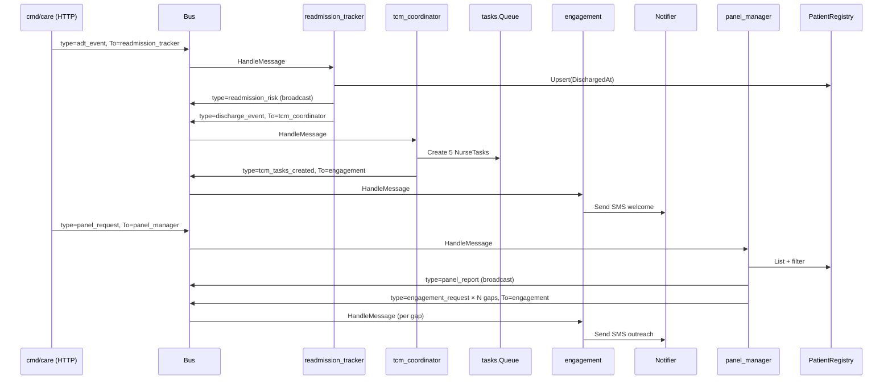

# Bodh — Medical Diagnostic Orchestrator & Care Services Platform (Go)

> **Bodh** (Sanskrit: *bodhi* — knowledge, awakening, insight) is an open-source **medical AI platform** implemented in **Go**. It follows Microsoft's [**Multi-Agent Reference Architecture (MARA)**](https://microsoft.github.io/multi-agent-reference-architecture/), implements a **virtual physician panel** inspired by [**MAI-DxO**](https://microsoft.ai/news/the-path-to-medical-superintelligence/) and the [**Sequential Diagnosis Benchmark (SD Bench)**](https://microsoft.ai/news/the-path-to-medical-superintelligence/), and adds a **care-services layer** (CDM, TCM, panel management, virtual office, RPM, engagement, readmission tracking) on the same bus.

Go · MARA · Medical AI · Sequential Diagnosis · FHIR · HL7 v2 · HIPAA-aware · Open Source

**Module path:** `github.com/PratikDhanave/bodh`

**Architecture diagrams:** [Architecture.png](Architecture.png) (MARA platform) · [architectureflow.png](architectureflow.png) (sequential diagnosis flow)

---

## ⚠️ Research disclaimer (read first)

**Bodh is a research and engineering reference. It is not approved for clinical use.**

- Do **not** use Bodh for real patient care, triage, treatment decisions, or billing.
- Demo agents use **simulated** answers and **rule-based** inference — not validated models.
- All rule-of-thumb thresholds (test costs, RPM alert limits, A1c/BP cutoffs, readmission weights) are **illustrative**, not clinical guidelines.
- HIPAA, FDA, ONC, and state-law alignment described below is **architectural guidance**: the codebase is not certified, audited, or under a Business Associate Agreement (BAA).
- Microsoft's MAI-DxO/SD-Bench work itself states that the result requires clinical validation, governance, and regulatory review before deployment.

At the heart of any future clinical product: **safety, trust, transparency, and human oversight.**

---

## Table of contents

### Part I — Get started
1. [Quick start](#quick-start)
2. [What is Bodh?](#what-is-bodh)
3. [The one-sentence model](#the-one-sentence-model)
4. [Repository layout](#repository-layout)

### Part II — Background & motivation
5. [MAI-DxO and SD Bench](#mai-dxo-and-sd-bench)
6. [Why MARA (and not one big LLM call)](#why-mara-and-not-one-big-llm-call)
7. [Care-services catalog](#care-services-catalog)

### Part III — Architecture
8. [Architecture diagrams](#architecture-diagrams)
9. [System architecture overview](#system-architecture-overview)
10. [MARA concepts → Go packages](#mara-concepts--go-packages)
11. [Virtual physician panel (MAI-DxO mapping)](#virtual-physician-panel-mai-dxo-mapping)
12. [Care-services workflows](#care-services-workflows)
12b. [Human-in-the-loop (HITL) — clinical oversight gate](#human-in-the-loop-hitl--clinical-oversight-gate)
13. [Clinical message protocol](#clinical-message-protocol)
14. [Domain model (`pkg/medical`)](#domain-model-pkgmedical)
15. [Package guide](#package-guide)
16. [Walkthrough: `cmd/demo`](#walkthrough-cmddemo-line-by-line)
17. [Walkthrough: `cmd/caredemo`](#walkthrough-cmdcaredemo)

### Part IV — Healthcare standards & interoperability
18. [FHIR R4](#fhir-r4)
19. [HL7 v2](#hl7-v2)
20. [SMART on FHIR / OAuth 2.0 / OIDC](#smart-on-fhir--oauth-20--oidc)
21. [FHIR Bulk Data API](#fhir-bulk-data-api)
22. [SMART Health Cards / SMART Health Links](#smart-health-cards--smart-health-links)
23. [Clinical terminologies](#clinical-terminologies)
24. [DICOM (imaging)](#dicom-imaging)
25. [X12 EDI (eligibility, claims, ERA)](#x12-edi-eligibility-claims-era)
26. [NCPDP SCRIPT (e-prescribing)](#ncpdp-script-e-prescribing)
27. [Direct Project (secure clinician messaging)](#direct-project-secure-clinician-messaging)
28. [CDA / C-CDA documents](#cda--c-cda-documents)

### Part V — Security & HIPAA compliance
29. [PHI handling principles](#phi-handling-principles)
30. [Security architecture](#security-architecture)
31. [HIPAA Privacy Rule](#hipaa-privacy-rule)
32. [HIPAA Security Rule (admin / physical / technical safeguards)](#hipaa-security-rule-administrative--physical--technical-safeguards)
33. [HIPAA Breach Notification Rule](#hipaa-breach-notification-rule)
34. [HITECH and the Information Blocking Rule](#hitech-and-the-information-blocking-rule)
35. [42 CFR Part 2 (substance-use records)](#42-cfr-part-2-substance-use-records)
36. [State privacy laws (CMIA, NY SHIELD, etc.)](#state-privacy-laws-cmia-ny-shield)
37. [GDPR and international privacy](#gdpr-and-international-privacy)
38. [HITRUST CSF, SOC 2, ISO 27001 / 27799](#hitrust-csf-soc-2-iso-27001--27799)
39. [De-identification and re-identification risk](#de-identification-and-re-identification-risk)
40. [Governance policies in Bodh](#governance-policies-in-bodh)

### Part VI — Regulatory pathway
41. [FDA — Software as a Medical Device (SaMD)](#fda--software-as-a-medical-device-samd)
42. [Clinical Decision Support (CDS) carve-out](#clinical-decision-support-cds-carve-out)
43. [21 CFR Part 11 (electronic records & signatures)](#21-cfr-part-11-electronic-records--signatures)
44. [ONC Health IT Certification](#onc-health-it-certification)
45. [CMS quality programs](#cms-quality-programs)
46. [Clinical validation pathway](#clinical-validation-pathway)
47. [Bias, equity, and model governance](#bias-equity-and-model-governance)

### Part VII — Operations
48. [Observability](#observability)
49. [Audit logging](#audit-logging)
50. [Configuration](#configuration)
51. [Deployment topologies](#deployment-topologies)
52. [Docker and Kubernetes](#docker-and-kubernetes)
53. [Backup, DR, BCP](#backup-disaster-recovery-business-continuity)
54. [Scaling, throughput, and tenancy](#scaling-throughput-and-tenancy)

### Part VIII — Quality & evaluation
55. [Evaluation (SD Bench alignment)](#evaluation-sd-bench-alignment)
56. [Diagnostic test catalog and costs](#diagnostic-test-catalog-and-costs)
57. [Sample cases and fixtures](#sample-cases-and-fixtures)
58. [Cohort analytics](#cohort-analytics)

### Part IX — Develop
59. [Add your first Bodh agent (tutorial)](#add-your-first-bodh-agent-tutorial)
60. [Design rules (from MARA)](#design-rules-from-mara)
61. [Testing](#testing)
62. [Contributing](#contributing)

### Part X — Reference
63. [HTTP API reference (`cmd/care`)](#http-api-reference-cmdcare)
64. [Message-type reference](#message-type-reference)
65. [Agent reference](#agent-reference)
66. [What is implemented today vs planned](#what-is-implemented-today-vs-planned)
67. [Roadmap](#roadmap)
68. [MARA chapters — what to read and when](#mara-chapters--what-to-read-and-when)
69. [Glossary](#glossary)
70. [References](#references)
71. [License / status](#license--status)

---

## Quick start

```bash
git clone https://github.com/PratikDhanave/bodh.git
cd bodh

# Diagnostic flow (MAI-DxO / SD-Bench style)
go run ./cmd/demo
go run ./cmd/demo -case=data/cases/demo_chf.json   # CHF + RPM

# Care services (CDM, TCM, panel, virtual office, ADT)
go run ./cmd/caredemo
go run ./cmd/caredemo -workflow=cdm
go run ./cmd/caredemo -workflow=tcm
go run ./cmd/caredemo -workflow=panel
go run ./cmd/caredemo -workflow=virtual_office
go run ./cmd/caredemo -workflow=adt

# HTTP API (RPM ingest, ADT, CDM, TCM, Panel, Inbox, Refill, Prior auth, FHIR)
go run ./cmd/care -addr=:8088

# Test suite
go test ./...
```

You should see logs like:

```
[bodh] [intake] case=demo-case-001 chief_complaint="Cough and fever"
[bodh] [supervisor] starting sequential diagnosis for case demo-case-001
[bodh] [questioner] ask: Duration and character of cough?
[bodh] [test_planner] ordering complete_blood_count ($45)
[bodh] [cost_guardian] APPROVE: $220.00 / $500.00 budget (44% utilized)
[bodh] [diagnostician] diagnosis="Community-acquired pneumonia" confidence=87%
[bodh] [reasoning_verifier] VERIFIED diagnosis "Community-acquired pneumonia"
[bodh] [supervisor] gold standard: Community-acquired pneumonia | match=true
```

For the care demo:

```
[bodh] [cdm_planner] plan condition=dm goals=1 meds=1 monitors=1 next_review=...
[bodh] [tcm_coordinator] discharge pt-001 primary=ADHF tasks=5 conflicts=0
[bodh] [panel_manager] panel=3 gaps=4 roll=map[chf:1 copd:1 dm:1 htn:1]
[bodh] [readmission_tracker] patient=pt-001 discharge risk=0.66 band=high
[bodh] [engagement] sms -> pt-002 template=care_gap reason=a1c_overdue
[bodh] === summary === nurse tasks: 12 — notifications sent: 8
```

---

## What is Bodh?

Bodh is two things in one repository:

1. **A multi-agent diagnostic orchestrator** — a virtual physician panel that asks targeted questions, orders cost-aware tests, infers a working diagnosis, and verifies its reasoning. Inspired by Microsoft's [MAI-DxO](https://microsoft.ai/news/the-path-to-medical-superintelligence/) and benchmarked against the Sequential Diagnosis Benchmark.

2. **A care-services platform** — chronic disease management, transitional care, panel management, virtual office (pre-visit prep, inbox triage, refills, prior auth), patient engagement, and readmission tracking. These run as additional agents on the same MARA bus.

The platform layer (orchestrator, registry, bus, governance, evaluation, observability) follows Microsoft's [Multi-Agent Reference Architecture (MARA)](https://microsoft.github.io/multi-agent-reference-architecture/) — agents do not call each other directly; they emit messages routed by the orchestrator and gated by governance policies.

### Engineering reality

Bodh is a **Go codebase** with rule-based agents and an in-memory bus. It is intentionally:
- **Model-agnostic** — every agent is a struct that implements one interface; an LLM-backed version drops in by composition.
- **Cost-aware** — every diagnostic test has a virtual USD price; a Cost Guardian enforces a per-case budget.
- **Governed** — policies run *before* agents see a message; deny stops processing.
- **Auditable** — every interaction is a `Message`; the orchestrator is the only place that touches the bus + policy + agents.

---

## The one-sentence model

> **A user (or API call) publishes a clinical message → the orchestrator delivers it to the right agent → the agent returns zero or more new messages → the orchestrator publishes those → governance gates each hop → the workflow continues until a terminal agent decides we're done.**

That is exactly what MARA's building blocks describe: an **orchestrator**, **specialized agents**, a **registry**, **memory**, **governance**, and **observability**.

---

## Repository layout

```
bodh/
├── Architecture.png             # MARA platform map (orchestrator, registry, agents, eval)
├── architectureflow.png         # Sequential diagnosis flow
├── architectureflow.webp        # WebP source for the flow diagram
├── cmd/
│   ├── demo/                    # Sequential diagnosis entrypoint
│   ├── caredemo/                # Care-services workflows (CDM/TCM/Panel/VO/ADT)
│   └── care/                    # HTTP API
├── agents/                      # Virtual physician panel + care services
│   ├── intake.go
│   ├── supervisor.go            # diagnostic_supervisor (MAI-DxO-style)
│   ├── questioner.go
│   ├── test_planner.go
│   ├── cost_guardian.go
│   ├── diagnostician.go
│   ├── reasoning_verifier.go
│   ├── rpm_monitor.go
│   ├── cdm_planner.go           # Chronic Disease Management
│   ├── tcm_coordinator.go       # Transitional Care Management
│   ├── panel_manager.go         # Panel Management / gap-in-care
│   ├── pre_visit_prep.go        # Virtual Office: pre-visit prep
│   ├── inbox_triage.go          # Virtual Office: inbox
│   ├── refill_manager.go        # Virtual Office: refills
│   ├── prior_auth.go            # Virtual Office: prior auth
│   ├── engagement.go            # Patient outreach
│   └── readmission_tracker.go   # ADT + risk
├── pkg/
│   ├── protocol/                # Message schema (shared wire format)
│   ├── agent/                   # Agent + Environment interfaces
│   ├── registry/                # Agent discovery
│   ├── comm/                    # Bus (in-memory; swappable)
│   ├── orchestration/           # Platform orchestrator
│   ├── governance/              # Policies + medical_policy.go
│   ├── medical/                 # CaseState, CarePlan, Panel, ADT, RPM, ...
│   ├── tasks/                   # Nurse work queue
│   ├── engagement/              # SMS/email/IVR notifier
│   ├── fhir/                    # Minimal FHIR R4 adapter
│   ├── analytics/               # Cohort metrics
│   ├── persistence/             # JSON file store
│   ├── memory/                  # KV store
│   ├── observability/           # Logger + Clock
│   └── eval/                    # InteractionRecord, CaseMetrics
├── data/
│   └── cases/
│       ├── demo_pneumonia.json
│       └── demo_chf.json
├── go.mod
├── go.sum
└── README.md
```

---

## MAI-DxO and SD Bench

### The limitation of multiple-choice medical AI benchmarks

For years, **USMLE-style** multiple-choice questions were the standard AI medical benchmark. Frontier models now score near-perfect on such exams. Microsoft and others argue these benchmarks **overstate** competence because they reward memorization over **iterative clinical reasoning** — the kind required in real cases.

### Sequential Diagnosis Benchmark (SD Bench)

From [The Path to Medical Superintelligence](https://microsoft.ai/news/the-path-to-medical-superintelligence/):

- **304** recent **New England Journal of Medicine (NEJM)** Case Records were transformed into **stepwise diagnostic encounters**.
- An agent (or physician) may **ask questions**, **order tests** (with virtual **cost**), and **update reasoning** until it provides a final diagnosis.
- Performance is measured on **accuracy** and **resource expenditure** — a **Pareto frontier** of diagnosis vs. cost.

MAI-DxO paired with OpenAI's **o3** reportedly reached **~85.5%** accuracy on these cases, vs. **~20%** mean for experienced physicians in their study setup. Microsoft cites up to ~25% of U.S. health spending as low-value or wasted — the cost dimension is real.

### What Bodh implements today

| SD Bench / MAI-DxO idea | Bodh status |
|-------------------------|-------------|
| Sequential ask → test → diagnose | ✅ Demo workflow |
| Virtual cost per test | ✅ `medical.TestCatalog` |
| Cost budget / guardian | ✅ `cost_guardian` + `MaxDiagnosticCostPolicy` |
| Self-verification before final diagnosis | ✅ `reasoning_verifier` |
| Virtual physician panel | ✅ 8 agents |
| NEJM case loader / 304 cases | 🔲 Planned |
| LLM-backed agents | 🔲 Planned |
| Public benchmark runner | 🔲 Planned |

---

## Why MARA (and not one big LLM call)

Microsoft's [Multi-Agent Reference Architecture](https://microsoft.github.io/multi-agent-reference-architecture/) focuses on systems where **many specialized agents** interact. The hard problems are not "write a prompt", but:

| Problem | Why it matters in medicine |
|---------|----------------------------|
| **Routing** | Should this message go to history, labs, or diagnosis? |
| **Decomposition** | Who owns step 1 vs step 2 in a long case? |
| **Governance** | PHI, budget caps, disallowed actions — **before** any agent runs |
| **State** | Case progression, prior questions, test results |
| **Operations** | Audit logs, evaluation vs. gold diagnosis, regression tests |
| **Safety** | Fail closed; explainable denials; human-in-the-loop hooks |

A single monolithic LLM call is hard to **audit**, **cap cost**, **swap models per step**, or **regression-test** when clinical guidelines change. Bodh keeps the orchestrator generic and puts clinical policy in **agents + governance**.

**Further reading:** [MARA Reference Architecture](https://microsoft.github.io/multi-agent-reference-architecture/docs/reference-architecture/Reference-Architecture.html) · [Building blocks](https://microsoft.github.io/multi-agent-reference-architecture/docs/building-blocks/Building-Blocks.html)

---

## Care-services catalog

Each service is one or more Bodh agents subscribing to specific message types, sharing in-memory state (patient registry, nurse task queue, notifier) injected through agent struct fields. The catalog covers the core workflows of value-based primary care: chronic disease management, transitional care, panel management, virtual office work, patient engagement, RPM, and readmission tracking.

| Service | Bodh agent(s) | Status |
|------------------------|---------------|--------|
| Remote Patient Monitoring (RPM) | `rpm_monitor` + device webhooks via `pkg/medical/rpm.go` | ✅ |
| Chronic Disease Management (CDM) | `cdm_planner` + `medical.CarePlan` templates (HTN, DM, CHF, CKD, COPD) | ✅ |
| Transitional Care Management (TCM) | `tcm_coordinator` + nurse `tasks.Queue` + `medical.ReconcileMedications` | ✅ |
| Panel Management | `panel_manager` + `DefaultPanelRules` (A1c, BP, CHF weight, annual visit, post-discharge) | ✅ |
| Virtual Office: Pre-visit prep | `pre_visit_prep` | ✅ |
| Virtual Office: Inbox | `inbox_triage` (auto-routes refill / PA / urgent) | ✅ |
| Virtual Office: Refills | `refill_manager` (auto-approves on-plan meds, escalates rest) | ✅ |
| Virtual Office: Prior auth | `prior_auth` (low-risk auto-approve, others to queue) | ✅ |
| Patient engagement | `engagement` + `pkg/engagement` (SMS / email / IVR) | ✅ |
| Readmission tracking | `readmission_tracker` (ADT feed + transparent risk score) | ✅ |
| EHR integration | `pkg/fhir` (Patient / Observation / Encounter / Condition) + HL7 v2 (planned) | ✅ FHIR · 🔲 HL7 v2 |
| Analytics / outcomes | `pkg/eval` + `pkg/analytics` | ✅ |

---

## Architecture diagrams

| File | What it shows | When to use it |
|------|----------------|----------------|
| [**Architecture.png**](Architecture.png) | Microsoft-style **MARA** — user, orchestrator, classifier, registry, knowledge, storage, supervisor/worker agents, MCP, observability, evaluation | Onboarding to **platform** packages |
| [**architectureflow.png**](architectureflow.png) | **Sequential diagnosis flow** — virtual physician panel | Onboarding to **`agents/`** + `cmd/demo` |
| [`architectureflow.webp`](architectureflow.webp) | WebP source (PNG preferred for GitHub) | Asset pipeline |

### Platform architecture — `Architecture.png`

<p align="center">
  
</p>

**How to read this diagram with the code:**

| Area on diagram | Bodh implementation | Go path |
|-----------------|---------------------|---------|
| User / User application | Entry that publishes the first `protocol.Message` | `cmd/demo`, `cmd/caredemo`, `cmd/care` (HTTP) |
| Orchestrator | Subscribes agents, runs governance, calls `HandleMessage`, republishes outputs | `pkg/orchestration` |
| Classifier | Route intent (chest pain vs rash, refill vs urgent) | `inbox_triage` agent · future `pkg/classifier` |
| Agent registry | Lists agents, resolves capabilities | `pkg/registry` |
| Knowledge layer | Guidelines, differentials, RAG | Planned: DB + vector index |
| Storage layer | Case + roster + queue state | `pkg/memory`, `pkg/persistence` (JSON file today) · planned PostgreSQL |
| Supervisor agent | Decompose diagnosis | `agents/supervisor.go` |
| Workers | Intake, questioner, tests, cost, dx, verify, CDM/TCM/panel/VO/RPM/engagement/readmission | `agents/*.go` |
| Integration / MCP / tools | Labs, imaging, LLM APIs, FHIR, HL7 v2 | `pkg/fhir` (today) · planned MCP tools |
| Observability | Logs, traces, clocks | `pkg/observability` |
| Evaluation | Accuracy vs gold, cost metrics | `pkg/eval` · planned `cmd/bench` |

### Clinical flow — `architectureflow.png`

<p align="center">
  
</p>

### Why images sometimes do not show on GitHub

| Cause | Fix |
|-------|-----|
| WebP in README | GitHub support is inconsistent; this repo displays the **PNG** export |
| Very large PNG | The README uses HTML `width` so the PNG scales |
| File not on `main` | Images must be committed on the branch you view |
| Broken relative path | Use `./Architecture.png` from README root |

---

## System architecture overview

> **Visual references:** Platform boxes → [`Architecture.png`](Architecture.png). Clinical message path → [`architectureflow.png`](architectureflow.png).

### Layered view

```
┌─────────────────────────────────────────────────────────────────────┐
│                      Ingress / API layer                            │
│       cmd/demo · cmd/caredemo · cmd/care (HTTP) · FHIR endpoints     │
└──────────────────────────────┬──────────────────────────────────────┘
                               │ publish protocol.Message
┌──────────────────────────────▼──────────────────────────────────────┐
│                         Governance layer                            │
│   MaxContentLength · RequireCaseID · MaxDiagnosticCost · Disclaimer │
└──────────────────────────────┬──────────────────────────────────────┘
                               │ allow
┌──────────────────────────────▼──────────────────────────────────────┐
│                    Orchestration & routing                          │
│   pkg/orchestration · pkg/comm (Bus) · pkg/registry · pkg/memory    │
└──────────────────────────────┬──────────────────────────────────────┘
                               │ deliver
┌──────────────────────────────▼──────────────────────────────────────┐
│                    Agent layer (workers)                            │
│   Diagnostic:  intake → rpm_monitor → supervisor → questioner →      │
│                test_planner → cost_guardian → diagnostician →        │
│                reasoning_verifier                                   │
│   Care:        cdm_planner · tcm_coordinator · panel_manager ·       │
│                pre_visit_prep · inbox_triage · refill_manager ·      │
│                prior_auth · engagement · readmission_tracker         │
└──────────────────────────────┬──────────────────────────────────────┘
                               │ read / write
┌──────────────────────────────▼──────────────────────────────────────┐
│                       Domain & state                                │
│   pkg/medical (CaseState, CarePlan, Panel, ADT, RPM, FHIR types)     │
│   pkg/tasks (NurseTask queue) · pkg/engagement (Notifier)           │
└──────────────────────────────┬──────────────────────────────────────┘
                               │ persist / aggregate
┌──────────────────────────────▼──────────────────────────────────────┐
│                  Persistence & analytics                            │
│  pkg/persistence (JSON file) · pkg/eval (records) · pkg/analytics    │
└─────────────────────────────────────────────────────────────────────┘
                               │
┌──────────────────────────────▼──────────────────────────────────────┐
│                         Observability                               │
│             pkg/observability (Logger, Clock) · future OTel          │
└─────────────────────────────────────────────────────────────────────┘
```

### Sequential diagnosis (sequence)



### Care services flow (sequence)



---

## MARA concepts → Go packages

This table is the **map of the codebase**.

| MARA concept | What it does | Go package | Key types / files |
|--------------|--------------|------------|-------------------|
| Message / protocol | Common wire format | `pkg/protocol` | `Message`, `MessageRole`, `NewMessage` |
| Agent | Domain worker — one message in, zero-N out | `pkg/agent` | `Agent`, `Environment` |
| Agent registry | Who exists? What can they do? | `pkg/registry` | `Registry`, `InMemoryRegistry`, `FindByCapability` |
| Communication bus | Routes by `Message.To` | `pkg/comm` | `Bus`, `InMemoryBus` |
| Orchestrator | Subscribe agents, apply policy, dispatch | `pkg/orchestration` | `Orchestrator`, `SimpleEnvironment` |
| Governance | Allow / deny before an agent sees a message | `pkg/governance` | `Policy`, `CompositePolicy`, `medical_policy.go` |
| Memory | Short / long-term context | `pkg/memory` | `KeyValueStore`, `InMemoryKV` |
| Observability | Logs, clocks | `pkg/observability` | `Logger`, `Clock`, `[bodh]` prefix |
| Evaluation | Record runs for offline / online eval | `pkg/eval` | `InteractionRecord`, `CaseMetrics`, `Store` |
| Medical domain | Case state, tests, diagnoses, care plans, panel, ADT, RPM | `pkg/medical` | `CaseState`, `TestCatalog`, `DiagnosisProposal`, `CarePlan`, `PanelReport`, `ADTEvent`, `RPMObservation`, `PatientRegistry` |
| Clinical agents | Virtual physician panel + care services | `agents/` | 17 agents |
| Tasks | Nurse work queue | `pkg/tasks` | `Queue`, `NurseTask` |
| Engagement | Outreach notifier | `pkg/engagement` | `Notifier`, `InMemoryNotifier` |
| FHIR adapter | R4 import/export | `pkg/fhir` | `Patient`, `Observation`, `Encounter`, `Condition` |
| Analytics | Cohort rollups | `pkg/analytics` | `CohortMetrics`, `GapBreakdown` |
| Persistence | JSON file store | `pkg/persistence` | `FileStore` |

---

## Virtual physician panel (MAI-DxO mapping)

### Agent registry table

| Agent ID | Human name | MAI-DxO action | Capability strings | Input `Type` | Output `Type` | Sends to |
|----------|------------|----------------|-------------------|--------------|---------------|----------|
| `intake` | Clinical Intake | (case entry) | `intake_presentation` | `presentation` | `case_state` | `rpm_monitor` |
| `rpm_monitor` | RPM Monitor | RPM triage | `rpm_ingest`, `vitals_triage` | `case_state` | `case_state` | `diagnostic_supervisor` |
| `diagnostic_supervisor` | Diagnostic Orchestrator | Panel coordination | `supervise_diagnosis`, `sequential_diagnosis` | `case_state`, `questions_complete`, `tests_complete`, `diagnosis` | `case_state` / terminal | `questioner`, `test_planner`, `diagnostician` |
| `questioner` | History & Symptom Questioner | **Ask question** | `ask_question`, `history_taking` | `case_state` | `questions_complete` | `diagnostic_supervisor` |
| `test_planner` | Diagnostic Test Planner | **Request test** | `order_test`, `interpret_results` | `case_state` | `case_state` | `cost_guardian` |
| `cost_guardian` | Diagnostic Cost Guardian | **Cost check** | `cost_check`, `pareto_optimization` | `case_state` | `tests_complete` | `diagnostic_supervisor` |
| `diagnostician` | Diagnostician | **Provide diagnosis** | `provide_diagnosis`, `differential_diagnosis` | `case_state` | `diagnosis_proposal` | `reasoning_verifier` |
| `reasoning_verifier` | Clinical Reasoning Verifier | **Verify reasoning** | `verify_reasoning`, `safety_check` | `diagnosis_proposal` | `diagnosis` | `diagnostic_supervisor` |

### Per-agent behavior

#### `intake` ([agents/intake.go](agents/intake.go))

- Parses `PatientPresentation` JSON.
- Builds initial `CaseState`: merges complaint + HPI, reads `case_id` / `max_cost_usd` / `gold_diagnosis` / `condition` / RPM observations from metadata.
- Initializes empty `Answers` and `TestResults` maps (required — JSON round-trip can yield `nil`).

#### `rpm_monitor` ([agents/rpm_monitor.go](agents/rpm_monitor.go))

- Evaluates `medical.EvaluateRPMAlerts` over `state.RPMObservations`.
- Demo thresholds: SBP ≥ 160, weight_lb ≥ 185, SpO₂ < 92, HR ≥ 110.
- Always forwards to supervisor (alerts are advisory, not gating).

#### `diagnostic_supervisor` ([agents/supervisor.go](agents/supervisor.go))

State machine on `msg.Type`:

| Incoming | Action |
|----------|--------|
| `case_state` (from RPM/intake) | forward to `questioner` |
| `questions_complete` | forward to `test_planner` |
| `tests_complete` | forward to `diagnostician` |
| `diagnosis` (verified) | finalize — log, score via `eval.ScoreCase` |

#### `questioner` ([agents/questioner.go](agents/questioner.go))

- Demo: four fixed history questions; `simulatedAnswer()` returns canned text.
- Hypotheses keyed off `state.Condition` (chf → ADHF / COPD-exacerbation / PNA; else CAP / viral URI / PE).
- Production: one question per message turn, or batched LLM call.

#### `test_planner` ([agents/test_planner.go](agents/test_planner.go))

- Demo workup for respiratory case: CBC + chest X-ray + BMP.
- Accumulates `TotalCostUSD` from `medical.TestCatalog`.
- Always routes through `cost_guardian` before supervisor sees `tests_complete`.

#### `cost_guardian` ([agents/cost_guardian.go](agents/cost_guardian.go))

- Compares `state.TotalCostUSD` to `state.MaxCostUSD`.
- Deny: log and emit no messages (supervisor handles rework — planned).
- Approve: emits `tests_complete`.

#### `diagnostician` ([agents/diagnostician.go](agents/diagnostician.go))

- `inferDiagnosis()`:
  - `Condition=chf` + ≥2 RPM alerts → ADHF @ 0.84
  - CXR infiltrate + CBC WBC → CAP @ 0.87
  - else low-confidence "undifferentiated"
- Sends `diagnosis_proposal` JSON to `reasoning_verifier`.

#### `reasoning_verifier` ([agents/reasoning_verifier.go](agents/reasoning_verifier.go))

- Demo rule: `confidence ≥ 0.5` AND non-empty `rationale`.
- On success: sets `WorkingDiagnosis`, emits `diagnosis` to supervisor.
- Production: LLM rubric, second model, or rules + human escalation.

---

## Human-in-the-loop (HITL) — clinical oversight gate

Every clinically consequential action in Bodh can be **gated by a human reviewer** before the platform acts on it. This is the FDA Clinical Decision Support (CDS) carve-out criterion #4 ("enable the clinician to independently review the basis for the recommendations") expressed in code: the platform proposes, a clinician disposes.

### How it works

A single `human_review` agent ([agents/human_review.go](agents/human_review.go)) is the gate. Upstream agents that need oversight do not address their output directly to the next agent — they wrap it in a **review envelope** and address it to `human_review` with type `review_request`. The gate records a `medical.ReviewRequest` in the [pkg/hitl](pkg/hitl/queue.go) queue and emits nothing. A reviewer decides via HTTP (`POST /reviews/{id}/decide`) or programmatic call (`HumanReviewAgent.ApplyDecision`); on approval the original payload is republished to its intended recipient.

```
upstream agent ──► human_review ──► (pending in queue)
                                        │
                            reviewer decides (HTTP / API)
                                        │
                            ┌───────────┴───────────┐
                            │                       │
                        approve                  reject
                            │                       │
                            ▼                       ▼
                    next agent (resume)      (no resume; logged)
```

The envelope is opaque metadata, so adding HITL to a new flow does not require any changes to governance or the bus:

| Envelope key | Type | Required | Purpose |
|--------------|------|----------|---------|
| `hitl_kind` | string | yes | Review category (e.g. `care_plan_review`) |
| `hitl_next_to` | string | yes | Agent to forward to on approval |
| `hitl_next_type` | string | yes | Message type used on resume |
| `hitl_priority` | string | no | `low` / `normal` / `high` / `urgent` (default `normal`) |
| `hitl_subject` | string | no | Short label shown in the queue UI |
| `hitl_sla_minutes` | float64 | no | Deadline; expired reviews never resume |

### Which flows are gated

Every gateable agent carries a `HITL bool` field. Default is `false` (the diagnostic `cmd/demo` is unaffected). `cmd/caredemo` and `cmd/care` set it to `true`. The currently gated outputs:

| Agent | When HITL=true, this output is gated | Review kind |
|-------|--------------------------------------|-------------|
| `reasoning_verifier` | verified diagnosis → `diagnostic_supervisor` | `diagnosis_review` |
| `cdm_planner` | care plan → `engagement` (panel_manager tracking is direct) | `care_plan_review` |
| `tcm_coordinator` | TCM welcome → `engagement` | `tcm_welcome_review` |
| `panel_manager` | per-gap outreach → `engagement` | `outreach_review` |
| `refill_manager` | refill response → `engagement` | `refill_review` |
| `prior_auth` | PA status → `engagement` | `prior_auth_review` |
| `readmission_tracker` | discharge → `tcm_coordinator` (priority scales with risk band) | `discharge_review` |

Flows that don't get a gate (already safe, or trivially informational): RPM ingest, panel_report broadcast, pre-visit chart prep (read-only), inbox triage (already routes urgent items to a human via the nurse task queue), readmission risk broadcast.

### Cascades

Approvals can trigger downstream agents that themselves emit review_requests (e.g. `discharge_review` approved → `tcm_coordinator` runs → emits `tcm_welcome_review`). The `cmd/caredemo` auto-approver drains the queue across rounds to demonstrate this; in production the reviewer's UI shows the cascaded reviews as they appear.

### Two-phase demo

```bash
go run ./cmd/caredemo
# Phase 1: agents publish review_requests → queued as "pending"
# Phase 2 (round 1): clinician-demo auto-approves 9 reviews → resumed messages publish
# Phase 2 (round 2): cascade from TCM publishes one more review_request → approved
# Phase 3: engagement sends 8 SMS notifications
# Summary: 10 human reviews (all approved), 12 nurse tasks, 8 notifications sent
```

Run with HITL off to see the direct (un-gated) behavior:

```bash
go run ./cmd/caredemo -hitl=false
```

### HTTP endpoints (`cmd/care`)

| Method | Path | Body | Description |
|--------|------|------|-------------|
| `GET`  | `/reviews` | — | All reviews. Query `?status=pending` to filter. |
| `GET`  | `/reviews/{id}` | — | Single review |
| `POST` | `/reviews/{id}/decide` | `{reviewer_id, decision, reason, modification}` | `decision` ∈ `approve` / `approve_with_modifications` / `reject`; on approval the resumed message publishes immediately |

### Why this matters

Three reasons it is worth the wiring:

1. **Patient safety.** Rule-based or LLM-backed agents make judgment calls. A clinician sign-off before the platform acts on a patient — sends an SMS, finalizes a diagnosis, submits a prior auth, opens a TCM cascade — is the last line of defense.
2. **Regulatory fit.** Under the 21st Century Cures Act CDS carve-out, software that supports a clinician but lets them independently review the basis for each recommendation can avoid SaMD classification. HITL is the architectural expression of that test.
3. **Auditability.** Every gated action becomes a `ReviewRequest` row with reviewer id, timestamp, decision, reason — the forensic trail HIPAA §164.312(b) and 21 CFR Part 11 both expect.

The gate is **opt-in per agent** (no change for the diagnostic demo) and **lossless on reject** (the original message is logged but does not republish, so no half-completed clinical action can leak past the gate).

---

## Care-services workflows

Bodh implements a care-services layer as additional agents on the same bus. They share the platform with the diagnostic panel and add their own message types.

| Service | Agent | Input `Type` | Output `Type` |
|---------|-------|--------------|---------------|
| Chronic Disease Management | `cdm_planner` | `cdm_request` | `care_plan_ready` |
| Transitional Care Management | `tcm_coordinator` | `discharge_event` | `tcm_tasks_created` |
| Panel Management / Gap-in-care | `panel_manager` | `panel_request` | `panel_report`, `engagement_request` |
| Pre-visit chart prep | `pre_visit_prep` | `pre_visit_request` | `pre_visit_ready` |
| Inbox triage | `inbox_triage` | `inbox_message` | `refill_request`, `prior_auth_request`, `inbox_routed` |
| Refill management | `refill_manager` | `refill_request` | `refill_response` |
| Prior authorization | `prior_auth` | `prior_auth_request` | `prior_auth_status` |
| Patient engagement | `engagement` | `care_plan_ready`, `engagement_request`, `tcm_tasks_created`, `refill_response` | `engagement_sent` |
| Readmission tracker | `readmission_tracker` | `adt_event` | `readmission_risk`, `discharge_event` |

### Shared state (dependency-injected)

- `medical.PatientRegistry` — population roster (CDM/TCM/panel/refill/readmission read & write)
- `tasks.Queue` — nurse work queue (TCM/inbox/refill/PA write; HTTP `GET /tasks` reads)
- `engagement.Notifier` — SMS / email / IVR sink (engagement writes; HTTP `GET /notifications` reads)

### Care-plan templates

`medical.BuildCarePlan(caseID, patientID, condition, now)` returns a deterministic plan. Condition keys: `htn`, `dm`, `chf`, `ckd`, `copd`. Each plan has:
- **Goals** (SMART-style — metric, target, unit, window)
- **Medications** (name, dose, frequency, class)
- **Monitoring** (metric, cadence, source, thresholds)
- **Education** (patient teaching topics)
- **NextReview** date

### Panel rule set

`medical.DefaultPanelRules()` (see [pkg/medical/panel.go](pkg/medical/panel.go)):

| Rule | Trigger | Severity |
|------|---------|----------|
| `a1c_overdue` | DM patient with no A1c in last 180 d | warn |
| `a1c_uncontrolled` | A1c ≥ 9 | urgent |
| `bp_uncontrolled` | HTN patient SBP ≥ 160 | urgent |
| `bp_elevated` | HTN patient SBP ≥ 140 | warn |
| `annual_visit_due` | No encounter in 365 d | info |
| `chf_weight_alert` | CHF patient weight ≥ 190 lb | urgent |
| `tcm_followup_open` | Discharged 7–30 d ago with no post-discharge visit | urgent |

### Readmission risk

`medical.ScoreReadmissionRisk` is a transparent rule-based (LACE-inspired) score, returning 0..1 and a low/medium/high band. Inputs: age, condition burden, recent discharge, BP, A1c. **Not** an opaque ML model.

### Run the care workflows

```bash
go run ./cmd/caredemo                      # all five workflows
go run ./cmd/caredemo -workflow=cdm
go run ./cmd/caredemo -workflow=tcm
go run ./cmd/caredemo -workflow=panel
go run ./cmd/caredemo -workflow=virtual_office
go run ./cmd/caredemo -workflow=adt
```

---

## Clinical message protocol

All coordination uses `pkg/protocol.Message` (re-exported as `agent.Message`).

### `Message` struct

```go
type Message struct {
    ID        string         // UUID — audit / causal graph
    From      string         // sender agent id or "user"
    To        string         // recipient agent id (routing address)
    Role      MessageRole    // user | system | agent | tool | observer | evaluator
    Type      string         // handler branch
    Content   string         // primary payload (JSON for clinical data)
    CreatedAt time.Time      // UTC
    Metadata  map[string]any // case_id, patient_id, trace_id, costs, ...
}
```

### Message roles

| Role | Use in Bodh |
|------|-------------|
| `user` | Initial `presentation` / API call |
| `agent` | Plans, case state, delegations |
| `tool` | Future: lab feed, imaging AI output |
| `system` | Policy broadcasts, config |
| `observer` | Audit / telemetry events |
| `evaluator` | Automated rubric scores vs gold diagnosis |

### Diagnostic-flow `Type` values

| Type | Direction | Content shape | Governance |
|------|-----------|---------------|------------|
| `presentation` | user → `intake` | `PatientPresentation` JSON | requires `case_id` |
| `case_state` | various | `CaseState` JSON | requires `case_id` |
| `questions_complete` | `questioner` → supervisor | `CaseState` JSON | requires `case_id` |
| `tests_complete` | `cost_guardian` → supervisor | `CaseState` JSON | requires `case_id` |
| `diagnosis_proposal` | `diagnostician` → verifier | `DiagnosisProposal` JSON | requires `case_id` |
| `diagnosis` | verifier → supervisor | `CaseState` JSON (final) | requires `case_id` |
| `order_test` | (future per-test messages) | test JSON | `MaxDiagnosticCostPolicy` applies |
| `ask_question` | (future single-Q turn) | question string | requires `case_id` |
| `verify_reasoning` | (reserved) | rubric payload | requires `case_id` |

### Care-services `Type` values

| Type | Direction | Content shape |
|------|-----------|---------------|
| `cdm_request` | user → `cdm_planner` | `{patient_id, condition, case_id}` |
| `care_plan_ready` | `cdm_planner` → engagement / panel_manager | `CarePlan` JSON |
| `discharge_event` | user/ADT → `tcm_coordinator` | `DischargeSummary` JSON |
| `tcm_tasks_created` | `tcm_coordinator` → engagement | `{patient_id, case_id, task_count}` |
| `panel_request` | user → `panel_manager` | `{condition?}` |
| `panel_report` | `panel_manager` → (broadcast) | `PanelReport` JSON |
| `engagement_request` | `panel_manager` → engagement | `CareGap` JSON |
| `pre_visit_request` | user → `pre_visit_prep` | `{patient_id, encounter_id}` |
| `pre_visit_ready` | `pre_visit_prep` → (broadcast) | summary JSON |
| `inbox_message` | user → `inbox_triage` | `{patient_id, subject, body}` |
| `inbox_routed` | `inbox_triage` → (broadcast) | `{category}` |
| `refill_request` | user/inbox → `refill_manager` | `{patient_id, medication}` |
| `refill_response` | `refill_manager` → engagement | `{status, reason}` |
| `prior_auth_request` | user/inbox → `prior_auth` | `{patient_id, code, payer}` |
| `prior_auth_status` | `prior_auth` → (broadcast) | `{status}` |
| `adt_event` | user → `readmission_tracker` | `ADTEvent` JSON |
| `readmission_risk` | `readmission_tracker` → (broadcast) | `{score, band}` |
| `engagement_sent` | `engagement` → (broadcast) | `{id, channel, template}` |

### Required metadata keys

| Key | Type | Required when | Purpose |
|-----|------|---------------|---------|
| `case_id` | string | All clinical `Type`s | Correlation; **never** log MRNs in clear |
| `patient_id` | string | Care-services types | Population correlation |
| `trace_id` | string | Recommended | Distributed tracing |
| `max_cost_usd` | float64 | Intake / case budget | SD-Bench cost ceiling |
| `gold_diagnosis` | string | Benchmarks only | Offline eval |
| `spent_usd`, `test_cost_usd` | float64 | Test ordering | Per-message budget check |
| `inbox_category` | string | Inbox routing | Triage decision recorded for audit |

### Example: starting a case

```json
{
  "from": "user",
  "to": "intake",
  "role": "user",
  "type": "presentation",
  "content": "{\"chief_complaint\":\"Cough and fever\",\"hpi\":\"58y, 5d productive cough, fever 38.9°C\",\"demographics\":\"58M\",\"vitals\":\"T 38.9, HR 98, RR 22, SpO2 94% RA\"}",
  "metadata": {
    "case_id": "demo-case-001",
    "trace_id": "trace-demo-001",
    "max_cost_usd": 500,
    "gold_diagnosis": "Community-acquired pneumonia"
  }
}
```

---

## Domain model (`pkg/medical`)

### Diagnostic types

| Type | Description |
|------|-------------|
| `PatientPresentation` | chief_complaint, hpi, demographics, vitals, condition, rpm_observations |
| `CaseState` | sequential-diagnosis source of truth — questions, answers, tests, results, hypotheses, working diagnosis, costs, RPM alerts |
| `DiagnosisProposal` | diagnosis, confidence (0–1), differential, rationale |
| `DiagnosticTest` | name, cost_usd, result, ordered |
| `TestCatalog` | `map[string]float64` — 8 demo tests, $35–$850 |
| `RPMObservation` | device, metric, value, unit, taken_at |

### Care-services types

| Type | Description |
|------|-------------|
| `PatientRecord` | Population-health snapshot (conditions, last labs/vitals, meds, RPM-enrolled, discharge date) |
| `PatientRegistry` | Thread-safe roster (Upsert/Get/List/FilterByCondition) |
| `CarePlan` | Goals, medications, monitoring, education, next_review |
| `DischargeSummary` | TCM input — primary_dx, disposition, home/new/stopped meds, follow_up_days, high_risk |
| `MedReconciliation` | Added / Stopped / Kept / Conflict |
| `PanelReport` | panel_size, gaps, condition_roll |
| `CareGap` | patient_id, rule, severity, detail |
| `ADTEvent` | event_id, patient_id, type (admit/discharge/transfer), facility, occurred_at, primary_dx |
| `ReadmissionRisk` | score (0–1), band (low/medium/high) |

### Encoding helpers

Every domain type carries `Encode*` / `Decode*` JSON helpers so payloads move over the bus without sharing concrete types between agents:

```go
medical.EncodePresentation, DecodePresentation
medical.EncodeState,        DecodeState
medical.EncodeCarePlan,     DecodeCarePlan
medical.EncodeDischarge,    DecodeDischarge
medical.EncodeADT,          DecodeADT
```

---

## Package guide

### `pkg/protocol` — the wire format
No import cycles. `pkg/agent` re-exports the types.

### `pkg/agent` — the worker contract

```go
type Agent interface {
    ID() string
    Name() string
    Capabilities() []string
    HandleMessage(ctx context.Context, msg Message, env Environment) ([]Message, error)
}

type Environment interface {
    Now() time.Time
    Logf(format string, args ...any)
}
```

Extend `Environment` via composition (memory, LLM client, FHIR client) rather than bloating the interface.

### `pkg/registry` — discovery

```go
type Registry interface {
    Register(ctx context.Context, a agent.Agent) error
    Get(ctx context.Context, id string) (agent.Agent, error)
    List(ctx context.Context) []agent.Agent
    FindByCapability(ctx context.Context, capability string) []agent.Agent
}
```

### `pkg/comm` — message bus

```go
type Bus interface {
    Subscribe(agentID string, h Handler) (unsubscribe func())
    Publish(ctx context.Context, msg protocol.Message)
}
```

Routing (`InMemoryBus`):
- `msg.To` non-empty → subscribers for that agent ID (async goroutines)
- `agentID == ""` subscription → broadcast

**Production swap:** Kafka, NATS, RabbitMQ, GCP Pub/Sub, AWS EventBridge — each implements `Bus` without touching agent code.

**Demo caveat:** `cmd/demo` and `cmd/caredemo` use a short `time.Sleep` so `main` does not exit before async handlers finish. Use `WaitGroup`, done messages, or context cancellation in production.

### `pkg/orchestration`

```go
type Orchestrator struct { reg; bus; policy; env }

// Start:
//   1) List() agents from registry
//   2) bus.Subscribe(agentID, handler) for each
//   3) On each message:
//        a) policy.Evaluate → deny stops processing
//        b) agent.HandleMessage(...) with the message
//        c) bus.Publish(each output)
```

No clinical logic here — matches MARA's orchestrator role.

### `pkg/governance` — safety at the boundary

```go
type Policy interface {
    Evaluate(ctx context.Context, msg protocol.Message) (PolicyResult, error)
}
```

`CompositePolicy` denies if any child denies (fail fast).

### `pkg/memory`, `pkg/observability`, `pkg/eval`

| Package | Today | Direction |
|---------|-------|-----------|
| `memory` | `InMemoryKV` | per-case scratchpad; conversation STM |
| `observability` | `[bodh]` stdout logger | `trace_id`, OpenTelemetry |
| `eval` | `InteractionRecord` + `CaseMetrics` | SD-Bench accuracy/cost reports |

### `pkg/tasks` — nurse work queue
`Create`, `UpdateStatus`, `List` (sorted by DueAt), `FilterOpen`, `CountByKind`.

### `pkg/engagement` — outreach notifier
Channels: SMS, email, IVR. Tracks acks and computes `AdherenceRate`.

### `pkg/fhir` — minimal FHIR R4 adapter
Patient → `PatientRecord`; Observation → `RPMObservation`; Encounter → `ADTEvent`; Condition → patient condition code.

### `pkg/analytics` — cohort metrics
`SummarizeCases([]eval.InteractionRecord)` and `GapBreakdown(PanelReport)`.

### `pkg/persistence` — JSON file store
Implements both `eval.Store` (records) and `memory.KeyValueStore` (KV) in a single file.

---

## Walkthrough: `cmd/demo` (line by line)

Open [cmd/demo/main.go](cmd/demo/main.go) alongside this section and [`architectureflow.png`](architectureflow.png).

```go
// 1. observability + environment
logger := observability.NewStdLogger()
env := &orchestration.SimpleEnvironment{Logger: logger, Clock: observability.SystemClock{}}

// 2. platform building blocks
reg := registry.NewInMemory()
bus := comm.NewInMemoryBus()
policy := governance.NewComposite(
    governance.MaxContentLengthPolicy{Max: 65536},
    governance.RequireCaseIDPolicy{},
    governance.MaxDiagnosticCostPolicy{},
    governance.ResearchDisclaimerPolicy{},
)

// 3. register the virtual physician panel
for _, a := range []agent.Agent{
    &agents.IntakeAgent{}, &agents.RPMMonitorAgent{}, &agents.DiagnosticSupervisor{},
    &agents.QuestionerAgent{}, &agents.TestPlannerAgent{}, &agents.CostGuardianAgent{},
    &agents.DiagnosticianAgent{}, &agents.ReasoningVerifierAgent{},
} { _ = reg.Register(ctx, a) }

// 4. start orchestration (subscriptions + governance)
orch := orchestration.NewOrchestrator(reg, bus, policy, env)
orch.Start(ctx)

// 5. publish the initial presentation
start := agent.NewMessage("user", "intake", agent.RoleUser, "presentation",
    medical.EncodePresentation(presentation), meta)
bus.Publish(ctx, start)

// 6. wait for async handlers (production: use a done message)
time.Sleep(3 * time.Second)
```

### Complete message trace (demo-case-001)

| Step | From | To | Type | Notes |
|------|------|-----|------|-------|
| 1 | `user` | `intake` | `presentation` | chief complaint + HPI |
| 2 | `intake` | `rpm_monitor` | `case_state` | no RPM observations, pass-through |
| 3 | `rpm_monitor` | `diagnostic_supervisor` | `case_state` | |
| 4 | `supervisor` | `questioner` | `case_state` | start history |
| 5 | `questioner` | `supervisor` | `questions_complete` | 4 Q&A, 3 hypotheses |
| 6 | `supervisor` | `test_planner` | `case_state` | order labs/imaging |
| 7 | `test_planner` | `cost_guardian` | `case_state` | total $220 |
| 8 | `cost_guardian` | `supervisor` | `tests_complete` | budget OK |
| 9 | `supervisor` | `diagnostician` | `case_state` | infer |
| 10 | `diagnostician` | `reasoning_verifier` | `diagnosis_proposal` | 87% CAP |
| 11 | `reasoning_verifier` | `supervisor` | `diagnosis` | verified |
| 12 | `supervisor` | — | (terminal) | logs final + gold match |

**Total virtual diagnostic cost:** $220 (CBC $45 + CXR $120 + BMP $55).

---

## Walkthrough: `cmd/caredemo`

[cmd/caredemo/main.go](cmd/caredemo/main.go) seeds a `PatientRegistry` with three demo patients (CHF/HTN, DM, COPD) then exercises five workflows:

- **CDM** — publish `cdm_request` for pt-002 (DM) → care plan, SMS welcome
- **TCM** — publish `discharge_event` for pt-001 (high-risk CHF) → 5 nurse tasks, welcome SMS
- **Panel** — publish `panel_request` → run all rules → 4 gaps detected → 4 outreach SMS
- **Virtual office** — pre-visit prep for pt-001, urgent inbox for pt-001, refill for pt-002 (auto-approved), MRI prior auth for pt-003 (queued)
- **ADT** — discharge for pt-001 → readmission risk 0.66 (high) → triggers TCM

Final summary line:

```
[bodh] === summary ===
[bodh] nurse tasks: 12 open / 12 total — kinds=map[inbox:1 prior_auth:1 tcm_follow_up:10]
[bodh] notifications sent: 8
```

---

# Part IV — Healthcare standards & interoperability

Real-world clinical software must speak the lingua franca of healthcare IT. This section documents which standards Bodh aligns with, which are implemented today, and which are stubbed for future work. **Use this as the integration checklist when you connect Bodh to a real EHR, payer, or device fleet.**

## FHIR R4

**Standard:** HL7 FHIR R4 — RESTful healthcare API; resource-based JSON/XML; widely adopted by Epic, Cerner/Oracle Health, athenahealth, Allscripts, Meditech, NextGen, eClinicalWorks, etc.

**Spec:** https://www.hl7.org/fhir/R4/

**Implemented in Bodh** ([pkg/fhir/fhir.go](pkg/fhir/fhir.go)):

| FHIR resource | Bodh mapping | Notes |
|---------------|--------------|-------|
| `Patient` | `PatientToRecord` → `medical.PatientRecord` | gender, birthDate → age |
| `Observation` | `ObservationToRPM` → `medical.RPMObservation` | code text + LOINC fallback (8480-6 SBP, 29463-7 weight, 59408-5/2708-6 SpO₂, 8867-4 HR, 4548-4 HbA1c, 2339-0 glucose) |
| `Encounter` | `EncounterToADT` → `medical.ADTEvent` | status=`finished` → discharge; `in-progress`/`arrived` → admit |
| `Condition` | `ConditionCode` → patient condition code | SNOMED-preferred, ICD fallback, text last |
| `CarePlan` (export) | `CarePlanToObservations` | goals exported as Observations |

**HTTP endpoints** ([cmd/care/main.go](cmd/care/main.go)):

| Method | Path | Body | Effect |
|--------|------|------|--------|
| `POST` | `/fhir/Patient` | FHIR R4 Patient | upsert into registry |
| `POST` | `/fhir/Encounter` | FHIR R4 Encounter | publish ADT event |
| `POST` | `/fhir/Condition` | FHIR R4 Condition | append condition code |

**Planned FHIR work:**
- Full Bundle / transaction support
- Search params (`Patient?identifier=...`, `Observation?patient=...&code=...&date=gt...`)
- Capability statement (`/metadata`)
- US Core profiles (USCDI v3+)
- `MedicationRequest`, `MedicationStatement`, `AllergyIntolerance`, `Immunization`, `DocumentReference`
- Subscription / Subscription R5 backports (push notifications)
- FHIR Questionnaire / QuestionnaireResponse for history-taking

## HL7 v2

**Standard:** HL7 v2.x — pipe-delimited messages, the workhorse of hospital interoperability for 30+ years. Still ubiquitous for ADT, lab orders/results, scheduling, charges.

**Common message types relevant to Bodh:**

| Trigger | Description | Bodh consumer |
|---------|-------------|---------------|
| `ADT^A01` | Admit / Visit notification | `readmission_tracker` |
| `ADT^A03` | Discharge / End visit | `readmission_tracker` → triggers `tcm_coordinator` |
| `ADT^A02`/`A06`/`A07` | Transfer | `readmission_tracker` |
| `ORM^O01` | Order message (lab/imaging) | `test_planner` (future) |
| `ORU^R01` | Observation result (labs, vitals) | `rpm_monitor` (future) |
| `SIU^S12` | Scheduling — appointment book | `pre_visit_prep` (future) |
| `DFT^P03` | Detailed financial transaction (charges) | `pkg/eval` (future) |
| `MDM^T02` | Medical document management | future doc agent |

**Status in Bodh:** 🔲 not yet implemented. A `pkg/hl7v2` parser is a planned addition. Recommended Go libraries to evaluate: open-source HL7 parsers, or a thin custom decoder for the segments above.

**Architectural note:** every HL7 v2 message converts into a single `protocol.Message` on the bus. The bridge is a stateless adapter — no clinical logic.

## SMART on FHIR / OAuth 2.0 / OIDC

**Standard:** SMART App Launch Framework — OAuth 2.0 + OpenID Connect profile that lets third-party apps launch securely inside (or alongside) an EHR.

**Spec:** https://hl7.org/fhir/smart-app-launch/

**Why it matters for Bodh:**
- Lets a clinician click a "Bodh" button inside Epic / Cerner and have Bodh open with the active patient already loaded.
- Provides the standard mechanism for **scope-based authorization**: `patient/Observation.read`, `user/Patient.read`, `system/*.read`.

**Status:** 🔲 not yet implemented. A `pkg/auth/smart` package is planned. The HTTP API (`cmd/care`) currently has **no authentication** — it is a research demo.

**Production checklist (for when this is added):**

| Requirement | Notes |
|-------------|-------|
| Standalone launch | `iss=<fhirBase>&launch=<token>` flow |
| EHR launch | `iss`, `aud=<clientID>`, `launch` parameter |
| Confidential vs public client | confidential = backend (Bodh server); public = browser app |
| `code` + PKCE | always require PKCE (S256) |
| ID Token (`fhirUser`) | identifies clinician for audit |
| Backend services | `system/*` scopes — needed for batch panel runs |
| Token endpoint authentication | private_key_jwt (RS384) for backend services |
| Scope mapping | each Bodh capability maps to a SMART scope |
| Token rotation | short access tokens + refresh; observe `exp` and `iat` |
| Audit | log every token, every resource read, every write |

## FHIR Bulk Data API

**Standard:** FHIR Bulk Data Access — async export of `Patient`, `Group`, `System` level data as NDJSON.

**Spec:** https://hl7.org/fhir/uv/bulkdata/

**Why it matters for Bodh:** the natural way to populate the `PatientRegistry` from an EHR for panel-management workflows. Pull a payer's attributed-lives roster once per day; reconcile.

**Endpoints to implement:** `$export`, `$export-poll-status`, output NDJSON URL list.

**Status:** 🔲 planned. The CMS Bulk Data implementation guide (BCDA / DPC) is a useful reference if Bodh is used in a value-based-care setting.

## SMART Health Cards / SMART Health Links

**Standards:** SMART Health Cards (signed JWS-based health record fragments — VC-style) and SMART Health Links (encrypted, shareable manifest of health resources).

**Why it matters:** patient-mediated data sharing without account creation; useful for engagement workflows.

**Status:** 🔲 not implemented. The engagement agent currently sends only plaintext SMS/email.

## Clinical terminologies

Bodh treats terminologies as opaque code strings today. Production systems should validate codes against authoritative tables and map between systems via UMLS / NLM crosswalks.

| Terminology | What it codes | Typical use in Bodh |
|-------------|---------------|---------------------|
| **SNOMED CT** | Clinical findings, disorders, procedures | `Condition.code`, hypotheses, working diagnosis |
| **LOINC** | Labs and clinical observations | `Observation.code` (already used: 8480-6, 29463-7, 4548-4, …) |
| **ICD-10-CM** | Diagnoses (US) | `Encounter.reasonCode`, claims |
| **ICD-10-PCS** | Inpatient procedures (US) | Procedure history |
| **CPT** | Outpatient procedures (US) | Test catalog, billing codes (99490 CCM, 99453/99454/99457 RPM, 99495/99496 TCM) |
| **HCPCS** | Procedures + supplies (US) | Medicare claims |
| **RxNorm** | Normalized medication names | `MedicationEntry.Name` |
| **NDC** | National Drug Code | Specific product / package |
| **CVX** | Vaccine codes | Immunization records |
| **UCUM** | Units of measure | `Quantity.unit` (mmHg, mg/dL, %, lb, etc.) |
| **NUCC** | Provider taxonomy | Clinician role identifiers |

**Important CPT codes for Bodh service revenue mapping (illustrative):**

| Service | CPT |
|---------|-----|
| Chronic Care Management (CCM) | 99490, 99491, 99437, 99439 |
| Principal Care Management (PCM) | 99424–99427 |
| Remote Physiologic Monitoring (RPM) | 99453 (setup), 99454 (device), 99457/99458 (treatment) |
| Remote Therapeutic Monitoring (RTM) | 98975–98981 |
| Transitional Care Management (TCM) | 99495 (mod complexity), 99496 (high complexity) |
| Behavioral Health Integration | 99492–99494, 99484 |

**Status:** 🔲 Bodh stores codes as strings; planned `pkg/terminology` for validation and crosswalks.

## DICOM (imaging)

**Standard:** DICOM (Digital Imaging and Communications in Medicine) — modality data, study/series/instance hierarchy, transfer syntaxes, networked services (C-FIND, C-STORE, C-MOVE).

**Spec:** https://www.dicomstandard.org/

**Why it matters for Bodh:** when `test_planner` orders imaging, in a real deployment the result is a DICOM SR (Structured Report) or a JPEG/PNG rendered on a viewer. Today the diagnostician reads a free-text result string. A future imaging-specialist agent would consume DICOM SRs.

**Status:** 🔲 not implemented. DICOMweb (QIDO-RS / WADO-RS / STOW-RS) is the modern REST-friendly path.

## X12 EDI (eligibility, claims, ERA)

**Standard:** ASC X12 — HIPAA-mandated transactions for healthcare administrative data.

| Transaction | What it is | When Bodh would use it |
|-------------|------------|------------------------|
| 270 / 271 | Eligibility inquiry / response | Verify patient coverage during inbox or visit prep |
| 837 (P/I/D) | Claim submission (professional / institutional / dental) | Bill CCM/RPM/TCM CPT codes |
| 835 | Electronic Remittance Advice (payment posting) | Reconciliation |
| 276 / 277 | Claim status inquiry / response | Follow-up |
| 278 | Services review / authorization | Prior-auth integration |
| 999 | Functional acknowledgment | Operational feedback |

**Status:** 🔲 not implemented. `prior_auth` agent currently uses an in-memory rule, not an X12 278 transaction.

## NCPDP SCRIPT (e-prescribing)

**Standard:** NCPDP SCRIPT — the e-prescribing standard for transmitting prescriptions between prescribers and pharmacies (used by Surescripts in the US).

**Relevant transactions:** NewRx, RefillRequest, RefillResponse, RxRenewalRequest, CancelRx, DrugUtilizationReview.

**Bodh status:** 🔲 the `refill_manager` is a stub. Production should integrate with a Surescripts gateway (Surescripts is currently the dominant US e-prescribing network).

## Direct Project (secure clinician messaging)

**Standard:** Direct Project — S/MIME-encrypted SMTP between accredited Direct addresses (`@direct.example.com`). Used for secure clinical messaging and document exchange (CCDAs, referrals).

**Bodh status:** 🔲 not implemented. A future TCM workflow can ship the discharge summary as a Direct message to the primary care provider.

## CDA / C-CDA documents

**Standard:** Clinical Document Architecture (HL7) — XML clinical documents. **Consolidated CDA (C-CDA)** is the ONC-mandated US flavor with structured templates: Continuity of Care Document (CCD), Discharge Summary, Referral Note, Progress Note, etc.

**Bodh use:** the `tcm_coordinator` produces a `DischargeSummary` struct today. To be ingestable by other EHRs without FHIR support, that struct would be rendered into a C-CDA Discharge Summary document.

**Status:** 🔲 planned `pkg/cda` for C-CDA export.

---

# Part V — Security & HIPAA compliance

> **Note:** Bodh is a research demo. The text below describes the architectural target needed for a production HIPAA-aligned deployment. The current codebase does **not** ship with a BAA, encryption-at-rest, identity provider, or audit pipeline.

## PHI handling principles

Bodh follows these principles for **Protected Health Information (PHI)**:

1. **Minimum necessary** — agents see only the fields required for their task. Don't pass the full clinical narrative when only the chief complaint is needed.
2. **Opaque identifiers** — `case_id` and `patient_id` are routing tokens, not MRNs. Real MRNs / SSNs / DOBs never appear in logs or message Metadata in production.
3. **Fail closed** — governance denies messages missing correlation IDs; a denied message never reaches an agent.
4. **Auditable everything** — every interaction is a `Message` with a UUID. Every agent emits structured logs. Every governance denial logs its `Reason`.
5. **No PHI in third-party telemetry** — if you wire OpenTelemetry, redact `Content` and `Metadata` before export.
6. **De-identify for evaluation** — `gold_diagnosis` and benchmark records use synthetic or de-identified data; never production PHI in CI.
7. **Encrypted at rest and in transit** — production deployments must encrypt the bus (TLS), the persistence layer (KMS-backed AES-256-GCM), and all backups.
8. **Right to delete** — Bodh's persistence layer must support point-deletion of a patient's records (GDPR Article 17 / state laws).

## Security architecture

Production target architecture (not yet built into the codebase):

```
                ┌──────────────────────────────────────────────┐
                │   Identity Provider (Keycloak / Azure AD /    │
                │   Okta / SMART on FHIR auth server)           │
                └─────────────┬────────────────────────────────┘
                              │ OIDC / OAuth 2.0
┌─────────────────────────────▼──────────────────────────────────┐
│                       API Gateway / Ingress                    │
│   - Terminates TLS 1.3 (cert from cert-manager / KMS)          │
│   - Validates JWT (RS384 / EdDSA), introspects opaque tokens   │
│   - Enforces rate limits, WAF rules                            │
│   - Strips identifying headers from upstream logs              │
└─────────────────────────────┬──────────────────────────────────┘
                              │ mTLS
┌─────────────────────────────▼──────────────────────────────────┐
│                      Bodh API (cmd/care)                       │
│   - Scope check (SMART scopes → governance policies)            │
│   - Patient context binding (sub, fhirUser, encounter)         │
│   - Emits audit event for every request                        │
└─────────────────────────────┬──────────────────────────────────┘
                              │ in-process (today) / mTLS (split)
┌─────────────────────────────▼──────────────────────────────────┐
│                     Orchestrator + Bus                         │
│   - All messages tagged with trace_id, tenant_id               │
│   - Bus encrypts payload (for Kafka/NATS production)            │
└─────────────────────────────┬──────────────────────────────────┘
                              │
┌─────────────────────────────▼──────────────────────────────────┐
│                         Persistence                            │
│   - PostgreSQL with column-level encryption for PHI fields      │
│   - Backups encrypted (KMS), retention policy                   │
│   - Row-level security per tenant                              │
└─────────────────────────────────────────────────────────────────┘
                              │
┌─────────────────────────────▼──────────────────────────────────┐
│   Observability sink (PHI-redacted): Loki / Tempo / Prometheus │
│   Audit sink (immutable, WORM): S3 Object Lock / Azure Blob immutability │
└─────────────────────────────────────────────────────────────────┘
```

### Authentication

| Mechanism | When |
|-----------|------|
| **OAuth 2.0 + OIDC (SMART on FHIR)** | EHR-launched apps, clinician identity |
| **OAuth 2.0 backend services** (`client_credentials` with `private_key_jwt`) | Server-to-server: panel batch jobs, ADT ingest from HIE |
| **mTLS** | Service-to-service inside the cluster |
| **JWT** | Stateless authn at the API gateway (RS384, EdDSA — avoid HS256 with shared secrets) |
| **API keys** | Limited; for non-PHI metadata only |

**Never use:**
- HTTP basic auth without TLS pinning
- Long-lived bearer tokens
- API keys checked into source
- Username/password in logs or query strings

### Authorization

- **Coarse-grained (route)** — gateway checks scope (`patient/*.read`, `user/CarePlan.write`).
- **Fine-grained (resource)** — Bodh governance policies check `tenant_id`, `patient_id`, and `case_id`. Extend `pkg/governance` with `RequireScopePolicy{Scope: "user/CarePlan.write"}`.
- **Patient-context binding** — a SMART-launched session is locked to one `patient_id`; cross-patient reads are denied.

### Cryptography

| Concern | Target |
|---------|--------|
| TLS | 1.3 only; HSTS; OCSP stapling; modern ciphers |
| Data at rest | AES-256-GCM with KMS-managed keys; rotate yearly minimum |
| Field-level | PHI columns (MRN, DOB, narrative) encrypted with envelope keys |
| Hashing | SHA-256 / SHA-3 for non-secret; Argon2id for passwords; HMAC-SHA-256 for MAC |
| Signing | EdDSA (Ed25519) or RSA-PSS; never MD5 / SHA-1 / unpadded RSA |
| Random | `crypto/rand` only |

### Key management

- Use **AWS KMS / Azure Key Vault / GCP KMS / HashiCorp Vault** — never raw keys in env vars.
- Customer-managed keys (CMK) for BAA-eligible AWS/Azure/GCP services.
- Key rotation policy documented; emergency rotation drill once a year.

### Secrets

- Never in env vars in plaintext for prod (use sealed-secrets, ESO, or sidecar injection).
- Pre-commit hook for credential scanning (gitleaks / trufflehog).
- Short-lived secrets via Vault / IAM Roles for Service Accounts.

### Network segmentation

- Separate subnets for ingress / app / data tiers.
- Default-deny network policies (Kubernetes NetworkPolicy or VPC SG).
- Egress filter — only known FHIR endpoints, the e-prescribing gateway, the notification provider, etc.

### Vulnerability management

- `go vet ./...`, `staticcheck`, `gosec` in CI.
- `govulncheck` against the module graph.
- Dependabot / Renovate weekly.
- Container scans (Trivy / Snyk).
- Annual third-party penetration test before any production launch.

---

## HIPAA Privacy Rule

**45 CFR Part 160 and 164 Subparts A and E.**

The Privacy Rule governs **uses and disclosures of PHI** by covered entities (providers, plans, clearinghouses) and their **business associates** (vendors processing PHI on their behalf). If Bodh is deployed by a covered entity, **the operator is a business associate** and must sign a Business Associate Agreement (BAA).

### Required practices in a production Bodh deployment

| Requirement | How Bodh maps |
|-------------|---------------|
| **Minimum Necessary Standard** | `RequireCaseIDPolicy` ensures correlation tokens only; planned `RedactNarrativePolicy` for logs |
| **Use & Disclosure** | `pkg/governance` denies messages outside allowed flows; audit captures every cross-boundary disclosure |
| **Patient Right to Access** (45 CFR 164.524) | `GET /patients/{id}` (planned) returns the patient's record bundle |
| **Right to Amendment** (164.526) | Persistence layer must support corrections with audit trail |
| **Right to Accounting of Disclosures** (164.528) | Immutable audit log |
| **Right to Restrict** (164.522) | Per-patient consent flags on `PatientRecord` |
| **Notice of Privacy Practices** (164.520) | Operator obligation; Bodh ships a template |
| **Marketing & Sale** (164.508) | Engagement notifier must respect opt-out and never sell PHI |

### Business Associate Agreement (BAA)

A BAA is required between the covered entity and Bodh's operator. The BAA must include the elements in 45 CFR 164.504(e):

- Permitted uses/disclosures
- Safeguards (refer to Security Rule controls)
- Subcontractor flow-through (e.g., Twilio for SMS must also have a BAA)
- Reporting of unauthorized use/disclosure (incl. breaches)
- Return / destruction of PHI on termination
- Compliance with Privacy Rule when carrying out covered entity obligations

**Common BAA-eligible subcontractors** when running Bodh on cloud infrastructure:

| Provider | Notes |
|----------|-------|
| AWS (most services) | BAA available; HIPAA-eligible service list applies |
| Azure | BAA available; HIPAA/HITRUST Blueprint |
| Google Cloud | BAA available; check service list (e.g., not all AI Platform features) |
| Twilio / SendGrid | Sign their BAA before sending PHI in SMS/email |
| Datadog / New Relic | Sign their BAA before piping logs / traces |
| OpenAI / Anthropic / Azure OpenAI | OpenAI requires Zero Data Retention agreement; Azure OpenAI has standard BAA via Azure; Anthropic offers BAA via API on request |

## HIPAA Security Rule (administrative / physical / technical safeguards)

**45 CFR Part 160 and 164 Subparts A and C.**

The Security Rule applies to **electronic PHI (ePHI)** and is organized into three families of safeguards. Each safeguard is either **Required** (R) or **Addressable** (A) — both must be implemented, but Addressable allows documented alternative measures if the standard one is unreasonable.

### Administrative safeguards (164.308)

| Standard | Status | Bodh / operator responsibility |
|----------|--------|--------------------------------|
| Security Management Process (R) | operator | Risk analysis, risk management, sanction policy, info system activity review |
| Assigned Security Responsibility (R) | operator | Named Security Officer |
| Workforce Security (R) | operator | Authorization, supervision, termination procedures |
| Information Access Management (R) | operator + Bodh | RBAC + SMART scopes |
| Security Awareness & Training (R) | operator | Annual workforce training |
| Security Incident Procedures (R) | operator | Incident response plan; Bodh audit log is the forensic source |
| Contingency Plan (R) | operator | Data backup, DR, emergency mode, testing |
| Evaluation (R) | operator | Periodic technical/non-technical evaluation |
| Business Associate Contracts (R) | operator | BAAs with covered entities and subcontractors |

### Physical safeguards (164.310)

| Standard | Status | Notes |
|----------|--------|-------|
| Facility Access Controls (A) | operator | Datacenter controls (cloud provider attestation) |
| Workstation Use (R) | operator | Clinician device policies |
| Workstation Security (R) | operator | Locking, encryption |
| Device & Media Controls (R) | operator | Disposal, reuse, accountability, backup |

For cloud-deployed Bodh, the cloud provider's HIPAA / SOC 2 attestation covers most physical safeguards (with a BAA in place).

### Technical safeguards (164.312)

| Standard | Implementation status | Notes |
|----------|-----------------------|-------|
| **Access Control** (R) — unique user ID | 🔲 planned | OIDC `sub` becomes the user ID; persisted in audit log |
| Emergency access procedure (R) | 🔲 planned | Break-glass account documented |
| Automatic logoff (A) | 🔲 planned | Session timeout at API gateway |
| Encryption / decryption (A) | 🔲 planned | TLS 1.3 + at-rest KMS |
| **Audit Controls** (R) | 🟡 partial | Every message logged today (see [Audit logging](#audit-logging)); production needs immutable sink |
| **Integrity** (R) — alterations | 🔲 planned | Append-only audit; checksum verification |
| Mechanism to authenticate ePHI (A) | 🔲 planned | Hash + digital signature on persisted records |
| **Person / Entity Authentication** (R) | 🔲 planned | OIDC / SMART / mTLS |
| **Transmission Security** (R) — integrity & encryption | 🔲 planned | TLS 1.3 end-to-end |

### HIPAA Security Rule controls — code-level cross-walk

| Control | Bodh code |
|---------|-----------|
| Audit log of every interaction | `pkg/orchestration` logs each `HandleMessage`, every governance decision |
| Access control — correlation | `RequireCaseIDPolicy` in [pkg/governance/medical_policy.go](pkg/governance/medical_policy.go) |
| Cost / scope limits | `MaxDiagnosticCostPolicy` |
| Content size limit (DoS) | `MaxContentLengthPolicy` |
| PHI redaction (planned) | `RedactNarrativePolicy` |
| Tenant isolation (planned) | `RequireTenantPolicy` |

## HIPAA Breach Notification Rule

**45 CFR Part 164 Subpart D.**

If a breach of unsecured PHI occurs:

| Audience | Deadline | Source |
|----------|----------|--------|
| Affected individuals | 60 days from discovery | 164.404 |
| HHS Secretary | 60 days (≥500 affected) or annually (<500) | 164.408 |
| Prominent media (≥500 in a state) | 60 days | 164.406 |
| Business associate → covered entity | "without unreasonable delay and in no case later than 60 days" | 164.410 |

Bodh's audit log is the **forensic record** that lets the operator determine the breach scope (what PHI, whose, what users).

**Safe Harbor exclusion (encryption):** a breach of *encrypted* data that meets the HHS Guidance (FIPS 140-2/3 cryptographic modules, NIST-approved algorithms) does **not** count as a breach. This is why encryption at rest and in transit is non-negotiable.

## HITECH and the Information Blocking Rule

**HITECH Act (2009):** strengthened HIPAA enforcement, extended liability to business associates, and authorized higher penalties.

**21st Century Cures Act (2016)** and the **ONC Information Blocking Rule (45 CFR Part 171):** prohibit "actions likely to interfere with access, exchange, or use of EHI" by clinicians, EHR vendors, and HIEs. There are eight named exceptions (Preventing Harm, Privacy, Security, Infeasibility, Health IT Performance, Content & Manner, Fees, Licensing).

**Bodh implication:** if Bodh sits inside a HIPAA-regulated workflow, it must not technically block legitimate access requests. The FHIR adapter and HTTP API should expose patient-mediated read access without artificial friction.

## 42 CFR Part 2 (substance-use records)

Stricter than HIPAA for **federally assisted programs treating substance use disorder (SUD)**. Requires patient consent for many disclosures HIPAA otherwise allows. Re-disclosure prohibited without a specific consent each time.

**Bodh status:** 🔲 not addressed. If Bodh ever stores SUD treatment records, add a `SegmentationPolicy` that flags Part 2 patients and demands an explicit consent token in `Metadata` before disclosing.

## State privacy laws (CMIA, NY SHIELD)

A non-exhaustive list of state laws that may impose obligations stricter than HIPAA:

| Law | Highlights |
|-----|------------|
| **California Confidentiality of Medical Information Act (CMIA)** | Civil + criminal penalties; private right of action |
| **New York SHIELD Act** | Reasonable security for private info of NY residents |
| **Texas HB 300 / Medical Records Privacy Act** | Training, breach notification, broader "covered entity" |
| **Illinois Biometric Information Privacy Act (BIPA)** | Consent + retention rules for biometrics |
| **Washington My Health My Data Act** | Consumer health data outside HIPAA's scope |
| **California Consumer Privacy Act (CCPA / CPRA)** | Some health data is exempt; non-PHI is not |

## GDPR and international privacy

If Bodh processes EU residents' health data, **GDPR Article 9** (special categories) and the **EHDS (European Health Data Space)** apply. Key obligations:

| GDPR Article | Bodh implication |
|--------------|-------------------|
| Art. 5 — lawfulness, fairness, transparency, minimization | Same as HIPAA minimum necessary |
| Art. 6 + 9 — lawful basis & special-category basis | Need explicit consent or substantial public interest |
| Art. 15 — right of access | Patient export API |
| Art. 17 — right to erasure | Persistence layer must support hard-delete by `patient_id` |
| Art. 20 — portability | FHIR / Bulk Data export |
| Art. 25 — Privacy by design | Bodh's governance-before-handler is exactly this |
| Art. 32 — security of processing | Encryption, audit, access control |
| Art. 33 / 34 — breach notification | 72 h to supervisory authority |
| Art. 35 — DPIA | Required for AI-based clinical decision support |
| Art. 22 — automated decision-making | "Right not to be subject to a decision based solely on automated processing" — Bodh's verifier + human review pattern fits this |
| Cross-border transfers (Ch V) | SCCs / adequacy decisions; data residency controls |

Other relevant regimes:
- **UK Data Protection Act 2018** + UK GDPR
- **Canada PIPEDA / PHIPA (Ontario) / HIA (Alberta)**
- **Brazil LGPD**
- **India DPDP Act 2023**

## HITRUST CSF, SOC 2, ISO 27001 / 27799

Three frameworks operators commonly pursue:

| Framework | Scope | Audit type |
|-----------|-------|-----------|
| **HITRUST CSF** | Healthcare-specific framework that incorporates HIPAA, NIST, ISO, PCI | r2 (assessable, full certifiable); the heaviest |
| **SOC 2 (Type II)** | AICPA Trust Services Criteria — Security, Availability, Processing Integrity, Confidentiality, Privacy | Most common SaaS attestation; ~6 month observation |
| **ISO/IEC 27001** | Information security management system | International recognition |
| **ISO/IEC 27799** | Health-sector application of 27002 | Adjunct to 27001 for healthcare |
| **NIST SP 800-66** | HIPAA implementation guide | Not certifiable; useful as a control-mapping checklist |
| **NIST AI RMF (AI 600-1)** | AI Risk Management Framework — generative AI profile | Required if Bodh uses LLMs |

## De-identification and re-identification risk

If Bodh processes data without HIPAA's restrictions, **the data must be de-identified.** HIPAA permits two methods:

1. **Safe Harbor (164.514(b)(2))** — remove the 18 listed identifiers (names, geography smaller than state, dates, SSN, MRN, IPs, biometrics, photos, etc.) AND have no actual knowledge that the remaining data could re-identify.
2. **Expert Determination (164.514(b)(1))** — a qualified statistician certifies "very small risk" of re-identification.

**Re-identification risk** rises sharply with:
- High-resolution dates (use year only)
- Rare diagnoses combined with demographics
- Geographic granularity (ZIP3 vs ZIP5)
- Free-text narrative (clinical notes may contain names, addresses)

**Bodh's role:** today the demo runs only on synthetic data. A production export pipeline must run de-identification *before* records leave the regulated boundary.

## Governance policies in Bodh

Live in [pkg/governance/](pkg/governance/). Composed via `governance.NewComposite(...)` and applied by the orchestrator before every `HandleMessage`.

| Policy | What it checks | When |
|--------|----------------|------|
| `MaxContentLengthPolicy{Max:65536}` | `len(msg.Content) ≤ 65536` | Always — DoS / prompt-bombing protection |
| `RequireCaseIDPolicy{}` | `metadata.case_id` present for clinical types | `presentation`, `case_state`, `ask_question`, `order_test`, `diagnosis`, `verify_reasoning` |
| `MaxDiagnosticCostPolicy{}` | `spent_usd + test_cost_usd ≤ max_cost_usd` | `order_test` |
| `ResearchDisclaimerPolicy{}` | Always allow; documents intent | All — research demo marker |

**Planned policies** (extend in [pkg/governance/medical_policy.go](pkg/governance/medical_policy.go)):

| Policy | Purpose |
|--------|---------|
| `RequireTenantPolicy` | Multi-tenant isolation |
| `RequireScopePolicy{Scope}` | SMART-on-FHIR scope check |
| `RedactNarrativePolicy` | Strip clinical narrative from logs |
| `Part2ConsentPolicy` | 42 CFR Part 2 SUD records |
| `BreakGlassPolicy` | Allow emergency cross-patient reads with audit |
| `RateLimitPolicy` | Per-tenant / per-clinician QPS cap |

### Tests

```bash
go test ./pkg/governance/... -v
go test ./pkg/medical/...     -v
```

---

# Part VI — Regulatory pathway

## FDA — Software as a Medical Device (SaMD)

The FDA regulates software as a medical device when it is **intended for use in the diagnosis, treatment, mitigation, cure, or prevention of disease.** Sequential-diagnosis tooling like MAI-DxO / Bodh sits squarely in that zone.

| Risk class | Examples | Pathway |
|------------|----------|---------|
| Class I | General wellness, low risk | Largely enforcement discretion |
| Class II | Most clinical decision support | 510(k) premarket notification |
| Class III | Life-supporting / sustaining | PMA — premarket approval |

**Key documents to track:**
- FDA AI/ML SaMD Action Plan
- FDA Predetermined Change Control Plan (PCCP) guidance — lets you update an AI model under a pre-approved envelope without re-clearing each time
- FDA Good Machine Learning Practice (GMLP) — joint US / Canada / UK guidance

## Clinical Decision Support (CDS) carve-out

Under **section 3060 of the 21st Century Cures Act** (codified at 21 USC § 360j(o)), certain CDS functions are exempt from device classification if they meet all four criteria:

1. **Not** intended to acquire, process, or analyze a medical image or signal.
2. Display, analyze, or print medical information about a patient.
3. Support or provide recommendations to a **health care professional** about prevention, diagnosis, or treatment.
4. Enable the HCP to **independently review** the basis for the recommendations.

Bodh's transparency goals (explanations in `rationale`, rule-based gap detection, score breakdowns) target criterion (4). If an LLM-backed Bodh ever opaques the rationale, criterion (4) is at risk and SaMD classification becomes likely.

## 21 CFR Part 11 (electronic records & signatures)

Applies to electronic records used in FDA-regulated submissions or clinical trials. Requires:

- Audit trail (immutable, time-stamped)
- Authority checks
- Device checks
- Electronic signature procedures with two-component identification
- Open / closed system controls

Bodh's audit-log pattern is compatible; production deployments in regulated trials need to add cryptographic signatures (e.g., RFC 3161 timestamping).

## ONC Health IT Certification

The **ONC Health IT Certification Program** certifies EHR-adjacent technology against the **2015 Edition Cures Update** criteria, including:

- USCDI (US Core Data for Interoperability)
- FHIR R4 with US Core profiles
- SMART App Launch (single-patient and population-level)
- Bulk Data API
- Information Blocking compliance
- API access for patients

If Bodh becomes a certified module, expect substantial conformance test investment.

## CMS quality programs

| Program | Why Bodh care services matter |
|---------|------------------------------|
| MIPS / Promoting Interoperability | Reward exchange + patient access; FHIR API alignment |
| MSSP / ACOs | Population health, panel management = ACO operations |
| Hospital Readmission Reduction Program (HRRP) | Tracks 30-day readmissions for AMI / CHF / Pneumonia / COPD / CABG / hip-knee — directly maps to Bodh's readmission tracker |
| Chronic Care Management (CCM) / Principal Care Management (PCM) / RPM / RTM / TCM | Time-based CPT codes; CDM + TCM agents track the work elements required for billing |
| Bundled Payments for Care Improvement (BPCI-A) | Episode-of-care accounting; Bodh case state is the natural recordkeeping unit |
| MSSP REACH / Direct Contracting | Capitated populations; cohort analytics in `pkg/analytics` |

## Clinical validation pathway

For a research demo to become a clinical product:

1. **Retrospective validation** — run the system over a held-out dataset (e.g., NEJM SD Bench, MIMIC-IV with appropriate data use agreement) and compare accuracy + cost vs gold standard.
2. **Silent prospective deployment** — run alongside clinicians without showing outputs; compare what the agent would have recommended vs what happened.
3. **Pilot deployment with shadow review** — clinicians see recommendations but Bodh outputs are reviewed by a second clinician.
4. **IRB-approved pragmatic trial** — measure clinical outcomes (mortality, readmission, cost) under randomization.
5. **Post-market surveillance** — drift detection, equity audits, adverse event reporting.

## Bias, equity, and model governance

A clinical AI system can hurt patients via:

| Failure mode | Example | Mitigation |
|--------------|---------|-----------|
| Training data bias | Underrepresented populations get worse triage | Stratified evaluation across age/sex/race/SES |
| Label leakage | `gold_diagnosis` appears in agent input during eval | Strict separation between input and label in benchmarks |
| Spec gaming | Cost-optimizer skips tests that *would* find the disease | Multi-objective eval (accuracy AND cost AND safety events) |
| Distribution shift | Trained on academic-center data, deployed in community | Drift monitor + alert + retraining |
| Automation bias | Clinicians over-trust the recommendation | UI shows confidence + rationale + dissenting hypotheses |
| Cybersecurity attacks | Prompt injection in clinical narrative | Sanitize Content before LLM call; structured outputs |

**Model governance** for a future LLM-backed Bodh:

- Per-agent model version pinned in deployment config
- A/B canary on a small fraction with safety gating
- Rollback on metric regression
- Logged prompts + responses (PHI-scrubbed) for forensic replay
- Annual bias audit + public report

---

# Part VII — Operations

## Observability

Today: stdout `Logger` with `[bodh]` prefix and microsecond timestamps. Logs:
- Every `agent.HandleMessage` entry/exit
- Every governance decision (`allow` / `deny` with `reason`)
- Every clinical inference (diagnosis, care plan, gap, risk band)

Production target:

| Signal | Tool |
|--------|------|
| Structured logs | zap / zerolog → Loki / Cloud Logging; redact `Content` before export |
| Metrics | `expvar` → Prometheus; SLI dashboards |
| Traces | OpenTelemetry; `trace_id` already a `Metadata` key |
| Events | CloudEvents on Kafka / NATS |

**Recommended SLIs / SLOs:**

| SLI | SLO (illustrative) |
|-----|-------------------|
| End-to-end diagnostic case duration p95 | < 60 s |
| RPM ingest → alert publish p99 | < 5 s |
| Engagement deliverability rate | ≥ 98 % |
| Panel-rule run latency for 10k patients | < 30 s |
| Governance policy deny rate (per type) | tracked, alert on spike |
| Refill auto-approve rate | tracked, alert on drop |

## Audit logging

`pkg/orchestration.Orchestrator` logs at four key points:

1. Policy evaluation (`allow` or `deny` with `reason`)
2. Agent invocation (`agent X handling message Y from Z`)
3. Agent errors
4. Each emitted output (republished via `bus.Publish`)

**Production audit-log requirements** for HIPAA / 21 CFR Part 11 / SOC 2:

- **Append-only** — write-once / immutable sink (S3 Object Lock, Azure Immutable Blob, Loki + retention lock).
- **Time-synced** — NTP / chrony required; log `monotonic` source if possible.
- **Tenant-segregated** — `tenant_id` field; cross-tenant query forbidden.
- **PHI-redacted** — narrative removed before persisting beyond the regulated boundary.
- **Tamper-evident** — periodic chain hash (Merkle / hash-linked).
- **Retention** — 6 years for HIPAA; longer for some state laws and trials.

## Configuration

Current entry points read flags only:

| Cmd | Flag | Default |
|-----|------|---------|
| `cmd/demo` | `-case` | (none — uses built-in pneumonia case) |
| `cmd/caredemo` | `-workflow` | `all` |
| `cmd/care` | `-addr` | `:8088` |

Production target: read from environment / file / Kubernetes ConfigMap. Recommended layout:

```
BODH_LISTEN_ADDR=:8088
BODH_TLS_CERT=/etc/bodh/tls.crt
BODH_TLS_KEY=/etc/bodh/tls.key
BODH_OIDC_ISSUER=https://idp.example.com
BODH_OIDC_AUDIENCE=bodh-care
BODH_BUS=nats://nats:4222
BODH_DB_DSN=postgres://...
BODH_LOG_LEVEL=info
BODH_TRACE_ENDPOINT=http://otel-collector:4318
BODH_TENANT_ID=tenant-acme
BODH_MAX_COST_USD=500
```

## Deployment topologies

| Topology | When | Pros | Cons |
|----------|------|------|------|
| **Single binary** (today) | Demo, single-tenant pilot | One process, easy to reason about, low cost | No HA; bus is in-memory; restart loses state |
| **Single binary + Postgres + Kafka** | Small production | HA via replicas, persistent bus, durable state | Operational overhead |
| **Microservices per agent** | Large scale, multi-team | Independent deploy, per-agent scaling, blast-radius limits | Network overhead, distributed tracing burden |
| **Serverless functions** (one per `HandleMessage`) | Bursty workloads | Auto-scale to zero, pay per call | Cold starts; observability harder |

The MARA abstractions make this a deployment choice, not a code rewrite — every interface (`Bus`, `Registry`, `Policy`, `Environment`) has both an in-memory and a swappable shape.

## Docker and Kubernetes

Minimal Dockerfile (planned):

```dockerfile
# Build
FROM golang:1.22-alpine AS build
WORKDIR /src
COPY . .
RUN CGO_ENABLED=0 go build -o /out/care ./cmd/care

# Run (distroless / minimal base)
FROM gcr.io/distroless/static-debian12
COPY --from=build /out/care /care
USER nonroot:nonroot
EXPOSE 8088
ENTRYPOINT ["/care"]
```

Minimal Kubernetes Deployment (planned):

```yaml
apiVersion: apps/v1
kind: Deployment
metadata:
  name: bodh-care
spec:
  replicas: 3
  selector: { matchLabels: { app: bodh-care } }
  template:
    metadata: { labels: { app: bodh-care } }
    spec:
      serviceAccountName: bodh-care
      containers:
      - name: care
        image: ghcr.io/PratikDhanave/bodh-care:latest
        readinessProbe:
          httpGet: { path: /healthz, port: 8088 }
        livenessProbe:
          httpGet: { path: /healthz, port: 8088 }
        env:
        - name: BODH_OIDC_ISSUER
          valueFrom: { configMapKeyRef: { name: bodh-config, key: oidcIssuer } }
        resources:
          limits: { cpu: 500m, memory: 512Mi }
        securityContext:
          allowPrivilegeEscalation: false
          readOnlyRootFilesystem: true
          runAsNonRoot: true
          capabilities: { drop: ["ALL"] }
```

**NetworkPolicy** (planned): default-deny, allow ingress only from the API gateway, egress only to OIDC + DB + Kafka.

## Backup, disaster recovery, business continuity

| Concern | Target |
|---------|--------|
| RPO (max acceptable data loss) | 15 min |
| RTO (max acceptable downtime) | 4 h for full service; 30 min for read-only |
| Backup cadence | Continuous WAL + daily snapshot |
| Backup encryption | KMS-managed; cross-region copy |
| Backup retention | 30 days hot, 6 years cold (HIPAA) |
| DR drill | Quarterly tabletop, annual game-day |
| BCP plan | Documented; communication tree; payer + provider notifications |

## Scaling, throughput, and tenancy

- **Bus throughput** — InMemoryBus is per-process. Production bus must be horizontally scalable (NATS JetStream / Kafka).
- **Stateless agents** — agents hold no per-request state; they read from `Environment` / injected stores. Horizontal scaling is trivial.
- **Sticky tenancy** — partition by `tenant_id` at the bus level; per-tenant DB schemas or row-level security in shared schemas.
- **Cell architecture** — for the largest scale, isolate tenant cells with their own bus + DB + monitoring; blast radius is bounded to one cell.

---

# Part VIII — Quality & evaluation

## Evaluation (SD Bench alignment)

`pkg/eval` ([eval.go](pkg/eval/eval.go), [metrics.go](pkg/eval/metrics.go)) provides:

```go
type CaseMetrics struct {
    DiagnosisMatch  bool
    Accuracy        float64
    CostUSD         float64
    CostUtilization float64
    MessageSteps    int
    RPMAlertCount   int
    UnderBudget     bool
}

ScoreCase(state medical.CaseState, messageSteps int) CaseMetrics
```

Each completed case yields a `CaseMetrics` that becomes an `InteractionRecord` for cohort rollup.

### Planned `cmd/bench`

| Metric | Definition |
|--------|------------|
| **Diagnostic accuracy** | `working_diagnosis` matches `gold_diagnosis` (exact or ICD-normalized) |
| **Mean test cost** | `total_cost_usd` averaged over cases |
| **Pareto score** | Accuracy vs cost scatter |
| **Steps to diagnosis** | Messages / questions / tests |
| **Safety events** | Confidence < threshold yet no human escalation |

## Diagnostic test catalog and costs

Defined in [pkg/medical/types.go](pkg/medical/types.go) (illustrative USD, research demo):

| Test key | Virtual cost (USD) | Demo result summary |
|----------|-------------------|---------------------|
| `complete_blood_count` | 45 | WBC 14.2 K, neutrophil predominance |
| `basic_metabolic_panel` | 55 | Within normal limits |
| `chest_xray` | 120 | RLL infiltrate / consolidation |
| `ecg` | 80 | (not used in default demo) |
| `urinalysis` | 35 | — |
| `ct_chest` | 850 | High cost — use when budget allows |
| `blood_culture` | 95 | — |
| `arterial_blood_gas` | 75 | — |

**MAI-DxO insight:** the best agents sit on the **Pareto frontier** — high accuracy, **lower** average test cost than humans who may over-order.

## Sample cases and fixtures

| File | Description |
|------|-------------|
| [`data/cases/demo_pneumonia.json`](data/cases/demo_pneumonia.json) | 58M cough/fever; gold CAP; $500 budget |
| [`data/cases/demo_chf.json`](data/cases/demo_chf.json) | 72F CHF with RPM observations; gold ADHF; $600 budget |

Future layout:

```
data/cases/
├── demo_pneumonia.json
├── demo_chf.json
├── nejm_001.json          # (planned) NEJM-style narrative
└── manifest.json          # (planned) SD Bench index
```

## Cohort analytics

`pkg/analytics.SummarizeCases` aggregates `InteractionRecord`s into:
- mean accuracy
- mean cost USD
- under-budget percentage
- mean RPM alert count per case

`pkg/analytics.GapBreakdown` turns a `PanelReport` into `{rule: count}` for dashboards.

---

# Part IX — Develop

## Add your first Bodh agent (tutorial)

### 1. Create `agents/radiologist.go`

```go
package agents

import (
    "context"
    "github.com/PratikDhanave/bodh/pkg/agent"
    "github.com/PratikDhanave/bodh/pkg/medical"
)

type RadiologistAgent struct{}

func (a *RadiologistAgent) ID() string   { return "radiologist" }
func (a *RadiologistAgent) Name() string { return "Imaging Specialist" }
func (a *RadiologistAgent) Capabilities() []string {
    return []string{"interpret_imaging"}
}

func (a *RadiologistAgent) HandleMessage(ctx context.Context, msg agent.Message, env agent.Environment) ([]agent.Message, error) {
    state, err := medical.DecodeState(msg.Content)
    if err != nil {
        return nil, err
    }
    env.Logf("[radiologist] reviewing %d studies", len(state.TestsOrdered))
    // TODO: LLM or PACS integration
    out := agent.NewMessage(a.ID(), "diagnostic_supervisor", agent.RoleAgent,
        "imaging_complete", medical.EncodeState(state), copyMeta(msg.Metadata))
    return []agent.Message{out}, nil
}
```

### 2. Register in `cmd/demo/main.go` (or `cmd/care/main.go`)

```go
_ = reg.Register(ctx, &agents.RadiologistAgent{})
```

### 3. Route from supervisor

Add a branch in `DiagnosticSupervisor.routeNext` for `imaging_complete`, or delegate only when `ct_chest` appears in `tests_ordered`.

### 4. PR checklist

- [ ] Table-driven test for `HandleMessage` on each `msg.Type`
- [ ] Capability documented in README agent table
- [ ] No direct agent-to-agent function calls
- [ ] Governance: `case_id`, budget, content length
- [ ] Logs use `env.Logf`; no raw MRN/SSN
- [ ] Domain types live in `pkg/medical`, not in the agent file

## Design rules (from MARA)

1. **Orchestrator coordinates; agents do not call each other.** Use `Message.To`.
2. **One agent = one meaningful clinical capability**, not one FHIR endpoint.
3. **Registry for discovery; bus for delivery.** Do not mix responsibilities.
4. **Governance runs before `HandleMessage`.** Fail closed.
5. **Prefer message-driven flows** for multi-step diagnosis; supervisor agent plans steps.
6. **Version agents and prompts**; rollback when eval metrics drop.
7. **Clinical safety:** outputs are decision **support**, not autonomous care; human attestation required for production.
8. **Cost-aware:** explicit `max_cost_usd`; avoid defaulting to "order everything."
9. **PHI hygiene:** opaque `case_id`; never log full narrative in production info-level logs.
10. **Standards-first:** prefer FHIR / HL7 / SNOMED / LOINC over custom shapes when integrating externally.

## Testing

```bash
go test ./...               # all packages
go test ./pkg/governance/... -v
go test ./pkg/medical/...    -v
go vet ./...
```

Today's coverage spans:
- `pkg/governance` (policy decisions on each clinical type)
- `pkg/medical` (care plans, panel rules, med rec, ADT risk, RPM thresholds)
- `pkg/tasks` (queue lifecycle)
- `pkg/engagement` (notifier + adherence)
- `pkg/fhir` (Observation/Encounter/Patient mappers)
- `pkg/analytics` (cohort + gap breakdown)
- `pkg/persistence` (JSON store round-trip)
- `pkg/eval` (case scoring)

Planned: table-driven tests for every agent's `HandleMessage`.

## Contributing

- Open issues for bugs, agent ideas, and benchmark integrations.
- **Diagram hygiene:** if a PR changes platform boxes or agent flow, update [`Architecture.png`](Architecture.png) and/or [`architectureflow.png`](architectureflow.png).
- **Good first tasks:**
  - Loader: read `data/cases/*.json` and publish `presentation` messages from `cmd/bench`
  - Table-driven tests for each agent's `HandleMessage`
  - `docs/messages.md` generated from README clinical types table
  - Stricter `inferDiagnosis` using SNOMED codes
  - HL7 v2 parser in `pkg/hl7v2`
  - OpenTelemetry export from `pkg/observability`
- Follow [Design rules](#design-rules-from-mara) and run `go test ./...` before PRs.

---

# Part X — Reference

## HTTP API reference (`cmd/care`)

Start the server: `go run ./cmd/care -addr=:8088`

All endpoints accept and return JSON. **No authentication is enforced today; do not put PHI through this binary.**

### Patient registry

| Method | Path | Body | Description |
|--------|------|------|-------------|
| `POST` | `/patients` | `medical.PatientRecord` | Upsert into in-memory roster |
| `GET`  | `/patients` | — | List all registered patients |

### Care services

| Method | Path | Body | Description |
|--------|------|------|-------------|
| `POST` | `/cdm` | `{patient_id,condition,case_id}` | Publish `cdm_request` |
| `POST` | `/tcm/discharge` | `medical.DischargeSummary` | Trigger TCM follow-ups |
| `POST` | `/panel` | `{condition:"all|htn|dm|chf"}` | Run panel rules |
| `POST` | `/pre_visit` | `{patient_id,encounter_id}` | Pre-visit summary |
| `POST` | `/inbox` | `{patient_id,subject,body}` | Triage inbound message |
| `POST` | `/refill` | `{patient_id,medication}` | Refill decision |
| `POST` | `/priorauth` | `{patient_id,code,payer}` | Prior-auth status |

### Events

| Method | Path | Body | Description |
|--------|------|------|-------------|
| `POST` | `/adt` | `medical.ADTEvent` | Admit / discharge / transfer |
| `POST` | `/rpm/observation` | `medical.RPMObservation` | Single RPM reading → returns alerts |

### FHIR

| Method | Path | Body | Description |
|--------|------|------|-------------|
| `POST` | `/fhir/Patient` | FHIR R4 Patient | Upsert into registry |
| `POST` | `/fhir/Encounter` | FHIR R4 Encounter | Map to ADT event |
| `POST` | `/fhir/Condition` | FHIR R4 Condition | Append condition code |

### Read

| Method | Path | Description |
|--------|------|-------------|
| `GET`  | `/tasks` | Nurse work queue (TCM / refills / PAs / inbox) |
| `GET`  | `/notifications` | Outreach log + adherence |

## Message-type reference

See [Clinical message protocol](#clinical-message-protocol) above for the full list — diagnostic flow + care-services flow.

## Agent reference

See [Virtual physician panel](#virtual-physician-panel-mai-dxo-mapping) and [Care-services workflows](#care-services-workflows).

## What is implemented today vs planned

| Layer | Status | Where |
|-------|--------|-------|
| MARA platform | ✅ | `pkg/protocol`, `pkg/agent`, `pkg/registry`, `pkg/comm`, `pkg/orchestration`, `pkg/governance`, `pkg/observability`, `pkg/memory`, `pkg/eval` |
| Architecture diagrams | ✅ | `Architecture.png`, `architectureflow.png` |
| Medical domain | ✅ | `pkg/medical` |
| Medical governance | ✅ | `pkg/governance/medical_policy.go` |
| Virtual physician panel | ✅ Demo (rule-based) | `agents/*.go` |
| Sequential diagnosis demo | ✅ | `cmd/demo` |
| Chronic Disease Management | ✅ | `agents/cdm_planner.go`, `pkg/medical/careplan.go` |
| Transitional Care Management | ✅ | `agents/tcm_coordinator.go`, `pkg/medical/discharge.go`, `pkg/tasks` |
| Panel Management + care gaps | ✅ | `agents/panel_manager.go`, `pkg/medical/panel.go` |
| Virtual Office | ✅ | `pre_visit_prep`, `inbox_triage`, `refill_manager`, `prior_auth` |
| Patient engagement | ✅ | `agents/engagement.go`, `pkg/engagement` |
| Readmission tracker | ✅ | `agents/readmission_tracker.go`, `pkg/medical/adt.go` |
| Human-in-the-loop gate | ✅ | `agents/human_review.go`, `pkg/hitl`, `pkg/medical/review.go` |
| FHIR R4 adapter | ✅ minimal | `pkg/fhir` |
| Cohort analytics | ✅ | `pkg/analytics` |
| Persistence | ✅ JSON file | `pkg/persistence` |
| HTTP API | ✅ | `cmd/care` |
| Care-services demo | ✅ | `cmd/caredemo` |
| Unit tests | ✅ Partial | `pkg/governance`, `pkg/medical`, `pkg/eval`, `pkg/tasks`, `pkg/engagement`, `pkg/fhir`, `pkg/analytics`, `pkg/persistence` |
| LLM-backed agents | 🔲 | Per-agent prompts + tool use |
| HL7 v2 adapter | 🔲 | `pkg/hl7v2` |
| SMART on FHIR auth | 🔲 | `pkg/auth/smart` |
| FHIR Bulk Data | 🔲 | `$export` + NDJSON pipeline |
| NEJM / SD Bench loader | 🔲 | `cmd/bench`, `data/cases/` |
| OpenTelemetry | 🔲 | `pkg/observability` extension |
| PostgreSQL persistence | 🔲 | Replace JSON file store |
| Multi-tenant policies | 🔲 | `RequireTenantPolicy`, `RequireScopePolicy` |
| Dashboard | 🔲 | Case timeline UI |
| HIPAA audit pipeline | 🔲 | Append-only sink + retention |
| 21 CFR Part 11 e-signature | 🔲 | Required for trial deployments |
| ONC Certification artifacts | 🔲 | USCDI conformance |

## Roadmap

| Phase | Goal | Deliverables |
|-------|------|--------------|
| 1 ✅ | MARA platform + diagnostic panel + RPM/CHF | `cmd/demo`, 8 agents, `pkg/eval`, governance tests |
| 2 ✅ | Care services layer | 9 additional agents, `pkg/tasks`/`engagement`/`fhir`/`analytics`/`persistence`, `cmd/caredemo`, `cmd/care` |
| 3 | Authentication + multi-tenancy | SMART on FHIR, `RequireScopePolicy`, tenant isolation |
| 4 | LLM integration | `Environment` with model router; prompt templates per agent; safety harness |
| 5 | SD-Bench evaluation | Case manifest, accuracy + cost report, Pareto plots |
| 6 | EHR integration | HL7 v2, FHIR Bulk Data, ADT pipelines |
| 7 | Production hardening | Postgres persistence, OTel, immutable audit, BAA-eligible deployments |
| 8 | Clinical partnerships | Validation protocol, human-in-the-loop review queue, IRB-approved pilot |

## MARA chapters — what to read and when

| Chapter | Link | When you need it |
|---------|------|------------------|
| Overview | [index](https://microsoft.github.io/multi-agent-reference-architecture/index.html) | Day 1 — vocabulary |
| Building blocks | [Building blocks](https://microsoft.github.io/multi-agent-reference-architecture/docs/building-blocks/Building-Blocks.html) | Before your first agent |
| Design options | [Design options](https://microsoft.github.io/multi-agent-reference-architecture/docs/design-options/Design-Options.html) | Monolith vs services |
| Agent registry | [Agent registry](https://microsoft.github.io/multi-agent-reference-architecture/docs/agent-registry/Agent-Registry.html) | Dynamic routing |
| Memory | [Memory](https://microsoft.github.io/multi-agent-reference-architecture/docs/memory/Memory.html) | Per-case session state |
| Agents communication | [Agents communication](https://microsoft.github.io/multi-agent-reference-architecture/docs/agents-communication/Agents-Communication.html) | Bus vs RPC |
| Observability | [Observability](https://microsoft.github.io/multi-agent-reference-architecture/docs/observability/Observability.html) | Tracing clinical flows |
| Evaluation | [Evaluation](https://microsoft.github.io/multi-agent-reference-architecture/docs/evaluation/Evaluation.html) | SD-Bench metrics |
| Security | [Security](https://microsoft.github.io/multi-agent-reference-architecture/docs/security/Security.html) | PHI, tool authz |
| Governance | [Governance](https://microsoft.github.io/multi-agent-reference-architecture/docs/governance/Governance.html) | Responsible AI |
| Reference Architecture | [Reference Architecture](https://microsoft.github.io/multi-agent-reference-architecture/docs/reference-architecture/Reference-Architecture.html) | Full diagram |

## Glossary

| Term | Meaning |
|------|---------|
| **ADT** | Admit / Discharge / Transfer — HL7 v2 event class |
| **BAA** | Business Associate Agreement — required HIPAA contract |
| **C-CDA** | Consolidated Clinical Document Architecture |
| **CCM** | Chronic Care Management (CPT 99490 family) |
| **CDS** | Clinical Decision Support |
| **CDM** | Chronic Disease Management |
| **DICOM** | Imaging interchange standard |
| **EHR / EMR** | Electronic Health / Medical Record |
| **ePHI** | Electronic Protected Health Information |
| **FHIR** | Fast Healthcare Interoperability Resources |
| **HEDIS** | Healthcare Effectiveness Data and Information Set |
| **HIE** | Health Information Exchange |
| **HITECH** | Health Information Technology for Economic and Clinical Health Act |
| **HL7** | Health Level Seven International |
| **HRRP** | Hospital Readmission Reduction Program |
| **LACE** | Length, Acuity, Comorbidity, Emergency — readmission risk score |
| **LOINC** | Logical Observation Identifiers Names and Codes |
| **MAI-DxO** | Microsoft AI Diagnostic Orchestrator |
| **MARA** | Microsoft Multi-Agent Reference Architecture |
| **MRN** | Medical Record Number |
| **NCPDP** | National Council for Prescription Drug Programs |
| **NDC** | National Drug Code |
| **ONC** | Office of the National Coordinator for Health IT |
| **PHI** | Protected Health Information |
| **PMA** | Pre-Market Approval (FDA) |
| **RPM / RTM** | Remote Physiologic / Therapeutic Monitoring |
| **SaMD** | Software as a Medical Device |
| **SCRIPT** | NCPDP's e-prescribing standard |
| **SD Bench** | Sequential Diagnosis Benchmark |
| **SMART on FHIR** | OAuth 2.0 + OIDC profile for EHR-launched apps |
| **SNOMED CT** | Systematized Nomenclature of Medicine — Clinical Terms |
| **TCM** | Transitional Care Management (CPT 99495/99496) |
| **UCUM** | Unified Code for Units of Measure |
| **USCDI** | US Core Data for Interoperability |
| **X12** | ANSI EDI standard family used for healthcare administrative txns |

## References

### Microsoft research & architecture
- [The Path to Medical Superintelligence (MAI-DxO, SD Bench)](https://microsoft.ai/news/the-path-to-medical-superintelligence/)
- [Multi-Agent Reference Architecture (overview)](https://microsoft.github.io/multi-agent-reference-architecture/)
- [Reference Architecture chapter](https://microsoft.github.io/multi-agent-reference-architecture/docs/reference-architecture/Reference-Architecture.html)

### Healthcare standards
- HL7 FHIR R4 — https://www.hl7.org/fhir/R4/
- HL7 v2.x — https://www.hl7.org/implement/standards/product_brief.cfm?product_id=185
- SMART App Launch — https://hl7.org/fhir/smart-app-launch/
- FHIR Bulk Data — https://hl7.org/fhir/uv/bulkdata/
- US Core profiles — https://hl7.org/fhir/us/core/
- SNOMED CT — https://www.snomed.org/
- LOINC — https://loinc.org/
- ICD-10-CM (CDC/NCHS) — https://www.cdc.gov/nchs/icd/icd-10-cm.htm
- RxNorm (NLM) — https://www.nlm.nih.gov/research/umls/rxnorm/
- CPT (AMA) — https://www.ama-assn.org/practice-management/cpt
- DICOM — https://www.dicomstandard.org/

### Regulation
- HIPAA (HHS) — https://www.hhs.gov/hipaa/
- 21st Century Cures Act / Information Blocking — https://www.healthit.gov/topic/information-blocking
- FDA SaMD — https://www.fda.gov/medical-devices/digital-health-center-excellence
- ONC Certification — https://www.healthit.gov/topic/certification-ehrs

### In-repo visuals
- MARA platform architecture — [`Architecture.png`](Architecture.png)
- Sequential diagnosis flow — [`architectureflow.png`](architectureflow.png)

### Clinical AI context
- NEJM Case Records of the MGH (source material for SD Bench — used by Microsoft with permission per their blog)
- USMLE as contrast to sequential diagnosis benchmarks

---

## License / status

Reference **Go** implementation of MARA patterns for **medical sequential diagnosis** and **value-based care services**. Extend agents and policies incrementally; keep `pkg/orchestration` thin and stable.

**Not a medical device. Not clinical software. Research and education only.**
