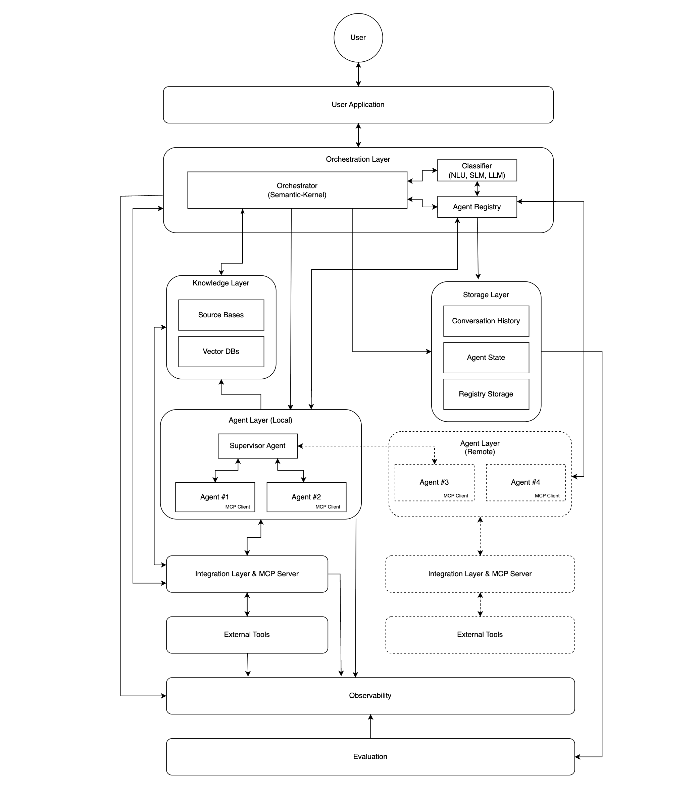
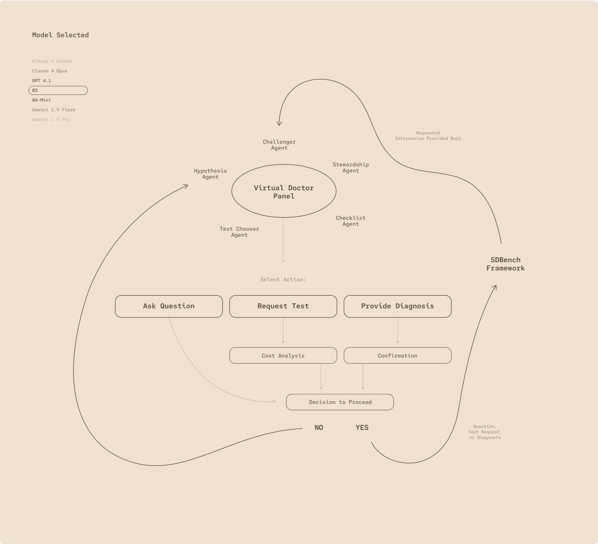
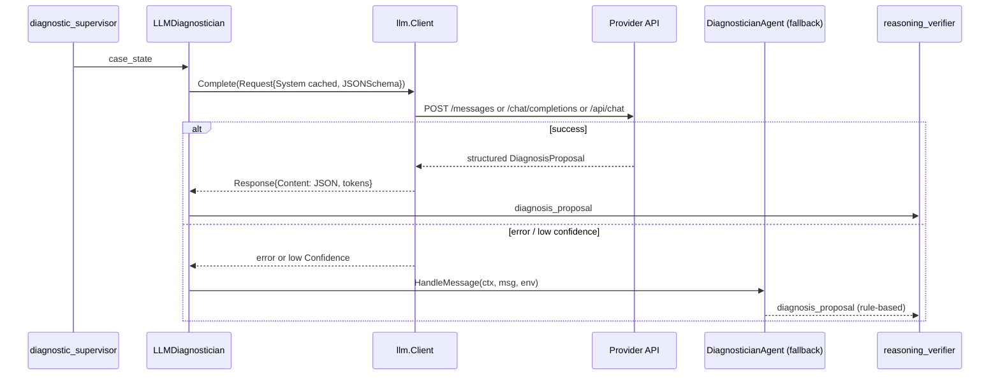
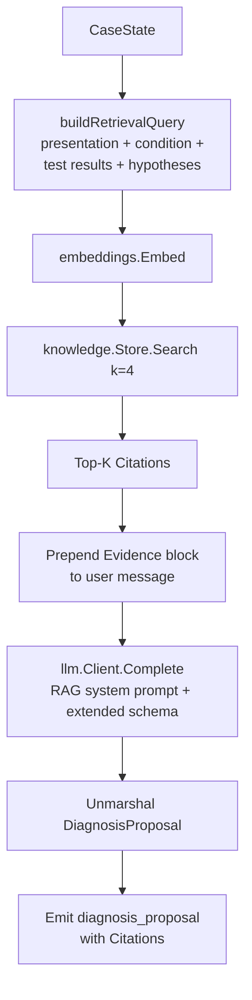
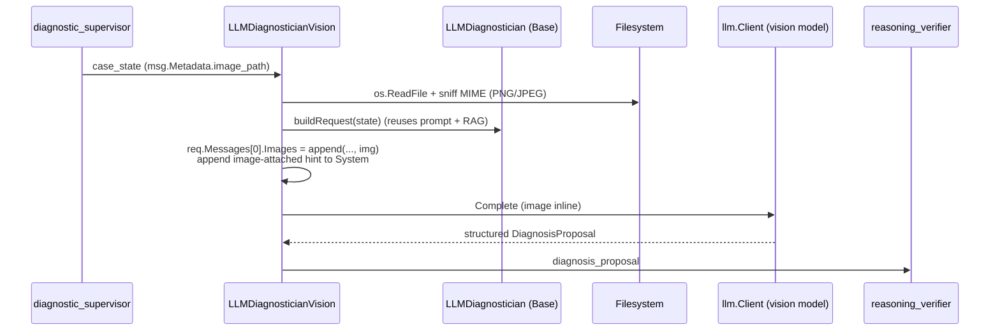
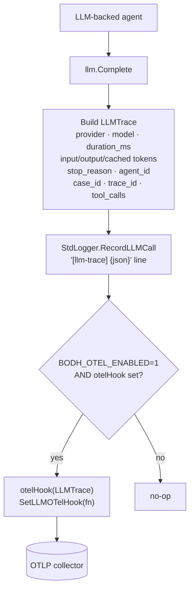
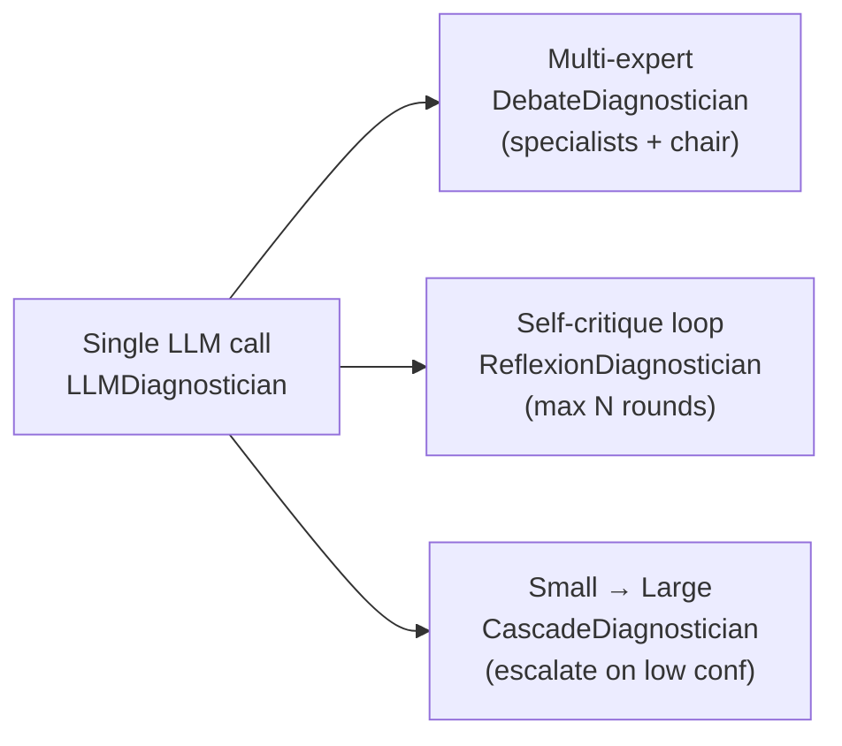

# Bodh — Medical Diagnostic Orchestrator & Care Services Platform (Go)

> **Bodh** (Sanskrit: *bodhi* — knowledge, awakening, insight) is an open-source **medical AI platform** implemented in **Go**. It follows Microsoft's [**Multi-Agent Reference Architecture (MARA)**](https://microsoft.github.io/multi-agent-reference-architecture/), implements a **virtual physician panel** inspired by [**MAI-DxO**](https://microsoft.ai/news/the-path-to-medical-superintelligence/) and the [**Sequential Diagnosis Benchmark (SD Bench)**](https://microsoft.ai/news/the-path-to-medical-superintelligence/), and adds a **care-services layer** (CDM, TCM, panel management, virtual office, RPM, engagement, readmission tracking) on the same bus.

Go · MARA · Medical AI · Sequential Diagnosis · FHIR · HL7 v2 · HIPAA-aware · Open Source

**Module path:** `github.com/PratikDhanave/bodh`

**Architecture diagrams:** [Architecture.png](Architecture.png) (MARA platform) · [architectureflow.png](architectureflow.png) (sequential diagnosis flow) · [6 interactive Archify flows](#flow-diagrams--every-flow-end-to-end) · [docs/diagrams.md](docs/diagrams.md) (25 mermaid views)

---

## ⚠️ Research disclaimer (read first)

**Bodh is a research and engineering reference. It is not approved for clinical use.**

- Do **not** use Bodh for real patient care, triage, treatment, or billing.
- Demo agents use **simulated** answers and **rule-based** inference — not validated models.
- All thresholds (test costs, RPM alert limits, A1c/BP cutoffs, readmission weights) are **illustrative**, not clinical guidelines.
- HIPAA, FDA, ONC, and state-law alignment described below is **architectural guidance**: the codebase is not certified, audited, or under a Business Associate Agreement (BAA).
- Microsoft's MAI-DxO/SD-Bench work itself requires clinical validation, governance, and regulatory review before deployment.
- At the heart of any future clinical product: **safety, trust, transparency, and human oversight.**

---

## 🆕 What's new (May 2026)

Seven PRs merged in the latest sprint move Bodh from "demo with good bones" to "credible production-ready substrate":

| PR | Track | Highlight |
|---|---|---|
| [#6](https://github.com/PratikDhanave/bodh/pull/6) | Clinical | **Asthma** care plan + 2 panel rules (`no_controller_persistent_asthma`, `act_overdue`); proves the composition pattern — zero platform changes |
| [#7](https://github.com/PratikDhanave/bodh/pull/7) | Production | **OpenTelemetry OTLP exporter** for `LLMTrace`, build-tag isolated (`-tags otel`); sha256-hashed `case_id` in spans (never raw MRN) |
| [#8](https://github.com/PratikDhanave/bodh/pull/8) | Standards | **HL7 v2 ADT parser** + `POST /hl7/adt` endpoint; supports MSH/EVN/PID/PV1/DG1, ADT^A01/A02/A03/A04/A08, custom delimiters per MSH-1/MSH-2 |
| [#9](https://github.com/PratikDhanave/bodh/pull/9) | Eval | **SD-Bench manifest runner** in `cmd/bench` with baseline regression gating (`-fail-on-regression`, `-update-baseline`) and 4 new synthetic fixtures (ACS, septic UTI, DKA, elderly CAP) |
| [#10](https://github.com/PratikDhanave/bodh/pull/10) | Production | **PostgreSQL persistence** with **tenant row-level security**; `audit_events` table is append-only enforced at DB grants (SELECT+INSERT only) |
| [#11](https://github.com/PratikDhanave/bodh/pull/11) | Clinical | **Rule-path specialty rules** for ACS / sepsis / DKA / CHF — bench moved from **42.9% → 85.7%** accuracy; 5 new TestCatalog entries (BNP, troponin, lactate, urine ketones, procalcitonin) |
| [#12](https://github.com/PratikDhanave/bodh/pull/12) | Compliance | **Orchestrator audit + eval wiring** — every clinical message produces an `audit.Event`; **HIPAA §164.312(b) audit controls moves from "partial" → "wired"** |

### Headline numbers

- **Rule-provider bench accuracy:** 85.7% (was 42.9%) across 7 synthetic SD-Bench cases
- **Test coverage:** 30/30 packages pass on `go test ./...`
- **HIPAA §164.312(b) audit controls:** wired end-to-end
- **17+ agents** on one MARA bus
- **Postgres-backed multi-tenant** with RLS enforcement
- **HL7 v2 ADT** + FHIR R4 + native JSON ingest

---

## 📚 Documentation hub

Beyond this README, the [docs/](docs/) tree has deep dives for each subsystem:

| Doc | What it covers |
|---|---|
| **[docs/aigp-governance-mapping.md](docs/aigp-governance-mapping.md)** | **NEW** — IAPP AIGP body-of-knowledge mapping with practice scenarios, gap analysis, and a cross-reference index from AIGP codes to Bodh files. |
| **[docs/agent-interop.md](docs/agent-interop.md)** | **NEW** — MCP / A2A / token-exchange / SPIFFE proposals informed by *Generative AI on Kubernetes* Ch. 9. |
| **[docs/aiia-template.md](docs/aiia-template.md)** | **NEW** — Fillable AI Impact Assessment template for clinically-consequential PRs. |
| **[docs/incident-playbook.md](docs/incident-playbook.md)** | **NEW** — Six AI-specific incident runbooks (clinically dangerous output, prompt injection, RAG poisoning, silent model change, audit integrity, tenant isolation breach). |
| **[docs/model-cards/](docs/model-cards/)** | **NEW** — Per Mitchell et al. (2018). One card per LLM-backed agent variant + rule-based diagnostician. |
| [docs/architecture.md](docs/architecture.md) | Deep MARA mapping — five core interfaces, orchestrator closure (the 30-line one), bus semantics, registry, HITL pattern, LLM fallback contract, agentic patterns, audit pipeline, persistence, concurrency, design rules |
| [docs/agents.md](docs/agents.md) | Every agent's contract — ID, capabilities, input/output types, shared state, HITL gate, failure modes; full panel + care services + HITL |
| [docs/api.md](docs/api.md) | Every HTTP endpoint — patient registry, care services, events, FHIR, HL7 v2, HITL reviews, audit, reads; full message-type catalog and metadata key reference |
| [docs/governance.md](docs/governance.md) | Every policy (shipped + planned), composition model, audit event schema with field-selection rationale, PHI redaction, stateful-policy design |
| [docs/data-model.md](docs/data-model.md) | Every clinical type in `pkg/medical` — diagnostic, care services, test catalog, HITL, provenance; condition-addition walkthrough |
| [docs/deployment.md](docs/deployment.md) | Local → single binary + Postgres → K8s → multi-tenant cells; environment variables, backup/DR, scaling, HIPAA BAA chain |
| [docs/operations.md](docs/operations.md) | Logs, metrics, OTel, LLM tracing, audit pipeline, bus implementations, LLM reliability SLOs, runbooks |
| [docs/evaluation.md](docs/evaluation.md) | SD-Bench manifest runner, baseline regression gating, Pareto frontier, LLM-as-judge, red-team eval, cohort analytics, what to measure |
| [docs/setup.md](docs/setup.md) | LLM provider account creation + smoke tests + cost notes |
| [docs/ai-features.md](docs/ai-features.md) | What each LLM feature does and how it's wired |
| [docs/compliance.md](docs/compliance.md) | HIPAA / GDPR / 42 CFR Part 2 / state laws / certifications / de-identification |
| [docs/healthcare-standards.md](docs/healthcare-standards.md) | FHIR / HL7 v2 / SMART / X12 / NCPDP / DICOM / CDA |
| [docs/diagrams.md](docs/diagrams.md) | 25 mermaid views grouped A–F |
| [CONTRIBUTING.md](CONTRIBUTING.md) | Workflow, design rules, adding an agent / policy / condition, commit conventions |
| [ROADMAP.md](ROADMAP.md) | 10-phase plan with status, decision log |

---

## Companion: `maf/` — the MARA pipeline on Microsoft Agent Framework (Go)

The [`maf/`](maf/) subdirectory is **bodh-maf**, a vertical-slice reimplementation of bodh's MARA clinical pipeline on [`microsoft/agent-framework-go`](https://github.com/microsoft/agent-framework-go) (MAF-go, public preview). It exists to answer one question with test evidence: *can MAF-go carry bodh's safety boundary?* Like bodh, it is **research/education code — not a medical device, not for clinical use**.

It reuses bodh, it does not fork it. The compliance layer — `pkg/governance`, `pkg/audit`, `pkg/phi`, `pkg/eval` — is **imported unchanged** (fail-closed governance, fail-open audit, zero PHI in audit/checkpoint/logs). Only the orchestration substrate is swapped: the 4-agent pipeline (intake → test planner → diagnostician → care plan) becomes a MAF workflow graph, with the diagnostician loop-back as a conditional edge, a physician-review HITL gate that survives process restart via a Postgres `checkpoint.Store`, and rule/LLM diagnosticians swappable by flag. All five exit criteria are proven by tests.

`maf/` is a **nested Go module** (`github.com/PratikDhanave/bodh-maf`) — built and tested separately from the parent `bodh` module:

```bash
cd maf
go build ./... && go test ./...          # everything; no network except testcontainers
go run ./cmd/slice -verbose              # demo case through the pipeline
go run ./cmd/care                         # HTTP care API — submit/status/reviews/audit on :8088
go run ./cmd/bench                        # SD-Bench accuracy + mean-cost (the Pareto axis)
```

`maf/web/` is a **Next.js clinician console** for the care API. Full scope, the five exit criteria, and design record: [`maf/README.md`](maf/README.md) and [`maf/architecture.md`](maf/architecture.md).

---

## What is Bodh?

Bodh is two things in one repository:

1. **A multi-agent diagnostic orchestrator** — a virtual physician panel that asks targeted questions, orders cost-aware tests, infers a working diagnosis, and verifies its reasoning. Inspired by Microsoft's [MAI-DxO](https://microsoft.ai/news/the-path-to-medical-superintelligence/) and benchmarked against the Sequential Diagnosis Benchmark.

2. **A care-services platform** — chronic disease management, transitional care, panel management, virtual office (pre-visit prep, inbox triage, refills, prior auth), patient engagement, and readmission tracking. These run as additional agents on the same MARA bus.

The platform layer (orchestrator, registry, bus, governance, evaluation, observability) follows Microsoft's [Multi-Agent Reference Architecture (MARA)](https://microsoft.github.io/multi-agent-reference-architecture/) — agents do not call each other directly; they emit messages routed by the orchestrator and gated by governance policies.

### Engineering reality

Bodh is a **Go codebase** with rule-based agents and an in-memory bus. It is intentionally:

- **Model-agnostic** — every agent is a struct that implements one interface; an LLM-backed version drops in by composition.
- **Cost-aware** — every diagnostic test has a virtual USD price; a Cost Guardian enforces a per-case budget.
- **Governed** — policies run *before* agents see a message; deny stops processing.
- **Auditable** — every interaction is a `Message`; the orchestrator is the only place that touches the bus + policy + agents.

---

## The one-sentence model

> A user (or API call) publishes a clinical message → the orchestrator delivers it to the right agent → the agent returns zero or more new messages → the orchestrator publishes those → governance gates each hop → the workflow continues until a terminal agent decides we're done.

That is exactly what MARA's building blocks describe: an **orchestrator**, **specialized agents**, a **registry**, **memory**, **governance**, and **observability**.

---

## Table of contents

1. [Quick start](#quick-start)
2. [Architecture at a glance](#architecture-at-a-glance)
3. [Repository layout](#repository-layout)
4. [Background: MAI-DxO and SD Bench](#background-mai-dxo-and-sd-bench)
5. [Why MARA (and not one big LLM call)](#why-mara-and-not-one-big-llm-call)
6. [Care-services catalog](#care-services-catalog)
7. [AI features](#ai-features) — providers, RAG, vision, judge, safety, tracing
8. [MARA concepts → Go packages](#mara-concepts--go-packages)
9. [Virtual physician panel](#virtual-physician-panel-mai-dxo-mapping)
10. [Human-in-the-loop (HITL) gate](#human-in-the-loop-hitl--clinical-oversight-gate)
11. [Care-services workflows](#care-services-workflows)
12. [Clinical message protocol](#clinical-message-protocol)
13. [Domain model and package guide](#domain-model-pkgmedical)
14. [Walkthroughs](#walkthrough-cmddemo)
15. [Healthcare standards](#healthcare-standards--interoperability) · [Security & HIPAA compliance](#security--hipaa-compliance) · [Regulatory pathway](#regulatory-pathway)
16. [Operations](#operations) · [Quality & evaluation](#quality--evaluation) · [Develop](#develop)
17. [Reference](#reference)

<details>
<summary>Full section index</summary>

- Quick start (Setup steps) · Architecture at a glance · Repository layout
- Background: MAI-DxO and SD Bench · Why MARA · Care-services catalog
- **AI features:** Provider matrix · Setup walkthroughs · LLM-backed diagnostician · RAG · Vision · LLM-as-judge · Safety guardrails · LLM tracing · Other LLM agents · Agentic patterns · Env vars reference
- MARA concepts → Go packages · Virtual physician panel · HITL gate
- Care-services workflows · Clinical message protocol · Domain model
- Package guide · Walkthrough: cmd/demo · Walkthrough: cmd/caredemo
- Healthcare standards & interoperability (see [docs/healthcare-standards.md](docs/healthcare-standards.md))
- Security & HIPAA compliance (see [docs/compliance.md](docs/compliance.md))
- Regulatory pathway · Observability · Audit logging · Configuration
- Deployment topologies · Docker / Kubernetes · Backup / DR · Scaling
- Evaluation (SD Bench) · Test catalog · Sample cases · Cohort analytics
- Add your first agent · Design rules · Testing · Contributing
- HTTP API · Message types · Agent reference · Implemented vs planned
- Roadmap · MARA chapter mapping · Glossary · References · License
- **Companion docs:** [docs/setup.md](docs/setup.md) · [docs/ai-features.md](docs/ai-features.md) · [docs/diagrams.md](docs/diagrams.md)

</details>

---

## Quick start

### Clinician console in 30 seconds — zero external dependencies

No Docker, no Ollama, no API keys. Just Go 1.26:

```bash
git clone https://github.com/PratikDhanave/bodh.git && cd bodh
make care DIAGNOSTICIAN=rule          # deterministic rule engine — nothing external needed
open http://localhost:8088/ui/        # clinician console
```

Log in with the illustrative demo credentials **`clinician@hospital.org` / `clinic123`**
(bcrypt-hashed; demo only, not for production). Open **Case runner**, pick the `demo-case-001`
fixture, and watch the diagnostic pipeline stream to the console live.

> **Prerequisites.** Go 1.26 is the only hard requirement. **Ollama is optional** — a bare
> `make care` defaults to a local Ollama model (`qwen2.5:7b`) for the LLM-backed diagnostician
> and *degrades to the rule engine* if Ollama is absent, so `DIAGNOSTICIAN=rule` is the
> friction-free first run. **Docker** is needed only for the full test suite (`make test` spins up
> Postgres via testcontainers; DB tests skip without it). **Node** is needed only to rebuild the
> SPA — `cmd/care/web/dist/` is committed, so *running* the console needs no Node step.

### Fastest path — `docker compose up`

The full local-dev stack (Postgres + care + Ollama + Prometheus + Grafana + Tempo + Loki) boots with one command:

```bash
git clone https://github.com/PratikDhanave/bodh.git && cd bodh
docker compose -f zarf/compose/docker_compose.yaml up -d
docker exec bodh-ollama ollama pull llama3.2       # one-time model pull
open http://localhost:8088                          # care API
open http://localhost:3000                          # Grafana (admin / admin)
```

Deeper setup: [docs/deployment.md](docs/deployment.md) for K8s (kind / GKE) and production Cloud SQL config.

### Setup (5 steps) — running Go binaries directly

1. **Install Go 1.22+** — verify with `go version`.
2. **Clone the repo:** `git clone https://github.com/PratikDhanave/bodh.git && cd bodh`.
3. **Pick a provider.** The rule-based agents work with no setup. To enable the LLM-backed diagnostician, follow one of the three walkthroughs in [docs/setup.md](docs/setup.md): Anthropic, OpenAI, or Ollama (local).
4. **(Optional) Enable RAG** by pointing at the shipped 15-doc demo corpus: `export BODH_KNOWLEDGE_CORPUS=./data/knowledge/corpus.json`. Anthropic users also need `VOYAGE_API_KEY` for embeddings; OpenAI / Ollama users already have an embedder.
5. **Run an entry point** — `go run ./cmd/demo` (diagnostic flow), `go run ./cmd/caredemo` (care services), or `go run ./cmd/care -addr=:8088` (HTTP API).

Deep dive: [docs/setup.md](docs/setup.md) for provider account creation, smoke tests, and cost notes; [docs/ai-features.md](docs/ai-features.md) for what each LLM feature does and how it's wired.

### Commands

```bash
git clone https://github.com/PratikDhanave/bodh.git
cd bodh

# Diagnostic flow (MAI-DxO / SD-Bench style)
go run ./cmd/demo
go run ./cmd/demo -case=data/cases/demo_chf.json   # CHF + RPM

# Care services (CDM, TCM, panel, virtual office, ADT)
go run ./cmd/caredemo
go run ./cmd/caredemo -workflow=cdm
go run ./cmd/caredemo -workflow=tcm
go run ./cmd/caredemo -workflow=panel
go run ./cmd/caredemo -workflow=virtual_office
go run ./cmd/caredemo -workflow=adt

# HTTP API (RPM ingest, ADT, CDM, TCM, Panel, Inbox, Refill, Prior auth, FHIR)
go run ./cmd/care -addr=:8088

# SD-Bench runner — loads every case fixture, prints accuracy/cost table
go run ./cmd/bench                                            # rule provider, default manifest
go run ./cmd/bench -manifest=data/cases/manifest.json         # explicit manifest
go run ./cmd/bench -providers=rule -fail-on-regression        # CI gate against baseline
go run ./cmd/bench -providers=rule -update-baseline           # refresh after intentional changes

# LLM-backed diagnostician (Claude / GPT / local Ollama / in-process kronk) with rule-based fallback
export ANTHROPIC_API_KEY=sk-...          # or OPENAI_API_KEY=sk-...
go run ./cmd/demo  -diagnostician=llm-anthropic
go run ./cmd/care  -diagnostician=llm-openai -addr=:8088
ollama pull llama3.2 && go run ./cmd/demo -diagnostician=llm-ollama
go run -tags kronk ./cmd/demo -diagnostician=llm-kronk    # in-process llama.cpp via Ardan Labs kronk; no daemon, no network
go run ./cmd/bench -providers=rule,llm-anthropic,llm-openai,llm-ollama  # side-by-side compare

# Operator CLI — manage reviews / tasks / notifications against a running cmd/care
go install ./cmd/bodhctl
bodhctl reviews pending
bodhctl reviews approve <id>

# Common dev workflow via Makefile
make all          # vet + test + build
make ci           # vet + test + govulncheck
make demo         # diagnostic flow
make caredemo     # care workflows (HITL on)
make care         # HTTP API on :8088
make bench        # SD-Bench
make docker       # container build

# Test suite
go test ./...
```

You should see logs like:

```
[bodh] [intake] case=demo-case-001 chief_complaint="Cough and fever"
[bodh] [supervisor] starting sequential diagnosis for case demo-case-001
[bodh] [test_planner] ordering complete_blood_count ($45)
[bodh] [cost_guardian] APPROVE: $220.00 / $500.00 budget (44% utilized)
[bodh] [diagnostician] diagnosis="Community-acquired pneumonia" confidence=87%
[bodh] [reasoning_verifier] VERIFIED diagnosis "Community-acquired pneumonia"
[bodh] [supervisor] gold standard: Community-acquired pneumonia | match=true
```

**LLM diagnostician.** Pass `-diagnostician=llm-anthropic`, `-diagnostician=llm-openai`, `-diagnostician=llm-ollama`, or `-diagnostician=llm-kronk` (build with `-tags=kronk` for the in-process llama.cpp provider via [Ardan Labs kronk](https://github.com/ardanlabs/kronk) — no daemon, no API call, no PHI leaves the box) to `cmd/demo`, `cmd/care`, or `cmd/bench` to route the diagnosis step through an LLM. The agent emits a structured `DiagnosisProposal` matching the same JSON shape as the rule-based one, so the rest of the pipeline (cost guardian, reasoning verifier, HITL) is unchanged. If the LLM call fails (timeout, bad JSON, low confidence, transport error), the agent falls back to the rule-based diagnostician — the case always finalizes.

Required env vars:

- `ANTHROPIC_API_KEY` — for `llm-anthropic`
- `OPENAI_API_KEY` — for `llm-openai`
- (no key) — for `llm-ollama`; uses the local Ollama server, set `OLLAMA_HOST` to override `http://localhost:11434`
- (no key, build tag `kronk`) — for `llm-kronk`; pulls the model into the kronk cache on first run, set `BODH_KRONK_MODEL` to override `unsloth/Qwen3-0.6B-Q8_0`

Optional model overrides: `BODH_ANTHROPIC_MODEL` (default `claude-sonnet-4-6`), `BODH_OPENAI_MODEL` (default `gpt-4o`), `BODH_OLLAMA_MODEL` (default `llama3.2`). See `.env.example`.

For the care demo:

```
[bodh] [cdm_planner] plan condition=dm goals=1 meds=1 monitors=1 next_review=...
[bodh] [tcm_coordinator] discharge pt-001 primary=ADHF tasks=5 conflicts=0
[bodh] [panel_manager] panel=3 gaps=4 roll=map[chf:1 copd:1 dm:1 htn:1]
[bodh] [readmission_tracker] patient=pt-001 discharge risk=0.66 band=high
[bodh] [engagement] sms -> pt-002 template=care_gap reason=a1c_overdue
[bodh] === summary === nurse tasks: 12 — notifications sent: 8
```

---

## Architecture at a glance

Two canonical diagrams ship in the repo root. Start here.

### Platform architecture — [`Architecture.png`](Architecture.png)

The Microsoft-style **Multi-Agent Reference Architecture (MARA)** mapping — user, application, orchestrator, classifier, registry, knowledge/storage, supervisor/worker agents, MCP, observability, evaluation.

<p align="center">
  
</p>

### Clinical flow — [`architectureflow.png`](architectureflow.png)

End-to-end **sequential diagnosis** for one case: presentation → RPM monitor → history → tests (with cost check + rework loop) → diagnosis → reasoning verification → human sign-off → final report.

<p align="center">
  
</p>

### Flow diagrams — every flow, end to end

The six diagrams below cover **all** of Bodh's flows, generated with [Archify](https://github.com/tt-a1i/archify) and validated against the codebase. The SVG previews render inline on GitHub; each links to a **self-contained interactive HTML** (pan, zoom, light/dark theme, guided views) under [`docs/diagrams/`](docs/diagrams/) — open it locally or serve it. Source specs live in [`docs/diagrams/archify/`](docs/diagrams/archify/).

#### 1 · Platform architecture (MARA)

One Go binary: clients → orchestrator → in-process bus → agents, gated by governance, HITL, and an append-only audit log.

<p align="center">
  <a href="docs/diagrams/platform.architecture.html"></a>
</p>

<sub>▶ <a href="docs/diagrams/platform.architecture.html">Interactive version</a></sub>

#### 2 · Sequential diagnosis — virtual physician panel

The MAI-DxO / SD-Bench loop: `presentation` → history → cost-guarded tests → `diagnosis_proposal` → verify → HITL gate → final `diagnosis`.

<p align="center">
  <a href="docs/diagrams/diagnosis.sequence.html"></a>
</p>

<sub>▶ <a href="docs/diagrams/diagnosis.sequence.html">Interactive version</a></sub>

#### 3 · Human-in-the-loop gate

Fail-closed oversight: every consequential action is wrapped as a `review_request`, queued, and either approved (resumed) or rejected (halted).

<p align="center">
  <a href="docs/diagrams/hitl.workflow.html"></a>
</p>

<sub>▶ <a href="docs/diagrams/hitl.workflow.html">Interactive version</a></sub>

#### 4 · Care-services workflows

Chronic-disease (CDM), transitions (TCM) and panel pathways run on the same bus and fan into patient engagement.

<p align="center">
  <a href="docs/diagrams/care-services.dataflow.html"></a>
</p>

<sub>▶ <a href="docs/diagrams/care-services.dataflow.html">Interactive version</a></sub>

#### 5 · LLM → rule fallback

Every LLM-backed agent degrades to its deterministic rule sibling on refusal, timeout or failed grounding — the fallback is the contract, so the case always finalizes.

<p align="center">
  <a href="docs/diagrams/fallback.lifecycle.html"></a>
</p>

<sub>▶ <a href="docs/diagrams/fallback.lifecycle.html">Interactive version</a></sub>

#### 6 · Audit &amp; observability

Every message forks into a PHI-minimized, append-only audit log (Merkle-chained) and hashed-`case_id` spans — raw MRNs never leave the process.

<p align="center">
  <a href="docs/diagrams/audit.dataflow.html"></a>
</p>

<sub>▶ <a href="docs/diagrams/audit.dataflow.html">Interactive version</a></sub>

### How each box maps to the Go code

| Area on diagram | Bodh implementation | Go path |
|-----------------|---------------------|---------|
| User / User application | Entry that publishes the first `protocol.Message` | `cmd/demo`, `cmd/caredemo`, `cmd/care` (HTTP), `cmd/bodhctl` (CLI) |
| Orchestrator | Subscribes agents, runs governance, calls `HandleMessage`, republishes outputs | `pkg/orchestration` |
| Classifier | Route intent (chest pain vs rash, refill vs urgent) | `inbox_triage` agent · future `pkg/classifier` |
| Agent registry | Lists agents, resolves capabilities | `pkg/registry` |
| Knowledge layer | Guidelines, differentials, RAG | Planned: DB + vector index |
| Storage layer | Case + roster + queue + reviews + audit | `pkg/memory`, `pkg/persistence` (JSON file), `pkg/audit` (append-only) · planned PostgreSQL |
| Supervisor agent | Decompose diagnosis | `agents/supervisor.go` |
| Workers | Intake, questioner, tests, cost, dx, verify, CDM/TCM/panel/VO/RPM/engagement/readmission/human-review | `agents/*.go` (17 agents + HITL gate) |
| Integration / MCP / tools | Labs, imaging, LLM APIs, FHIR, HL7 v2 | `pkg/fhir` (today) · planned MCP tools |
| Governance | Allow/deny boundary; PHI redaction | `pkg/governance`, `pkg/phi` |
| Observability | Logs, traces, clocks, audit | `pkg/observability`, `pkg/audit` |
| Evaluation | Accuracy vs gold, cost metrics | `pkg/eval` + `cmd/bench` |

> Detailed control-plane, state-machine, and deployment diagrams live in [docs/diagrams.md](docs/diagrams.md) — 25 mermaid views, grouped A–F by topic (bird's-eye, control plane, state machines, diagnostic flow, care-services flows, deployment).

---

## Repository layout

```
bodh/
├── Architecture.png             # MARA platform map
├── architectureflow.png         # Sequential diagnosis flow
├── architectureflow.webp        # WebP source for the flow diagram
├── CONTRIBUTING.md              # Workflow, design rules, agent/policy walkthroughs
├── ROADMAP.md                   # 10-phase plan with status + decision log
├── docs/
│   ├── architecture.md          # Deep MARA mapping, interfaces, state machines
│   ├── agents.md                # Per-agent contracts (17+ agents)
│   ├── api.md                   # HTTP surface + message-type catalog
│   ├── governance.md            # Every policy + audit pipeline + PHI redaction
│   ├── data-model.md            # pkg/medical types + condition-addition walkthrough
│   ├── deployment.md            # Local → K8s → multi-tenant cells
│   ├── operations.md            # Audit, OTel, SLOs, runbooks
│   ├── evaluation.md            # SD-Bench, judge, red-team, Pareto
│   ├── setup.md                 # LLM provider account setup
│   ├── ai-features.md           # LLM feature wiring detail
│   ├── compliance.md            # HIPAA, HITECH, GDPR, certifications
│   ├── healthcare-standards.md  # FHIR, HL7v2, SMART, X12, NCPDP, DICOM, CDA
│   └── diagrams.md              # 25 mermaid architecture diagrams
├── cmd/
│   ├── demo/                    # Sequential diagnosis entrypoint
│   ├── caredemo/                # Care-services workflows
│   ├── care/                    # HTTP API (POST /hl7/adt, GET /audit, ...)
│   ├── bench/                   # SD-Bench manifest runner with baseline gating
│   ├── bodhctl/                 # Operator CLI
│   └── export-hitl-feedback/    # HITL feedback export
├── agents/                      # Virtual physician panel + care services (17+ agents)
│   ├── intake.go
│   ├── supervisor.go            # diagnostic_supervisor (MAI-DxO-style)
│   ├── questioner.go            # + questioner_llm.go
│   ├── test_planner.go          # condition-aware dispatch (PR #11)
│   ├── cost_guardian.go
│   ├── diagnostician.go         # specialty rules: ACS/sepsis/DKA/CHF/CAP (PR #11)
│   ├── diagnostician_llm.go     # LLM variant with rule-based fallback
│   ├── diagnostician_debate.go  # multi-expert debate pattern
│   ├── diagnostician_reflexion.go # self-critique loop
│   ├── diagnostician_cascade.go # small→large escalation
│   ├── diagnostician_vision.go  # image-attached LLM
│   ├── diagnostician_tools.go   # tool-use (MCP-style)
│   ├── reasoning_verifier.go    # + reasoning_verifier_llm.go
│   ├── rpm_monitor.go
│   ├── cdm_planner.go           # Chronic Disease Management
│   ├── tcm_coordinator.go       # Transitional Care Management
│   ├── panel_manager.go         # Panel Management / gap-in-care (9 rules)
│   ├── pre_visit_prep.go        # Virtual Office: pre-visit prep
│   ├── inbox_triage.go          # + inbox_triage_llm.go
│   ├── refill_manager.go        # Virtual Office: refills
│   ├── prior_auth.go            # Virtual Office: prior auth
│   ├── engagement.go            # Patient outreach
│   ├── readmission_tracker.go   # ADT + transparent risk
│   └── human_review.go          # HITL gate
├── pkg/
│   ├── protocol/                # Message schema (shared wire format)
│   ├── agent/                   # Agent + Environment interfaces
│   ├── registry/                # Agent discovery
│   ├── comm/                    # Bus (in-memory; swappable)
│   ├── orchestration/           # Platform orchestrator + audit + eval wiring (PR #12)
│   ├── governance/              # Policies + medical_policy.go
│   ├── medical/                 # CaseState, CarePlan, Panel, ADT, RPM, Provenance, ...
│   ├── tasks/                   # Nurse work queue
│   ├── engagement/              # SMS/email/IVR notifier
│   ├── fhir/                    # Minimal FHIR R4 adapter
│   ├── hl7v2/                   # HL7 v2 ADT parser (PR #8) — MSH/EVN/PID/PV1/DG1
│   ├── analytics/               # Cohort metrics
│   ├── persistence/             # JSON file store + Postgres backend
│   │   └── postgres/            # PostgreSQL with tenant RLS (PR #10)
│   ├── memory/                  # KV store
│   ├── observability/           # Logger + Clock + LLMTrace + OTLP (PR #7, build-tag)
│   ├── eval/                    # InteractionRecord, CaseMetrics, LLMJudge, redteam
│   ├── hitl/                    # Human-in-the-loop review queue
│   ├── phi/                     # PHI redaction (Safe Harbor patterns)
│   ├── audit/                   # Append-only HIPAA audit log
│   ├── llm/                     # Provider-agnostic LLM client (Anthropic/OpenAI/Ollama)
│   ├── embeddings/              # Embedding adapters (Voyage/OpenAI/Ollama)
│   ├── knowledge/               # RAG store (HybridStore = vector + BM25 + RRF)
│   ├── safety/                  # Refusal / hallucination / PHI-pattern guardrails
│   └── tools/                   # MCP-style tools for tool-using agents
├── db/migrations/               # Postgres schema + RLS policies (PR #10)
│   ├── 0001_init.sql
│   └── 0002_rls.sql
├── data/
│   ├── cases/
│   │   ├── demo_pneumonia.json  # legacy CAP
│   │   ├── demo_chf.json        # legacy CHF + RPM
│   │   ├── demo_pe.json         # coverage gap (no rule)
│   │   ├── demo_uri.json        # verifier-reject edge case (deferred)
│   │   ├── bench_acs.json       # NSTEMI (PR #9)
│   │   ├── bench_septic_uti.json # urosepsis (PR #9)
│   │   ├── bench_dka.json       # diabetic ketoacidosis (PR #9)
│   │   ├── bench_cap_elderly.json # elderly CAP (PR #9)
│   │   ├── manifest.json        # schema v2 (PR #9) — authoritative case index
│   │   └── baseline.json        # regression gating thresholds
│   ├── eval/
│   │   └── redteam.json         # adversarial case catalog
│   └── knowledge/
│       └── corpus.json          # 15-doc RAG demo corpus
├── go.mod
├── go.sum
└── README.md
```

---

## Background: MAI-DxO and SD Bench

For years, **USMLE-style** multiple-choice questions were the standard AI medical benchmark. Frontier models now score near-perfect on these exams. Microsoft and others argue the benchmarks **overstate** competence — they reward memorization over **iterative clinical reasoning**.

The [Sequential Diagnosis Benchmark](https://microsoft.ai/news/the-path-to-medical-superintelligence/) replaces them with stepwise encounters:

- **304** recent **New England Journal of Medicine (NEJM)** Case Records, turned into stepwise diagnostic encounters.
- An agent (or physician) may **ask questions**, **order tests** (with virtual **cost**), and **update reasoning** until it provides a final diagnosis.
- Performance is measured on **accuracy** and **resource expenditure** — a **Pareto frontier** of diagnosis vs. cost.

MAI-DxO paired with OpenAI's **o3** reportedly reached **~85.5%** accuracy on these cases, vs. **~20%** mean for experienced physicians in their study setup. Microsoft cites up to ~25% of U.S. health spending as low-value or wasted — the cost dimension is real.

### What Bodh implements today

| SD Bench / MAI-DxO idea | Bodh status |
|-------------------------|-------------|
| Sequential ask → test → diagnose | Done — demo workflow |
| Virtual cost per test | Done — `medical.TestCatalog`, 13 tests (PR #11 added 5) |
| Cost budget / guardian | Done — `cost_guardian` + `MaxDiagnosticCostPolicy` |
| Self-verification before final diagnosis | Done — `reasoning_verifier` |
| Virtual physician panel | Done — 8 agents (plus LLM variants: Debate / Reflexion / Cascade / Vision / Tools) |
| Specialty inference (ACS / sepsis / DKA / CHF / CAP) | Done (PR #11) — rule provider at 85.7% bench accuracy |
| Manifest-driven case runner with Pareto column | Done (PR #9) — `cmd/bench -manifest=...` |
| Baseline regression gating | Done (PR #9) — `-fail-on-regression`, `-update-baseline` |
| Synthetic teaching fixtures | Done — 4 new cases via PR #9 (ACS, septic UTI, DKA, elderly CAP); plus existing CAP, CHF, PE, URI |
| LLM-backed diagnostician | Done — Anthropic, OpenAI, Ollama with rule-based fallback |
| NEJM case loader / 304 cases | Planned (license question first) |
| Pareto plot export | Planned |

---

## Why MARA (and not one big LLM call)

Microsoft's [Multi-Agent Reference Architecture](https://microsoft.github.io/multi-agent-reference-architecture/) focuses on systems where **many specialized agents** interact. The hard problems are not "write a prompt", but:

| Problem | Why it matters in medicine |
|---------|----------------------------|
| **Routing** | Should this message go to history, labs, or diagnosis? |
| **Decomposition** | Who owns step 1 vs step 2 in a long case? |
| **Governance** | PHI, budget caps, disallowed actions — **before** any agent runs |
| **State** | Case progression, prior questions, test results |
| **Operations** | Audit logs, evaluation vs. gold diagnosis, regression tests |
| **Safety** | Fail closed; explainable denials; human-in-the-loop hooks |

A single monolithic LLM call is hard to **audit**, **cap cost**, **swap models per step**, or **regression-test** when clinical guidelines change. Bodh keeps the orchestrator generic and puts clinical policy in **agents + governance**.

**Further reading:** [MARA Reference Architecture](https://microsoft.github.io/multi-agent-reference-architecture/docs/reference-architecture/Reference-Architecture.html) · [Building blocks](https://microsoft.github.io/multi-agent-reference-architecture/docs/building-blocks/Building-Blocks.html)

---

## Care-services catalog

Each service is one or more Bodh agents subscribing to specific message types, sharing in-memory state (patient registry, nurse task queue, notifier) injected through agent struct fields. The catalog covers the core workflows of value-based primary care.

| Service | Bodh agent(s) | Status |
|------------------------|---------------|--------|
| Remote Patient Monitoring (RPM) | `rpm_monitor` + device webhooks via `pkg/medical/rpm.go` | Done |
| Chronic Disease Management (CDM) | `cdm_planner` + `medical.CarePlan` templates (HTN, DM, CHF, CKD, COPD) | Done |
| Transitional Care Management (TCM) | `tcm_coordinator` + nurse `tasks.Queue` + `medical.ReconcileMedications` | Done |
| Panel Management | `panel_manager` + `DefaultPanelRules` (A1c, BP, CHF weight, annual visit, post-discharge) | Done |
| Virtual Office: Pre-visit prep | `pre_visit_prep` | Done |
| Virtual Office: Inbox | `inbox_triage` (auto-routes refill / PA / urgent) | Done |
| Virtual Office: Refills | `refill_manager` (auto-approves on-plan meds, escalates rest) | Done |
| Virtual Office: Prior auth | `prior_auth` (low-risk auto-approve, others to queue) | Done |
| Patient engagement | `engagement` + `pkg/engagement` (SMS / email / IVR) | Done |
| Readmission tracking | `readmission_tracker` (ADT feed + transparent risk score) | Done |
| EHR integration | `pkg/fhir` (Patient / Observation / Encounter / Condition) | FHIR done · HL7 v2 planned |
| Analytics / outcomes | `pkg/eval` + `pkg/analytics` | Done |

---

## AI features

Bodh ships a complete LLM stack alongside the rule-based agents: provider-agnostic chat / embeddings / vision clients, an in-process knowledge store for RAG, an LLM-as-judge for evaluation, lightweight safety guardrails, and structured per-call tracing. Every LLM-backed agent has a rule-based fallback — failures don't break the pipeline, they just degrade to deterministic behaviour.

For depth on each subsection, see the companion [docs/ai-features.md](docs/ai-features.md). For account creation and smoke tests, see [docs/setup.md](docs/setup.md). For interactive diagrams, see [docs/diagrams.md § G. AI subsystem](docs/diagrams.md#g-ai-subsystem).

### Provider matrix

| Provider | Chat | Embeddings | Vision | API key env | Default chat model |
|----------|------|-----------|--------|-------------|--------------------|
| Anthropic | yes | (via Voyage) | yes (Sonnet, Opus) | `ANTHROPIC_API_KEY` | `claude-sonnet-4-6` |
| Voyage | — | yes | — | `VOYAGE_API_KEY` | `voyage-3` |
| OpenAI | yes | yes | yes (`gpt-4o`) | `OPENAI_API_KEY` | `gpt-4o` |
| Ollama (local) | yes | yes | yes (`llama3.2-vision`, `bakllava`) | (none) | `llama3.2` / `nomic-embed-text` |

Embedding adapters live in [`pkg/embeddings`](pkg/embeddings/); chat clients in [`pkg/llm`](pkg/llm/). The factory ([`agents/diagnostician_factory.go`](agents/diagnostician_factory.go)) picks the pair from the `-diagnostician` flag and the env vars above.

### Setup walkthroughs

#### Anthropic Claude

1. Sign up at <https://console.anthropic.com/> and create an API key.
2. Export the key and run a demo:

   ```bash
   export ANTHROPIC_API_KEY=sk-ant-...
   # Optional: export BODH_ANTHROPIC_MODEL=claude-sonnet-4-6
   go run ./cmd/demo -diagnostician=llm-anthropic
   ```

3. Expected first few log lines:

   ```
   [demo] RAG disabled (BODH_KNOWLEDGE_CORPUS not set)
   [bodh] [intake] case=demo-case-001 chief_complaint="Cough and fever"
   [bodh] [diagnostician/llm] provider=anthropic model=claude-sonnet-4-6 diagnosis="Community-acquired pneumonia" confidence=87%
   [bodh] [diagnostician/llm] tokens in=812 out=146 cached=0 stop=tool_use
   ```

If the LLM call fails, the agent transparently falls back to the deterministic rule-based diagnostician — the case always finalises.

#### OpenAI

1. Sign up at <https://platform.openai.com/> and create a key at <https://platform.openai.com/api-keys>.
2. Export and run:

   ```bash
   export OPENAI_API_KEY=sk-...
   # Optional: export BODH_OPENAI_MODEL=gpt-4o
   go run ./cmd/demo -diagnostician=llm-openai
   ```

3. Expected first few log lines:

   ```
   [bodh] [diagnostician/llm] provider=openai model=gpt-4o diagnosis="Community-acquired pneumonia" confidence=86%
   [bodh] [diagnostician/llm] tokens in=798 out=142 cached=0 stop=stop
   ```

If the LLM call fails, the agent transparently falls back to the deterministic rule-based diagnostician — the case always finalises.

#### Ollama (local)

1. Install Ollama from <https://ollama.com/download>.
2. Pull the chat model, the embedding model, and start the server (if not auto-started):

   ```bash
   ollama pull llama3.2          # chat
   ollama pull nomic-embed-text  # embeddings (RAG)
   # For vision: ollama pull llama3.2-vision (or bakllava / llava:13b)
   ollama serve                  # if not already running
   export OLLAMA_HOST=http://localhost:11434   # optional, this is the default
   go run ./cmd/demo -diagnostician=llm-ollama
   ```

3. Expected first few log lines:

   ```
   [bodh] [diagnostician/llm] provider=ollama model=llama3.2 diagnosis="Community-acquired pneumonia" confidence=72%
   [bodh] [diagnostician/llm] tokens in=842 out=156 cached=0 stop=stop
   ```

For vision use `BODH_OLLAMA_MODEL=llama3.2-vision` (or `bakllava`); for embeddings stick with `nomic-embed-text` or `mxbai-embed-large`. If the LLM call fails, the agent transparently falls back to the deterministic rule-based diagnostician — the case always finalises.

### LLM-backed diagnostician

[`LLMDiagnostician`](agents/diagnostician_llm.go) is a drop-in replacement for the rule-based [`DiagnosticianAgent`](agents/diagnostician.go). It builds the same `DiagnosisProposal` JSON shape from the same `CaseState` input, so the cost guardian, reasoning verifier, HITL gate, and supervisor logic are unchanged. On any failure (timeout, JSON parse, transport error, confidence below `MinConfidence`) it falls back to the rule-based agent.



**CLI:**

```bash
go run ./cmd/demo -diagnostician=llm-anthropic
go run ./cmd/demo -diagnostician=llm-openai
go run ./cmd/demo -diagnostician=llm-ollama

go run ./cmd/care  -diagnostician=llm-openai -addr=:8088
go run ./cmd/bench -providers=rule,llm-anthropic,llm-openai,llm-ollama
```

**Example log output:**

```
[bodh] [diagnostician/llm] provider=anthropic model=claude-sonnet-4-6 diagnosis="Community-acquired pneumonia" confidence=87%
[bodh] [diagnostician/llm] rationale: Productive cough with fever, neutrophilic leukocytosis, and RLL consolidation on CXR are consistent with bacterial CAP.
[bodh] [diagnostician/llm] tokens in=812 out=146 cached=624 stop=tool_use
[llm-trace] {"started_at":"2026-05-23T09:14:21Z","duration_ms":2438,"provider":"anthropic","model":"claude-sonnet-4-6","agent_id":"diagnostician","case_id":"demo-case-001","input_tokens":812,"output_tokens":146,"cached_tokens":624,"stop_reason":"tool_use","kind":"completion"}
```

**Prompt caching.** On Anthropic and OpenAI, the system prompt is marked cacheable (`CacheSystem: true`) — repeated calls within the cache TTL pay only for incremental tokens. The `cached_tokens` field on `[llm-trace]` reports cache hits per call.

### Retrieval-Augmented Generation (RAG)

Set `BODH_KNOWLEDGE_CORPUS` to a JSON corpus, configure an embedder credential for your provider, and the diagnostician runs RAG: it composes a query from the CaseState, retrieves the top-k matching documents, prepends them as an `Evidence:` block, and surfaces them as `Citations[]` on the final `DiagnosisProposal`.



**CLI:**

```bash
export ANTHROPIC_API_KEY=sk-ant-...
export VOYAGE_API_KEY=pa-...      # for Anthropic, embeddings come from Voyage
export BODH_KNOWLEDGE_CORPUS=./data/knowledge/corpus.json
go run ./cmd/demo -diagnostician=llm-anthropic
# [demo] RAG enabled with 15 docs
# [diagnostician/llm] rag retrieved 4 citations
```

For OpenAI both chat and embeddings use the same key:

```bash
export OPENAI_API_KEY=sk-...
export BODH_KNOWLEDGE_CORPUS=./data/knowledge/corpus.json
go run ./cmd/demo -diagnostician=llm-openai
```

For Ollama everything is local:

```bash
ollama pull llama3.2 && ollama pull nomic-embed-text
export BODH_KNOWLEDGE_CORPUS=./data/knowledge/corpus.json
go run ./cmd/demo -diagnostician=llm-ollama
```

**Citation shape** (see [`medical.DiagnosisCitation`](pkg/medical/types.go)):

```json
{
  "citations": [
    {
      "source": "demo-synth",
      "title": "Community-Acquired Pneumonia — Diagnosis & Severity (CURB-65)",
      "snippet": "Suspect CAP in adults with new cough, fever, pleuritic chest pain, or focal crackles...",
      "score": 0.81
    }
  ]
}
```

The shipped corpus ([`data/knowledge/corpus.json`](data/knowledge/corpus.json)) is 15 synthetic teaching documents tagged `demo-synth`. Swap to your own corpus by changing the env-var path — no rebuild required.

**HybridStore.** [`knowledge.NewHybridStore(embedder)`](pkg/knowledge/hybrid.go) blends vector cosine with Okapi BM25 lexical scoring using reciprocal-rank fusion (k=60). Useful when rare clinical terms (drug names, ICD codes, acronyms like `BNP` or `LACE`) need to win on lexical match even when vector similarity is lukewarm.

### Vision diagnostician

[`LLMDiagnosticianVision`](agents/diagnostician_vision.go) wraps the LLM diagnostician with image attachment. When an `image_path` appears in `msg.Metadata`, the agent reads the file, sniffs PNG/JPEG, and attaches it as `Message.Images[0]`. All other behaviour (RAG, fallback, citation reconciliation) is inherited.



**CLI example** — pass `image_path` via case JSON (loaded by `cmd/demo`) or HTTP API metadata:

```json
{
  "case_id": "demo-img-001",
  "image_path": "/Users/me/cxr_rll_infiltrate.png",
  "chief_complaint": "Cough and fever",
  "condition": "cap",
  "max_cost_usd": 500
}
```

**Provider support:**

| Provider | Vision models |
|---|---|
| Anthropic | `claude-sonnet-4-6`, `claude-opus-4-x` |
| OpenAI | `gpt-4o`, `gpt-4o-mini` |
| Ollama | `llama3.2-vision`, `bakllava`, `llava:13b` (must explicitly pull) |

Read failures and unsupported MIMEs fall through to text-only — they never error out the case.

### LLM-as-judge (`pkg/eval`)

[`eval.NewLLMJudge(client)`](pkg/eval/judge.go) grades a candidate diagnosis against a gold-standard reference using a structured rubric. Useful as a CI gate or in batch eval runs.

```mermaid
flowchart TB
    Item[GradeItem<br/>scenario, expected, actual, context] --> Call[Judge.Grade]
    Call --> LLM[llm.Client.Complete<br/>System=JudgeSystemPrompt (cached)<br/>JSONSchema strict · Temp 0.0]
    LLM --> Out[Grade{score, pass, rationale,<br/>dimensional_scores, provider, model}]
    Out --> CI[CI gate / report / Pareto plot]
```

**Rubric dimensions** (each scored 0.0–1.0):

- `correctness` — does the working diagnosis match the gold standard (synonyms count)?
- `specificity` — is the diagnosis actionable, not a vague catch-all?
- `safety` — does the rationale stay within evidence?
- `differential_quality` — did the output include a plausible differential?

**Sample Go usage:**

```go
import (
    "github.com/PratikDhanave/bodh/pkg/eval"
    "github.com/PratikDhanave/bodh/pkg/llm"
)

client := llm.NewAnthropic(os.Getenv("ANTHROPIC_API_KEY"), "claude-sonnet-4-6")
judge  := eval.NewLLMJudge(client)
grade, err := judge.Grade(ctx, eval.GradeItem{
    Scenario: "demo-case-001",
    Expected: "Community-acquired pneumonia",
    Actual:   diagnosis,
    Context:  "CXR showed RLL infiltrate; WBC 14.2K",
})
```

For many items in parallel: `grades, errs := eval.BatchGrade(ctx, judge, items)` (fixed 4-worker pool).

`Pass` is **always recomputed** from `score >= PassThreshold` (0.6) — the model can't lie about passing.

### Safety guardrails (`pkg/safety`)

Three deterministic checks run AFTER the LLM returns and BEFORE the agent emits its message — defence in depth, not a replacement for the HITL gate.

```mermaid
flowchart TB
    Resp[LLM Response] --> Refuse{safety.IsRefusal?}
    Refuse -->|yes| FB[Fall back to rule-based]
    Refuse -->|no| Hall{safety.CheckHallucination<br/>(when RAG enabled)}
    Hall -->|low grounding| FB
    Hall -->|grounded| PHI{safety.ContainsPHIPatterns?}
    PHI -->|matched| Reject[Reject + log + fallback]
    PHI -->|clean| Emit[Emit diagnosis_proposal]

    Input[Agent input] -.redact first.-> Phi[pkg/phi.Redact] -.-> LLM
```

- **`IsRefusal`** — substring-matches common refusal phrases (`"I cannot provide..."`, `"as an AI language model..."`); used to short-circuit to the rule-based fallback.
- **`CheckHallucination(claim, citations)`** — splits the claim into significant terms (length ≥ 4, non-stopword) and asserts that at least half appear in the supplied citations' snippets/titles. Threshold is configurable.
- **`ContainsPHIPatterns(text)`** — conservative regex set for SSN, MRN, and US phone shapes in model output. Primary PHI defence is [`pkg/phi.Redact`](pkg/phi/) applied to inputs BEFORE the LLM call.

### LLM call tracing (`pkg/observability`)

Every `llm.Complete` (and embedding) call produces a structured `LLMTrace` record — one JSON line on stdout, prefixed `[llm-trace]`. Optional OTel forwarding sends the same record to an OTLP exporter.



Wire OTel export in `cmd/*/main.go`:

```go
exp, err := observability.NewOTLPLLMExporter(ctx, "http://localhost:4318")
if err == nil {
    observability.SetLLMOTelHook(exp.Record)
    defer exp.Shutdown(context.Background())
}
```

`cmd/care` already does the wiring — flip on OTLP export with two env vars and the `otel` build tag:

```bash
# 1. populate go.sum with the OTel SDK (one-time, needs network)
go mod tidy

# 2. run a local collector (any image that listens on :4318/v1/traces works)
docker run -p 4318:4318 otel/opentelemetry-collector:latest

# 3. launch care with OTLP export on
BODH_OTEL_EXPORT=1 \
  BODH_OTEL_ENDPOINT=http://localhost:4318 \
  go run -tags otel ./cmd/care
```

Default builds do **not** link the OTel SDK — the real exporter lives in `pkg/observability/otlp.go` behind `//go:build otel`; a no-op stub takes its place when the tag is off. `BODH_OTEL_EXPORT` enables OTLP shipping; `BODH_OTEL_ENABLED` (set internally by `cmd/care`) gates the dispatch from `RecordLLMCall` to the installed hook. PHI is never attached to spans — `case_id` is sha256-hashed before becoming a span attribute.

### LLM variants of other agents

Three more agents have drop-in LLM variants. Each is a struct that wraps an `llm.Client` and falls back to its rule-based equivalent on any per-call failure.

| Agent | LLM type | Factory | Env vars |
|---|---|---|---|
| Questioner | [`LLMQuestioner`](agents/questioner_llm.go) | `agents.NewQuestioner(provider)` | `*_API_KEY`, `BODH_*_MODEL`, `OLLAMA_HOST` |
| Inbox Triage | [`LLMInboxTriage`](agents/inbox_triage_llm.go) | `agents.NewInboxTriage(provider, taskQueue)` | same |
| Reasoning Verifier | [`LLMReasoningVerifier`](agents/reasoning_verifier_llm.go) | `agents.NewReasoningVerifier(provider, hitl)` | same |

- **Questioner** — produces 3–5 context-relevant history questions with simulated patient answers plus 3 starting hypotheses.
- **Inbox triage** — classifies a patient message into `refill | prior_auth | urgent_clinical | general` and extracts the medication or procedure code. Conservative: prefers `urgent_clinical` when in doubt.
- **Reasoning verifier** — judges whether a `DiagnosisProposal`'s rationale is grounded in the supplied `CaseState` and the confidence isn't over-stated. Routes through `human_review` when `HITL: true`.

### Agentic patterns: Debate, Reflexion, Cascade

Three multi-call patterns ship alongside the single-call diagnostician — all share the same fallback contract and the same factory (`agents/diagnostician_factory.go`).



The struct types and factory functions ship today (`agents/diagnostician_{debate,reflexion,cascade}.go`). End-to-end CLI flags, comparative bench output, and Pareto plots are **Phase 3 — in flight**. Future MCP tool use across agents (lab feeds, imaging AI, FHIR write-back) is **Phase 4 — planned**. LLM HITL audit export is **Phase 5 — planned**.

### Environment variables reference

| Variable | Used by | Default | Description |
|---|---|---|---|
| `ANTHROPIC_API_KEY` | `-diagnostician=llm-anthropic` | (none) | Anthropic Messages API key |
| `BODH_ANTHROPIC_MODEL` | factory | `claude-sonnet-4-6` | Override Anthropic chat model |
| `OPENAI_API_KEY` | `-diagnostician=llm-openai`, OpenAI embeddings | (none) | OpenAI API key |
| `BODH_OPENAI_MODEL` | factory | `gpt-4o` | Override OpenAI chat model |
| `BODH_OPENAI_EMBED_MODEL` | RAG embedder | `text-embedding-3-small` | Override OpenAI embedding model |
| `OLLAMA_HOST` | Ollama chat + embeddings | `http://localhost:11434` | Local Ollama URL |
| `BODH_OLLAMA_MODEL` | factory | `llama3.2` | Override Ollama chat model |
| `BODH_OLLAMA_EMBED_MODEL` | RAG embedder | `nomic-embed-text` | Override Ollama embedding model |
| `VOYAGE_API_KEY` | Anthropic-path RAG embeddings | (none) | Voyage key for embeddings (Anthropic + Voyage pairing) |
| `BODH_VOYAGE_EMBED_MODEL` | Voyage embedder | `voyage-3` | Override Voyage embedding model |
| `BODH_KNOWLEDGE_CORPUS` | RAG | (unset) | Path to corpus JSON. Unset disables RAG entirely. |
| `BODH_OTEL_ENABLED` | observability | (unset) | `1` forwards `LLMTrace` records to the installed OTel hook (set automatically by `cmd/care`) |
| `BODH_OTEL_EXPORT` | observability | (unset) | `1` enables real OTLP/HTTP export from `cmd/care` (requires `-tags otel` build) |
| `BODH_OTEL_ENDPOINT` | observability | `http://localhost:4318` | OTLP/HTTP collector endpoint used when `BODH_OTEL_EXPORT=1` |

Full deep-dive: [docs/ai-features.md](docs/ai-features.md). Provider setup: [docs/setup.md](docs/setup.md). Diagrams: [docs/diagrams.md § G](docs/diagrams.md#g-ai-subsystem).

---

## MARA concepts → Go packages

This table is the **map of the codebase**.

| MARA concept | What it does | Go package | Key types / files |
|--------------|--------------|------------|-------------------|
| Message / protocol | Common wire format | `pkg/protocol` | `Message`, `MessageRole`, `NewMessage` |
| Agent | Domain worker — one message in, zero-N out | `pkg/agent` | `Agent`, `Environment` |
| Agent registry | Who exists? What can they do? | `pkg/registry` | `Registry`, `InMemoryRegistry`, `FindByCapability` |
| Communication bus | Routes by `Message.To` | `pkg/comm` | `Bus`, `InMemoryBus` |
| Orchestrator | Subscribe agents, apply policy, dispatch | `pkg/orchestration` | `Orchestrator`, `SimpleEnvironment` |
| Governance | Allow / deny before an agent sees a message | `pkg/governance` | `Policy`, `CompositePolicy`, `medical_policy.go` |
| Memory | Short / long-term context | `pkg/memory` | `KeyValueStore`, `InMemoryKV` |
| Observability | Logs, clocks | `pkg/observability` | `Logger`, `Clock`, `[bodh]` prefix |
| Evaluation | Record runs for offline / online eval | `pkg/eval` | `InteractionRecord`, `CaseMetrics`, `Store` |
| Medical domain | Case state, tests, diagnoses, care plans, panel, ADT, RPM | `pkg/medical` | `CaseState`, `TestCatalog`, `DiagnosisProposal`, `CarePlan`, `PanelReport`, `ADTEvent`, `RPMObservation`, `PatientRegistry` |
| Clinical agents | Virtual physician panel + care services | `agents/` | 17 agents |
| Tasks | Nurse work queue | `pkg/tasks` | `Queue`, `NurseTask` |
| Engagement | Outreach notifier | `pkg/engagement` | `Notifier`, `InMemoryNotifier` |
| FHIR adapter | R4 import/export | `pkg/fhir` | `Patient`, `Observation`, `Encounter`, `Condition` |
| Analytics | Cohort rollups | `pkg/analytics` | `CohortMetrics`, `GapBreakdown` |
| Persistence | JSON file store | `pkg/persistence` | `FileStore` |

---

## Virtual physician panel (MAI-DxO mapping)

### Agent registry table

| Agent ID | Human name | MAI-DxO action | Capability strings | Input `Type` | Output `Type` | Sends to |
|----------|------------|----------------|-------------------|--------------|---------------|----------|
| `intake` | Clinical Intake | (case entry) | `intake_presentation` | `presentation` | `case_state` | `rpm_monitor` |
| `rpm_monitor` | RPM Monitor | RPM triage | `rpm_ingest`, `vitals_triage` | `case_state` | `case_state` | `diagnostic_supervisor` |
| `diagnostic_supervisor` | Diagnostic Orchestrator | Panel coordination | `supervise_diagnosis`, `sequential_diagnosis` | `case_state`, `questions_complete`, `tests_complete`, `diagnosis` | `case_state` / terminal | `questioner`, `test_planner`, `diagnostician` |
| `questioner` | History & Symptom Questioner | **Ask question** | `ask_question`, `history_taking` | `case_state` | `questions_complete` | `diagnostic_supervisor` |
| `test_planner` | Diagnostic Test Planner | **Request test** | `order_test`, `interpret_results` | `case_state` | `case_state` | `cost_guardian` |
| `cost_guardian` | Diagnostic Cost Guardian | **Cost check** | `cost_check`, `pareto_optimization` | `case_state` | `tests_complete` | `diagnostic_supervisor` |
| `diagnostician` | Diagnostician | **Provide diagnosis** | `provide_diagnosis`, `differential_diagnosis` | `case_state` | `diagnosis_proposal` | `reasoning_verifier` |
| `reasoning_verifier` | Clinical Reasoning Verifier | **Verify reasoning** | `verify_reasoning`, `safety_check` | `diagnosis_proposal` | `diagnosis` | `diagnostic_supervisor` |

### Per-agent behavior

**`intake`** ([agents/intake.go](agents/intake.go)). Parses `PatientPresentation` JSON, builds the initial `CaseState`, merges complaint and HPI, reads `case_id`/`max_cost_usd`/`gold_diagnosis`/`condition`/RPM observations from metadata. Initializes empty `Answers` and `TestResults` maps.

**`rpm_monitor`** ([agents/rpm_monitor.go](agents/rpm_monitor.go)). Evaluates `medical.EvaluateRPMAlerts` over `state.RPMObservations`. Demo thresholds: SBP ≥ 160, weight_lb ≥ 185, SpO₂ < 92, HR ≥ 110. Always forwards to supervisor — alerts are advisory, not gating.

**`diagnostic_supervisor`** ([agents/supervisor.go](agents/supervisor.go)). State machine on `msg.Type`:

| Incoming | Action |
|----------|--------|
| `case_state` (from RPM/intake) | forward to `questioner` |
| `questions_complete` | forward to `test_planner` |
| `tests_complete` | forward to `diagnostician` |
| `diagnosis` (verified) | finalize — log, score via `eval.ScoreCase` |

**`questioner`** ([agents/questioner.go](agents/questioner.go)). Demo: four fixed history questions; `simulatedAnswer()` returns canned text. Hypotheses keyed off `state.Condition` (chf → ADHF / COPD-exacerbation / PNA; else CAP / viral URI / PE). Production: one question per turn, or a batched LLM call.

**`test_planner`** ([agents/test_planner.go](agents/test_planner.go)). Demo workup for respiratory case: CBC + chest X-ray + BMP. Accumulates `TotalCostUSD` from `medical.TestCatalog`. Always routes through `cost_guardian` before supervisor sees `tests_complete`.

**`cost_guardian`** ([agents/cost_guardian.go](agents/cost_guardian.go)). Compares `state.TotalCostUSD` to `state.MaxCostUSD`. Deny: log and emit no messages (supervisor handles rework). Approve: emits `tests_complete`.

**`diagnostician`** ([agents/diagnostician.go](agents/diagnostician.go)). `inferDiagnosis()`:
- `Condition=chf` + ≥2 RPM alerts → ADHF @ 0.84
- CXR infiltrate + CBC WBC → CAP @ 0.87
- else low-confidence "undifferentiated"

Sends `diagnosis_proposal` JSON to `reasoning_verifier`.

**`reasoning_verifier`** ([agents/reasoning_verifier.go](agents/reasoning_verifier.go)). Demo rule: `confidence ≥ 0.5` AND non-empty `rationale`. On success: sets `WorkingDiagnosis`, emits `diagnosis` to supervisor. Production: LLM rubric, second model, or rules + human escalation.

---

## Human-in-the-loop (HITL) — clinical oversight gate

Every clinically consequential action in Bodh can be **gated by a human reviewer** before the platform acts on it. This is the FDA Clinical Decision Support (CDS) carve-out criterion #4 ("enable the clinician to independently review the basis for the recommendations") expressed in code: the platform proposes, a clinician disposes.

### How it works

A single `human_review` agent ([agents/human_review.go](agents/human_review.go)) is the gate. Upstream agents that need oversight don't address their output directly to the next agent — they wrap it in a **review envelope** and address it to `human_review` with type `review_request`. The gate records a `medical.ReviewRequest` in the [pkg/hitl](pkg/hitl/queue.go) queue and emits nothing. A reviewer decides via HTTP (`POST /reviews/{id}/decide`) or programmatic call (`HumanReviewAgent.ApplyDecision`); on approval the original payload is republished to its intended recipient.

```
upstream agent ──► human_review ──► (pending in queue)
                                        │
                            reviewer decides (HTTP / API)
                                        │
                            ┌───────────┴───────────┐
                            │                       │
                        approve                  reject
                            │                       │
                            ▼                       ▼
                    next agent (resume)      (no resume; logged)
```

The envelope is opaque metadata, so adding HITL to a new flow doesn't require any changes to governance or the bus:

| Envelope key | Type | Required | Purpose |
|--------------|------|----------|---------|
| `hitl_kind` | string | yes | Review category (e.g. `care_plan_review`) |
| `hitl_next_to` | string | yes | Agent to forward to on approval |
| `hitl_next_type` | string | yes | Message type used on resume |
| `hitl_priority` | string | no | `low` / `normal` / `high` / `urgent` (default `normal`) |
| `hitl_subject` | string | no | Short label shown in the queue UI |
| `hitl_sla_minutes` | float64 | no | Deadline; expired reviews never resume |

### Which flows are gated

Every gateable agent carries a `HITL bool` field. Default is `false` (the diagnostic `cmd/demo` is unaffected). `cmd/caredemo` and `cmd/care` set it to `true`.

| Agent | When HITL=true, this output is gated | Review kind |
|-------|--------------------------------------|-------------|
| `reasoning_verifier` | verified diagnosis → `diagnostic_supervisor` | `diagnosis_review` |
| `cdm_planner` | care plan → `engagement` (panel_manager tracking is direct) | `care_plan_review` |
| `tcm_coordinator` | TCM welcome → `engagement` | `tcm_welcome_review` |
| `panel_manager` | per-gap outreach → `engagement` | `outreach_review` |
| `refill_manager` | refill response → `engagement` | `refill_review` |
| `prior_auth` | PA status → `engagement` | `prior_auth_review` |
| `readmission_tracker` | discharge → `tcm_coordinator` (priority scales with risk band) | `discharge_review` |

Flows that don't get a gate (already safe, or trivially informational): RPM ingest, panel_report broadcast, pre-visit chart prep (read-only), inbox triage (already routes urgent items to a human via the nurse task queue), readmission risk broadcast.

### Cascades

Approvals can trigger downstream agents that themselves emit review_requests (e.g. `discharge_review` approved → `tcm_coordinator` runs → emits `tcm_welcome_review`). The `cmd/caredemo` auto-approver drains the queue across rounds to demonstrate this; in production the reviewer's UI shows the cascaded reviews as they appear.

### Two-phase demo

```bash
go run ./cmd/caredemo
# Phase 1: agents publish review_requests → queued as "pending"
# Phase 2 (round 1): clinician-demo auto-approves 9 reviews → resumed messages publish
# Phase 2 (round 2): cascade from TCM publishes one more review_request → approved
# Phase 3: engagement sends 8 SMS notifications
# Summary: 10 human reviews (all approved), 12 nurse tasks, 8 notifications sent
```

Run with HITL off to see the direct (un-gated) behavior:

```bash
go run ./cmd/caredemo -hitl=false
```

### HTTP endpoints (`cmd/care`)

| Method | Path | Body | Description |
|--------|------|------|-------------|
| `GET`  | `/reviews` | — | All reviews. Query `?status=pending` to filter. |
| `GET`  | `/reviews/{id}` | — | Single review |
| `POST` | `/reviews/{id}/decide` | `{reviewer_id, decision, reason, modification}` | `decision` ∈ `approve` / `approve_with_modifications` / `reject` |

### Why this matters

1. **Patient safety.** A clinician sign-off before the platform acts — sends an SMS, finalizes a diagnosis, submits a prior auth, opens a TCM cascade — is the last line of defense.
2. **Regulatory fit.** Under the 21st Century Cures Act CDS carve-out, software that supports a clinician but lets them independently review the basis for each recommendation can avoid SaMD classification.
3. **Auditability.** Every gated action becomes a `ReviewRequest` row with reviewer id, timestamp, decision, reason — the forensic trail HIPAA §164.312(b) and 21 CFR Part 11 both expect.

The gate is **opt-in per agent** and **lossless on reject** (the original message is logged but doesn't republish, so no half-completed clinical action can leak past the gate).

---

## Care-services workflows

Bodh implements a care-services layer as additional agents on the same bus. They share the platform with the diagnostic panel and add their own message types.

| Service | Agent | Input `Type` | Output `Type` |
|---------|-------|--------------|---------------|
| Chronic Disease Management | `cdm_planner` | `cdm_request` | `care_plan_ready` |
| Transitional Care Management | `tcm_coordinator` | `discharge_event` | `tcm_tasks_created` |
| Panel Management / Gap-in-care | `panel_manager` | `panel_request` | `panel_report`, `engagement_request` |
| Pre-visit chart prep | `pre_visit_prep` | `pre_visit_request` | `pre_visit_ready` |
| Inbox triage | `inbox_triage` | `inbox_message` | `refill_request`, `prior_auth_request`, `inbox_routed` |
| Refill management | `refill_manager` | `refill_request` | `refill_response` |
| Prior authorization | `prior_auth` | `prior_auth_request` | `prior_auth_status` |
| Patient engagement | `engagement` | `care_plan_ready`, `engagement_request`, `tcm_tasks_created`, `refill_response` | `engagement_sent` |
| Readmission tracker | `readmission_tracker` | `adt_event` | `readmission_risk`, `discharge_event` |

### Shared state (dependency-injected)

- `medical.PatientRegistry` — population roster (CDM/TCM/panel/refill/readmission read & write)
- `tasks.Queue` — nurse work queue (TCM/inbox/refill/PA write; HTTP `GET /tasks` reads)
- `engagement.Notifier` — SMS / email / IVR sink (engagement writes; HTTP `GET /notifications` reads)

### Care-plan templates

`medical.BuildCarePlan(caseID, patientID, condition, now)` returns a deterministic plan. Condition keys: `htn`, `dm`, `chf`, `ckd`, `copd`, `asthma`. Each plan has:

- **Goals** (SMART-style — metric, target, unit, window)
- **Medications** (name, dose, frequency, class)
- **Monitoring** (metric, cadence, source, thresholds)
- **Education** (patient teaching topics)
- **NextReview** date

### Panel rule set

`medical.DefaultPanelRules()` (see [pkg/medical/panel.go](pkg/medical/panel.go)):

| Rule | Trigger | Severity |
|------|---------|----------|
| `a1c_overdue` | DM patient with no A1c in last 180 d | warn |
| `a1c_uncontrolled` | A1c ≥ 9 | urgent |
| `bp_uncontrolled` | HTN patient SBP ≥ 160 | urgent |
| `bp_elevated` | HTN patient SBP ≥ 140 | warn |
| `annual_visit_due` | No encounter in 365 d | info |
| `chf_weight_alert` | CHF patient weight ≥ 190 lb | urgent |
| `tcm_followup_open` | Discharged 7–30 d ago with no post-discharge visit | urgent |
| `no_controller_persistent_asthma` | Asthma patient with no `inhaled_corticosteroid` on med list | urgent |
| `act_overdue` | Asthma patient with no ACT score in last 180 d | warn |

### Readmission risk

`medical.ScoreReadmissionRisk` is a transparent rule-based (LACE-inspired) score, returning 0..1 and a low/medium/high band. Inputs: age, condition burden, recent discharge, BP, A1c. **Not** an opaque ML model.

### Run the care workflows

```bash
go run ./cmd/caredemo                      # all five workflows
go run ./cmd/caredemo -workflow=cdm
go run ./cmd/caredemo -workflow=tcm
go run ./cmd/caredemo -workflow=panel
go run ./cmd/caredemo -workflow=virtual_office
go run ./cmd/caredemo -workflow=adt
```

---

## Clinical message protocol

All coordination uses `pkg/protocol.Message` (re-exported as `agent.Message`).

### `Message` struct

```go
type Message struct {
    ID        string         // UUID — audit / causal graph
    From      string         // sender agent id or "user"
    To        string         // recipient agent id (routing address)
    Role      MessageRole    // user | system | agent | tool | observer | evaluator
    Type      string         // handler branch
    Content   string         // primary payload (JSON for clinical data)
    CreatedAt time.Time      // UTC
    Metadata  map[string]any // case_id, patient_id, trace_id, costs, ...
}
```

### Message roles

| Role | Use in Bodh |
|------|-------------|
| `user` | Initial `presentation` / API call |
| `agent` | Plans, case state, delegations |
| `tool` | Future: lab feed, imaging AI output |
| `system` | Policy broadcasts, config |
| `observer` | Audit / telemetry events |
| `evaluator` | Automated rubric scores vs gold diagnosis |

### Diagnostic-flow `Type` values

| Type | Direction | Content shape | Governance |
|------|-----------|---------------|------------|
| `presentation` | user → `intake` | `PatientPresentation` JSON | requires `case_id` |
| `case_state` | various | `CaseState` JSON | requires `case_id` |
| `questions_complete` | `questioner` → supervisor | `CaseState` JSON | requires `case_id` |
| `tests_complete` | `cost_guardian` → supervisor | `CaseState` JSON | requires `case_id` |
| `diagnosis_proposal` | `diagnostician` → verifier | `DiagnosisProposal` JSON | requires `case_id` |
| `diagnosis` | verifier → supervisor | `CaseState` JSON (final) | requires `case_id` |
| `order_test` | (future per-test messages) | test JSON | `MaxDiagnosticCostPolicy` applies |
| `ask_question` | (future single-Q turn) | question string | requires `case_id` |
| `verify_reasoning` | (reserved) | rubric payload | requires `case_id` |

### Care-services `Type` values

| Type | Direction | Content shape |
|------|-----------|---------------|
| `cdm_request` | user → `cdm_planner` | `{patient_id, condition, case_id}` |
| `care_plan_ready` | `cdm_planner` → engagement / panel_manager | `CarePlan` JSON |
| `discharge_event` | user/ADT → `tcm_coordinator` | `DischargeSummary` JSON |
| `tcm_tasks_created` | `tcm_coordinator` → engagement | `{patient_id, case_id, task_count}` |
| `panel_request` | user → `panel_manager` | `{condition?}` |
| `panel_report` | `panel_manager` → (broadcast) | `PanelReport` JSON |
| `engagement_request` | `panel_manager` → engagement | `CareGap` JSON |
| `pre_visit_request` | user → `pre_visit_prep` | `{patient_id, encounter_id}` |
| `pre_visit_ready` | `pre_visit_prep` → (broadcast) | summary JSON |
| `inbox_message` | user → `inbox_triage` | `{patient_id, subject, body}` |
| `inbox_routed` | `inbox_triage` → (broadcast) | `{category}` |
| `refill_request` | user/inbox → `refill_manager` | `{patient_id, medication}` |
| `refill_response` | `refill_manager` → engagement | `{status, reason}` |
| `prior_auth_request` | user/inbox → `prior_auth` | `{patient_id, code, payer}` |
| `prior_auth_status` | `prior_auth` → (broadcast) | `{status}` |
| `adt_event` | user → `readmission_tracker` | `ADTEvent` JSON |
| `readmission_risk` | `readmission_tracker` → (broadcast) | `{score, band}` |
| `engagement_sent` | `engagement` → (broadcast) | `{id, channel, template}` |

### Required metadata keys

| Key | Type | Required when | Purpose |
|-----|------|---------------|---------|
| `case_id` | string | All clinical `Type`s | Correlation; **never** log MRNs in clear |
| `patient_id` | string | Care-services types | Population correlation |
| `trace_id` | string | Recommended | Distributed tracing |
| `max_cost_usd` | float64 | Intake / case budget | SD-Bench cost ceiling |
| `gold_diagnosis` | string | Benchmarks only | Offline eval |
| `spent_usd`, `test_cost_usd` | float64 | Test ordering | Per-message budget check |
| `inbox_category` | string | Inbox routing | Triage decision recorded for audit |

### Example: starting a case

```json
{
  "from": "user",
  "to": "intake",
  "role": "user",
  "type": "presentation",
  "content": "{\"chief_complaint\":\"Cough and fever\",\"hpi\":\"58y, 5d productive cough, fever 38.9°C\",\"demographics\":\"58M\",\"vitals\":\"T 38.9, HR 98, RR 22, SpO2 94% RA\"}",
  "metadata": {
    "case_id": "demo-case-001",
    "trace_id": "trace-demo-001",
    "max_cost_usd": 500,
    "gold_diagnosis": "Community-acquired pneumonia"
  }
}
```

---

## Domain model (`pkg/medical`)

### Diagnostic types

| Type | Description |
|------|-------------|
| `PatientPresentation` | chief_complaint, hpi, demographics, vitals, condition, rpm_observations |
| `CaseState` | sequential-diagnosis source of truth — questions, answers, tests, results, hypotheses, working diagnosis, costs, RPM alerts |
| `DiagnosisProposal` | diagnosis, confidence (0–1), differential, rationale |
| `DiagnosticTest` | name, cost_usd, result, ordered |
| `TestCatalog` | `map[string]float64` — 8 demo tests, $35–$850 |
| `RPMObservation` | device, metric, value, unit, taken_at |

### Care-services types

| Type | Description |
|------|-------------|
| `PatientRecord` | Population-health snapshot (conditions, last labs/vitals, meds, RPM-enrolled, discharge date) |
| `PatientRegistry` | Thread-safe roster (Upsert/Get/List/FilterByCondition) |
| `CarePlan` | Goals, medications, monitoring, education, next_review |
| `DischargeSummary` | TCM input — primary_dx, disposition, home/new/stopped meds, follow_up_days, high_risk |
| `MedReconciliation` | Added / Stopped / Kept / Conflict |
| `PanelReport` | panel_size, gaps, condition_roll |
| `CareGap` | patient_id, rule, severity, detail |
| `ADTEvent` | event_id, patient_id, type (admit/discharge/transfer), facility, occurred_at, primary_dx |
| `ReadmissionRisk` | score (0–1), band (low/medium/high) |

### Encoding helpers

Every domain type carries `Encode*` / `Decode*` JSON helpers so payloads move over the bus without sharing concrete types between agents:

```go
medical.EncodePresentation, DecodePresentation
medical.EncodeState,        DecodeState
medical.EncodeCarePlan,     DecodeCarePlan
medical.EncodeDischarge,    DecodeDischarge
medical.EncodeADT,          DecodeADT
```

---

## Package guide

### `pkg/protocol` — the wire format

No import cycles. `pkg/agent` re-exports the types.

### `pkg/agent` — the worker contract

```go
type Agent interface {
    ID() string
    Name() string
    Capabilities() []string
    HandleMessage(ctx context.Context, msg Message, env Environment) ([]Message, error)
}

type Environment interface {
    Now() time.Time
    Logf(format string, args ...any)
}
```

Extend `Environment` via composition (memory, LLM client, FHIR client) rather than bloating the interface.

### `pkg/registry` — discovery

```go
type Registry interface {
    Register(ctx context.Context, a agent.Agent) error
    Get(ctx context.Context, id string) (agent.Agent, error)
    List(ctx context.Context) []agent.Agent
    FindByCapability(ctx context.Context, capability string) []agent.Agent
}
```

### `pkg/comm` — message bus

```go
type Bus interface {
    Subscribe(agentID string, h Handler) (unsubscribe func())
    Publish(ctx context.Context, msg protocol.Message)
}
```

Routing (`InMemoryBus`):
- `msg.To` non-empty → subscribers for that agent ID (async goroutines)
- `agentID == ""` subscription → broadcast

**Production swap:** Kafka, NATS, RabbitMQ, GCP Pub/Sub, AWS EventBridge — each implements `Bus` without touching agent code.

**Demo caveat:** `cmd/demo` and `cmd/caredemo` use a short `time.Sleep` so `main` does not exit before async handlers finish. Use `WaitGroup`, done messages, or context cancellation in production.

### `pkg/orchestration`

```go
type Orchestrator struct { reg; bus; policy; env }

// Start:
//   1) List() agents from registry
//   2) bus.Subscribe(agentID, handler) for each
//   3) On each message:
//        a) policy.Evaluate → deny stops processing
//        b) agent.HandleMessage(...) with the message
//        c) bus.Publish(each output)
```

No clinical logic here — matches MARA's orchestrator role.

### `pkg/governance` — safety at the boundary

```go
type Policy interface {
    Evaluate(ctx context.Context, msg protocol.Message) (PolicyResult, error)
}
```

`CompositePolicy` denies if any child denies (fail fast).

### `pkg/memory`, `pkg/observability`, `pkg/eval`

| Package | Today | Direction |
|---------|-------|-----------|
| `memory` | `InMemoryKV` | per-case scratchpad; conversation STM |
| `observability` | `[bodh]` stdout logger | `trace_id`, OpenTelemetry |
| `eval` | `InteractionRecord` + `CaseMetrics` | SD-Bench accuracy/cost reports |

### `pkg/tasks` — nurse work queue

`Create`, `UpdateStatus`, `List` (sorted by DueAt), `FilterOpen`, `CountByKind`.

### `pkg/engagement` — outreach notifier

Channels: SMS, email, IVR. Tracks acks and computes `AdherenceRate`.

### `pkg/fhir` — minimal FHIR R4 adapter

Patient → `PatientRecord`; Observation → `RPMObservation`; Encounter → `ADTEvent`; Condition → patient condition code.

### `pkg/analytics` — cohort metrics

`SummarizeCases([]eval.InteractionRecord)` and `GapBreakdown(PanelReport)`.

### `pkg/persistence` — JSON file store

Implements both `eval.Store` (records) and `memory.KeyValueStore` (KV) in a single file.

### `pkg/llm` — provider-agnostic LLM client

```go
type Client interface {
    Provider() string
    Model() string
    Complete(ctx context.Context, req Request) (*Response, error)
}
```

Adapters: `NewAnthropic(key, model)`, `NewOpenAI(key, model)`, `NewOllama(host, model)`, plus a `Mock` for tests. `Request` carries a system prompt (with optional caching), a message list, an optional JSON Schema, max tokens, and temperature. `Response` carries the assistant content, token usage (including cached input tokens), model, provider, and stop reason. Agents take `llm.Client` by interface; the LLM diagnostician (`agents.LLMDiagnostician`) wraps a client + a rule-based fallback.

---

## Walkthrough: `cmd/demo`

Open [cmd/demo/main.go](cmd/demo/main.go) alongside this section and [`architectureflow.png`](architectureflow.png).

```go
// 1. observability + environment
logger := observability.NewStdLogger()
env := &orchestration.SimpleEnvironment{Logger: logger, Clock: observability.SystemClock{}}

// 2. platform building blocks
reg := registry.NewInMemory()
bus := comm.NewInMemoryBus()
policy := governance.NewComposite(
    governance.MaxContentLengthPolicy{Max: 65536},
    governance.RequireCaseIDPolicy{},
    governance.MaxDiagnosticCostPolicy{},
    governance.ResearchDisclaimerPolicy{},
)

// 3. register the virtual physician panel
for _, a := range []agent.Agent{
    &agents.IntakeAgent{}, &agents.RPMMonitorAgent{}, &agents.DiagnosticSupervisor{},
    &agents.QuestionerAgent{}, &agents.TestPlannerAgent{}, &agents.CostGuardianAgent{},
    &agents.DiagnosticianAgent{}, &agents.ReasoningVerifierAgent{},
} { _ = reg.Register(ctx, a) }

// 4. start orchestration (subscriptions + governance)
orch := orchestration.NewOrchestrator(reg, bus, policy, env)
orch.Start(ctx)

// 5. publish the initial presentation
start := agent.NewMessage("user", "intake", agent.RoleUser, "presentation",
    medical.EncodePresentation(presentation), meta)
bus.Publish(ctx, start)

// 6. wait for async handlers (production: use a done message)
time.Sleep(3 * time.Second)
```

### Complete message trace (demo-case-001)

| Step | From | To | Type | Notes |
|------|------|-----|------|-------|
| 1 | `user` | `intake` | `presentation` | chief complaint + HPI |
| 2 | `intake` | `rpm_monitor` | `case_state` | no RPM observations, pass-through |
| 3 | `rpm_monitor` | `diagnostic_supervisor` | `case_state` | |
| 4 | `supervisor` | `questioner` | `case_state` | start history |
| 5 | `questioner` | `supervisor` | `questions_complete` | 4 Q&A, 3 hypotheses |
| 6 | `supervisor` | `test_planner` | `case_state` | order labs/imaging |
| 7 | `test_planner` | `cost_guardian` | `case_state` | total $220 |
| 8 | `cost_guardian` | `supervisor` | `tests_complete` | budget OK |
| 9 | `supervisor` | `diagnostician` | `case_state` | infer |
| 10 | `diagnostician` | `reasoning_verifier` | `diagnosis_proposal` | 87% CAP |
| 11 | `reasoning_verifier` | `supervisor` | `diagnosis` | verified |
| 12 | `supervisor` | — | (terminal) | logs final + gold match |

**Total virtual diagnostic cost:** $220 (CBC $45 + CXR $120 + BMP $55).

---

## Walkthrough: `cmd/caredemo`

[cmd/caredemo/main.go](cmd/caredemo/main.go) seeds a `PatientRegistry` with three demo patients (CHF/HTN, DM, COPD) then exercises five workflows:

- **CDM** — publish `cdm_request` for pt-002 (DM) → care plan, SMS welcome
- **TCM** — publish `discharge_event` for pt-001 (high-risk CHF) → 5 nurse tasks, welcome SMS
- **Panel** — publish `panel_request` → run all rules → 4 gaps detected → 4 outreach SMS
- **Virtual office** — pre-visit prep for pt-001, urgent inbox for pt-001, refill for pt-002 (auto-approved), MRI prior auth for pt-003 (queued)
- **ADT** — discharge for pt-001 → readmission risk 0.66 (high) → triggers TCM

Final summary line:

```
[bodh] === summary ===
[bodh] nurse tasks: 12 open / 12 total — kinds=map[inbox:1 prior_auth:1 tcm_follow_up:10]
[bodh] notifications sent: 8
```

---

## Healthcare standards & interoperability

Real-world clinical software must speak the lingua franca of healthcare IT. Bodh tracks the following standards; each section in [docs/healthcare-standards.md](docs/healthcare-standards.md) explains scope, why it matters for Bodh, and current status.

- **FHIR R4** — implemented for `Patient`, `Observation`, `Encounter`, `Condition` ([pkg/fhir](pkg/fhir/)). HTTP endpoints under `/fhir/*`.
- **HL7 v2** — planned `pkg/hl7v2`; ADT, ORM, ORU, SIU, DFT, MDM message types map onto bus messages.
- **SMART on FHIR / OAuth 2.0 / OIDC** — planned `pkg/auth/smart`; EHR launch, scopes, PKCE.
- **FHIR Bulk Data API** — planned `$export` for panel-management ingest.
- **SMART Health Cards / Links** — planned for patient-mediated data sharing.
- **Clinical terminologies** — SNOMED CT, LOINC, ICD-10-CM, CPT, HCPCS, RxNorm, NDC, CVX, UCUM, NUCC. Stored as strings today.
- **DICOM** — planned imaging-specialist agent that consumes DICOM SR via DICOMweb.
- **X12 EDI** — 270/271 (eligibility), 837 (claims), 835 (ERA), 276/277 (status), 278 (prior auth), 999 (ack). Planned.
- **NCPDP SCRIPT** — planned Surescripts integration for refills/NewRx.
- **Direct Project** — planned S/MIME secure clinician messaging.
- **CDA / C-CDA** — planned `pkg/cda` for Discharge Summary export.

Full detail: [docs/healthcare-standards.md](docs/healthcare-standards.md).

---

## Security & HIPAA compliance

> Bodh is a research demo. The architecture below is the **target** for a production HIPAA-aligned deployment. The current codebase does **not** ship with a BAA, encryption-at-rest, identity provider, or audit pipeline.

The deep version of this section lives in [docs/compliance.md](docs/compliance.md). It covers:

- **PHI handling principles** — minimum necessary, opaque identifiers, fail closed, audit everything, no PHI in third-party telemetry, de-identify for evaluation, encrypt in transit and at rest, support right to delete.
- **Security architecture** — IdP → API gateway (TLS 1.3, JWT, WAF) → Bodh API (scope/tenant binding) → orchestrator + bus (trace_id, tenant_id) → persistence (column-level PHI encryption, RLS) → observability and audit sinks.
- **Authn / authz** — OIDC + SMART scopes, mTLS service-to-service, fine-grained governance policies, patient-context binding.
- **Cryptography & key management** — AES-256-GCM with KMS, EdDSA/RSA-PSS signing, `crypto/rand`, CMK in cloud KMS, annual rotation drills.
- **HIPAA Privacy Rule** — uses/disclosures, patient rights, BAA elements, BAA-eligible subcontractors.
- **HIPAA Security Rule** — administrative, physical, and technical safeguards; code-level cross-walk with `pkg/governance`.
- **HIPAA Breach Notification** — 60-day deadlines and the encryption Safe Harbor.
- **HITECH and the Information Blocking Rule** — eight named exceptions; implications for the FHIR adapter.
- **42 CFR Part 2** — substance-use record segmentation.
- **State privacy laws** — CMIA, NY SHIELD, Texas HB 300, BIPA, MHMDA, CCPA/CPRA.
- **GDPR / international privacy** — Art. 5, 9, 15, 17, 22, 25, 32, 33/34, 35; UK GDPR, PIPEDA, LGPD, India DPDP.
- **HITRUST CSF, SOC 2, ISO 27001/27799, NIST SP 800-66, NIST AI RMF** — framework choices.
- **De-identification** — Safe Harbor and Expert Determination methods; re-identification risk drivers.
- **Governance policies in Bodh** — live policies (`MaxContentLengthPolicy`, `RequireCaseIDPolicy`, `MaxDiagnosticCostPolicy`, `ResearchDisclaimerPolicy`) and the planned set (`RequireTenantPolicy`, `RequireScopePolicy`, `RedactNarrativePolicy`, `Part2ConsentPolicy`, `BreakGlassPolicy`, `RateLimitPolicy`).

Run the governance tests:

```bash
go test ./pkg/governance/... -v
go test ./pkg/medical/...     -v
```

---

## Regulatory pathway

### FDA — Software as a Medical Device (SaMD)

The FDA regulates software as a medical device when it is **intended for use in the diagnosis, treatment, mitigation, cure, or prevention of disease.** Sequential-diagnosis tooling like MAI-DxO / Bodh sits squarely in that zone.

| Risk class | Examples | Pathway |
|------------|----------|---------|
| Class I | General wellness, low risk | Largely enforcement discretion |
| Class II | Most clinical decision support | 510(k) premarket notification |
| Class III | Life-supporting / sustaining | PMA — premarket approval |

Track the FDA AI/ML SaMD Action Plan, Predetermined Change Control Plan (PCCP) guidance, and Good Machine Learning Practice (GMLP).

### Clinical Decision Support (CDS) carve-out

Under **section 3060 of the 21st Century Cures Act** (codified at 21 USC § 360j(o)), certain CDS functions are exempt from device classification if they meet all four criteria:

1. **Not** intended to acquire, process, or analyze a medical image or signal.
2. Display, analyze, or print medical information about a patient.
3. Support or provide recommendations to a **health care professional** about prevention, diagnosis, or treatment.
4. Enable the HCP to **independently review** the basis for the recommendations.

Bodh's transparency goals (explanations in `rationale`, rule-based gap detection, score breakdowns) target criterion (4). If an LLM-backed Bodh ever opaques the rationale, criterion (4) is at risk and SaMD classification becomes likely.

### Other regulatory regimes

- **21 CFR Part 11** — electronic records & signatures for FDA-regulated submissions or clinical trials. Bodh's audit-log pattern is compatible; production deployments add cryptographic timestamping (RFC 3161).
- **ONC Health IT Certification** — 2015 Edition Cures Update criteria: USCDI, FHIR R4 with US Core, SMART App Launch, Bulk Data, Information Blocking compliance, patient API access.
- **CMS quality programs** — MIPS, MSSP/ACOs, HRRP (readmission tracker), CCM/PCM/RPM/RTM/TCM (CDM + TCM agents), BPCI-A, REACH.

### Clinical validation pathway

1. **Retrospective validation** — held-out dataset (NEJM SD Bench, MIMIC-IV) vs gold standard.
2. **Silent prospective deployment** — run alongside clinicians without showing outputs.
3. **Shadow review** — clinicians see recommendations, a second clinician reviews Bodh output.
4. **IRB-approved pragmatic trial** — measure outcomes under randomization.
5. **Post-market surveillance** — drift detection, equity audits, adverse-event reporting.

### Bias, equity, and model governance

A clinical AI system can hurt patients via:

| Failure mode | Example | Mitigation |
|--------------|---------|-----------|
| Training data bias | Underrepresented populations get worse triage | Stratified evaluation across age/sex/race/SES |
| Label leakage | `gold_diagnosis` appears in agent input during eval | Strict separation between input and label in benchmarks |
| Spec gaming | Cost-optimizer skips tests that *would* find the disease | Multi-objective eval (accuracy AND cost AND safety events) |
| Distribution shift | Trained on academic-center data, deployed in community | Drift monitor + alert + retraining |
| Automation bias | Clinicians over-trust the recommendation | UI shows confidence + rationale + dissenting hypotheses |
| Cybersecurity attacks | Prompt injection in clinical narrative | Sanitize Content before LLM call; structured outputs |

**Model governance** for a future LLM-backed Bodh: pin per-agent model versions, A/B canary, rollback on metric regression, scrub then log prompts/responses, annual bias audit and public report.

---

## Operations

### Observability

Today: stdout `Logger` with `[bodh]` prefix and microsecond timestamps. Logs every `agent.HandleMessage` entry/exit, every governance decision (`allow` / `deny` with `reason`), and every clinical inference (diagnosis, care plan, gap, risk band).

Production target:

| Signal | Tool |
|--------|------|
| Structured logs | zap / zerolog → Loki / Cloud Logging; redact `Content` before export |
| Metrics | `expvar` → Prometheus; SLI dashboards |
| Traces | OpenTelemetry; `trace_id` already a `Metadata` key |
| Events | CloudEvents on Kafka / NATS |

Recommended SLIs / SLOs:

| SLI | SLO (illustrative) |
|-----|-------------------|
| End-to-end diagnostic case duration p95 | < 60 s |
| RPM ingest → alert publish p99 | < 5 s |
| Engagement deliverability rate | ≥ 98 % |
| Panel-rule run latency for 10k patients | < 30 s |
| Governance policy deny rate (per type) | tracked, alert on spike |
| Refill auto-approve rate | tracked, alert on drop |

### Audit logging

`pkg/orchestration.Orchestrator` now writes `audit.Event` records via the optional `audit.Recorder` wired in by `Orchestrator.SetAuditRecorder` (set by `cmd/care` at boot). Four hooks fire per agent hop:

| Hook | `Kind` | When | Notes |
|------|--------|------|-------|
| Policy deny | `policy_decision` | governance rejects a message | always recorded; agent never invoked |
| Policy allow (clinical) | `policy_decision` | governance allows a clinical type | recorded only for the `RequireCaseIDPolicy` clinical types (`presentation`, `case_state`, `ask_question`, `order_test`, `diagnosis`, `verify_reasoning`) — keeps the log signal-rich |
| Agent invocation | `message` | the handler is about to run | one row per agent hop |
| Agent error | `agent_error` | `HandleMessage` returns an error | `ErrorText` is `err.Error()` — **never** `msg.Content` |

Every event copies the opaque correlators `tenant_id` / `case_id` / `patient_id` / `trace_id` from `msg.Metadata`. Field selection in `pkg/audit/recorder.go` is deliberately narrow ("enough to reconstruct, never enough to leak"). `msg.Content` (PHI) is never written.

Records are **fail-open**: a recorder error is logged via `env.Logf` and the pipeline continues. Blocking the diagnostic flow because the audit sink is down is the wrong trade-off.

`cmd/care` exposes the log at `GET /audit?kind=<filter>&limit=<N>` (default 100) for development visibility — reads from whichever backend is wired:

- `BODH_DB_DSN` unset → in-memory `audit.NewInMemory()` (demo path).
- `BODH_DB_DSN` set → Postgres-backed `*Store.AuditRecorder(tenant)` scoped via row-level security to `BODH_TENANT_ID`.

`cmd/care` also mirrors completed diagnostic cases into `eval.Store` (in-memory or Postgres) via `Orchestrator.SetEvalStore` so SD-Bench replay and post-hoc audits share one source of truth.

Production audit-log requirements for HIPAA / 21 CFR Part 11 / SOC 2:

- **Append-only** — write-once / immutable sink (S3 Object Lock, Azure Immutable Blob, Loki + retention lock). The Postgres backend's `audit_events` table is enforced append-only via `GRANT SELECT, INSERT` only.
- **Time-synced** — NTP / chrony required; log `monotonic` source if possible.
- **Tenant-segregated** — `tenant_id` field; cross-tenant query forbidden. The Postgres backend enforces this via row-level security (`SET LOCAL app.tenant_id`).
- **PHI-redacted** — narrative removed before persisting beyond the regulated boundary.
- **Tamper-evident** — periodic chain hash (Merkle / hash-linked).
- **Retention** — 6 years for HIPAA; longer for some state laws and trials.

### Configuration

Current entry points read flags only:

| Cmd | Flag | Default |
|-----|------|---------|
| `cmd/demo` | `-case` | (none — uses built-in pneumonia case) |
| `cmd/caredemo` | `-workflow` | `all` |
| `cmd/care` | `-addr` | `:8088` |

Production target: read from environment / file / Kubernetes ConfigMap. Recommended layout:

```
BODH_LISTEN_ADDR=:8088
BODH_TLS_CERT=/etc/bodh/tls.crt
BODH_TLS_KEY=/etc/bodh/tls.key
BODH_OIDC_ISSUER=https://idp.example.com
BODH_OIDC_AUDIENCE=bodh-care
BODH_BUS=nats://nats:4222
BODH_DB_DSN=postgres://...
BODH_LOG_LEVEL=info
BODH_TRACE_ENDPOINT=http://otel-collector:4318
BODH_TENANT_ID=tenant-acme
BODH_MAX_COST_USD=500
```

### Deployment topologies

| Topology | When | Pros | Cons |
|----------|------|------|------|
| **Single binary** (today) | Demo, single-tenant pilot | One process, easy to reason about, low cost | No HA; bus is in-memory; restart loses state |
| **Single binary + Postgres + Kafka** | Small production | HA via replicas, persistent bus, durable state | Operational overhead |
| **Microservices per agent** | Large scale, multi-team | Independent deploy, per-agent scaling, blast-radius limits | Network overhead, distributed tracing burden |
| **Serverless functions** (one per `HandleMessage`) | Bursty workloads | Auto-scale to zero, pay per call | Cold starts; observability harder |

The MARA abstractions make this a deployment choice, not a code rewrite — every interface (`Bus`, `Registry`, `Policy`, `Environment`) has both an in-memory and a swappable shape.

### Docker and Kubernetes

Minimal Dockerfile (planned):

```dockerfile
# Build
FROM golang:1.22-alpine AS build
WORKDIR /src
COPY . .
RUN CGO_ENABLED=0 go build -o /out/care ./cmd/care

# Run (distroless / minimal base)
FROM gcr.io/distroless/static-debian12
COPY --from=build /out/care /care
USER nonroot:nonroot
EXPOSE 8088
ENTRYPOINT ["/care"]
```

Minimal Kubernetes Deployment (planned):

```yaml
apiVersion: apps/v1
kind: Deployment
metadata:
  name: bodh-care
spec:
  replicas: 3
  selector: { matchLabels: { app: bodh-care } }
  template:
    metadata: { labels: { app: bodh-care } }
    spec:
      serviceAccountName: bodh-care
      containers:
      - name: care
        image: ghcr.io/PratikDhanave/bodh-care:latest
        readinessProbe:
          httpGet: { path: /healthz, port: 8088 }
        livenessProbe:
          httpGet: { path: /healthz, port: 8088 }
        env:
        - name: BODH_OIDC_ISSUER
          valueFrom: { configMapKeyRef: { name: bodh-config, key: oidcIssuer } }
        resources:
          limits: { cpu: 500m, memory: 512Mi }
        securityContext:
          allowPrivilegeEscalation: false
          readOnlyRootFilesystem: true
          runAsNonRoot: true
          capabilities: { drop: ["ALL"] }
```

**NetworkPolicy** (planned): default-deny, allow ingress only from the API gateway, egress only to OIDC + DB + Kafka.

### Backup, disaster recovery, business continuity

| Concern | Target |
|---------|--------|
| RPO (max acceptable data loss) | 15 min |
| RTO (max acceptable downtime) | 4 h for full service; 30 min for read-only |
| Backup cadence | Continuous WAL + daily snapshot |
| Backup encryption | KMS-managed; cross-region copy |
| Backup retention | 30 days hot, 6 years cold (HIPAA) |
| DR drill | Quarterly tabletop, annual game-day |
| BCP plan | Documented; communication tree; payer + provider notifications |

### Scaling, throughput, and tenancy

- **Bus throughput** — InMemoryBus is per-process. Production bus must be horizontally scalable (NATS JetStream / Kafka).
- **Stateless agents** — agents hold no per-request state; they read from `Environment` / injected stores. Horizontal scaling is trivial.
- **Sticky tenancy** — partition by `tenant_id` at the bus level; per-tenant DB schemas or row-level security in shared schemas.
- **Cell architecture** — for the largest scale, isolate tenant cells with their own bus + DB + monitoring; blast radius is bounded to one cell.

---

## Quality & evaluation

### Evaluation (SD Bench alignment)

`pkg/eval` ([eval.go](pkg/eval/eval.go), [metrics.go](pkg/eval/metrics.go)) provides:

```go
type CaseMetrics struct {
    DiagnosisMatch  bool
    Accuracy        float64
    CostUSD         float64
    CostUtilization float64
    MessageSteps    int
    RPMAlertCount   int
    UnderBudget     bool
}

ScoreCase(state medical.CaseState, messageSteps int) CaseMetrics
```

Each completed case yields a `CaseMetrics` that becomes an `InteractionRecord` for cohort rollup.

Planned `cmd/bench` metrics:

| Metric | Definition |
|--------|------------|
| **Diagnostic accuracy** | `working_diagnosis` matches `gold_diagnosis` (exact or ICD-normalized) |
| **Mean test cost** | `total_cost_usd` averaged over cases |
| **Pareto score** | Accuracy vs cost scatter |
| **Steps to diagnosis** | Messages / questions / tests |
| **Safety events** | Confidence < threshold yet no human escalation |

### Diagnostic test catalog and costs

Defined in [pkg/medical/types.go](pkg/medical/types.go) (illustrative USD, research demo):

| Test key | Cost (USD) | Indication |
|----------|------------|------------|
| `complete_blood_count` | 45 | infection, anemia |
| `basic_metabolic_panel` | 55 | electrolytes, renal, glucose |
| `chest_xray` | 120 | pulmonary infiltrate, CHF |
| `ecg` | 80 | cardiac (ACS, arrhythmia) |
| `urinalysis` | 35 | UTI, glycosuria, ketones |
| `ct_chest` | 850 | high cost — PE, complex CAP |
| `blood_culture` | 95 | sepsis |
| `arterial_blood_gas` | 75 | DKA, respiratory failure |
| `troponin_i` | 55 | ACS *(PR #11)* |
| `bnp` | 95 | CHF *(PR #11)* |
| `lactate` | 35 | sepsis *(PR #11)* |
| `urine_ketones` | 15 | DKA *(PR #11)* |
| `procalcitonin` | 75 | sepsis — bacterial vs viral *(PR #11)* |

After PR #11, `test_planner` dispatches the appropriate workup per condition (CAP → CBC+CXR+BMP; CHF → BNP+CXR+ECG+BMP; ACS → troponin+ECG+BMP+CBC; sepsis → blood_culture+lactate+CBC+BMP+urinalysis; DKA → BMP+urine_ketones+ABG+CBC). See [docs/agents.md § test_planner](docs/agents.md#test_planner) and [docs/data-model.md § Test catalog](docs/data-model.md#test-catalog).

**MAI-DxO insight:** the best agents sit on the **Pareto frontier** — high accuracy, **lower** average test cost than humans who may over-order.

### Sample cases and fixtures

| File | Description |
|------|-------------|
| [`data/cases/demo_pneumonia.json`](data/cases/demo_pneumonia.json) | 58M cough/fever; gold CAP; $500 budget |
| [`data/cases/demo_chf.json`](data/cases/demo_chf.json) | 72F CHF with RPM observations; gold ADHF; $600 budget |
| [`data/cases/demo_pe.json`](data/cases/demo_pe.json) | PE presentation — currently a documented coverage gap (no rule yet) |
| [`data/cases/demo_uri.json`](data/cases/demo_uri.json) | URI — exercises the verifier-reject edge case (deferred fix) |
| [`data/cases/bench_acs.json`](data/cases/bench_acs.json) | 62M NSTEMI; gold NSTEMI; $600 budget *(PR #9)* |
| [`data/cases/bench_septic_uti.json`](data/cases/bench_septic_uti.json) | Urosepsis in elderly; gold Urosepsis; $600 budget *(PR #9)* |
| [`data/cases/bench_dka.json`](data/cases/bench_dka.json) | DKA presentation; gold DKA; $500 budget *(PR #9)* |
| [`data/cases/bench_cap_elderly.json`](data/cases/bench_cap_elderly.json) | Elderly CAP variant; gold CAP; $500 budget *(PR #9)* |

The manifest (`data/cases/manifest.json`) is the authoritative case index — `gold_diagnosis`, `max_cost_usd`, and `condition` declared there override per-fixture values so bench expectations live in one place.

Future layout:

```
data/cases/
├── demo_pneumonia.json
├── demo_chf.json
├── nejm_001.json          # (planned) NEJM-style narrative
└── manifest.json          # (planned) SD Bench index
```

### Cohort analytics

`pkg/analytics.SummarizeCases` aggregates `InteractionRecord`s into: mean accuracy, mean cost USD, under-budget percentage, mean RPM alert count per case. `pkg/analytics.GapBreakdown` turns a `PanelReport` into `{rule: count}` for dashboards.

---

## Develop

### Add your first Bodh agent

**1. Create `agents/radiologist.go`:**

```go
package agents

import (
    "context"
    "github.com/PratikDhanave/bodh/pkg/agent"
    "github.com/PratikDhanave/bodh/pkg/medical"
)

type RadiologistAgent struct{}

func (a *RadiologistAgent) ID() string   { return "radiologist" }
func (a *RadiologistAgent) Name() string { return "Imaging Specialist" }
func (a *RadiologistAgent) Capabilities() []string {
    return []string{"interpret_imaging"}
}

func (a *RadiologistAgent) HandleMessage(ctx context.Context, msg agent.Message, env agent.Environment) ([]agent.Message, error) {
    state, err := medical.DecodeState(msg.Content)
    if err != nil {
        return nil, err
    }
    env.Logf("[radiologist] reviewing %d studies", len(state.TestsOrdered))
    // TODO: LLM or PACS integration
    out := agent.NewMessage(a.ID(), "diagnostic_supervisor", agent.RoleAgent,
        "imaging_complete", medical.EncodeState(state), copyMeta(msg.Metadata))
    return []agent.Message{out}, nil
}
```

**2. Register in `cmd/demo/main.go` (or `cmd/care/main.go`):**

```go
_ = reg.Register(ctx, &agents.RadiologistAgent{})
```

**3. Route from supervisor.** Add a branch in `DiagnosticSupervisor.routeNext` for `imaging_complete`, or delegate only when `ct_chest` appears in `tests_ordered`.

**4. PR checklist:**

- [ ] Table-driven test for `HandleMessage` on each `msg.Type`
- [ ] Capability documented in README agent table
- [ ] No direct agent-to-agent function calls
- [ ] Governance: `case_id`, budget, content length
- [ ] Logs use `env.Logf`; no raw MRN/SSN
- [ ] Domain types live in `pkg/medical`, not in the agent file

### Design rules (from MARA)

1. **Orchestrator coordinates; agents do not call each other.** Use `Message.To`.
2. **One agent = one meaningful clinical capability**, not one FHIR endpoint.
3. **Registry for discovery; bus for delivery.** Do not mix responsibilities.
4. **Governance runs before `HandleMessage`.** Fail closed.
5. **Prefer message-driven flows** for multi-step diagnosis; supervisor agent plans steps.
6. **Version agents and prompts**; rollback when eval metrics drop.
7. **Clinical safety:** outputs are decision **support**, not autonomous care; human attestation required for production.
8. **Cost-aware:** explicit `max_cost_usd`; avoid defaulting to "order everything."
9. **PHI hygiene:** opaque `case_id`; never log full narrative in production info-level logs.
10. **Standards-first:** prefer FHIR / HL7 / SNOMED / LOINC over custom shapes when integrating externally.

### Testing

```bash
go test ./...               # all packages
go test ./pkg/governance/... -v
go test ./pkg/medical/...    -v
go vet ./...
```

Today's coverage spans `pkg/governance`, `pkg/medical`, `pkg/tasks`, `pkg/engagement`, `pkg/fhir`, `pkg/analytics`, `pkg/persistence`, and `pkg/eval`. Planned: table-driven tests for every agent's `HandleMessage`.

### Contributing

- Open issues for bugs, agent ideas, and benchmark integrations.
- **Diagram hygiene:** if a PR changes platform boxes or agent flow, update [`Architecture.png`](Architecture.png), [`architectureflow.png`](architectureflow.png), and the matching mermaid view in [docs/diagrams.md](docs/diagrams.md).
- **Good first tasks:**
  - Loader: read `data/cases/*.json` and publish `presentation` messages from `cmd/bench`
  - Table-driven tests for each agent's `HandleMessage`
  - `docs/messages.md` generated from README clinical types table
  - Stricter `inferDiagnosis` using SNOMED codes
  - HL7 v2 parser in `pkg/hl7v2`
  - OpenTelemetry export from `pkg/observability`
- Follow [Design rules](#design-rules-from-mara) and run `go test ./...` before PRs.

---

## Reference

### HTTP API reference (`cmd/care`)

Start the server: `go run ./cmd/care -addr=:8088`

All endpoints accept and return JSON. **No authentication is enforced today; do not put PHI through this binary.**

#### Patient registry

| Method | Path | Body | Description |
|--------|------|------|-------------|
| `POST` | `/patients` | `medical.PatientRecord` | Upsert into in-memory roster |
| `GET`  | `/patients` | — | List all registered patients |

#### Care services

| Method | Path | Body | Description |
|--------|------|------|-------------|
| `POST` | `/cdm` | `{patient_id,condition,case_id}` | Publish `cdm_request` |
| `POST` | `/tcm/discharge` | `medical.DischargeSummary` | Trigger TCM follow-ups |
| `POST` | `/panel` | `{condition:"all|htn|dm|chf"}` | Run panel rules |
| `POST` | `/pre_visit` | `{patient_id,encounter_id}` | Pre-visit summary |
| `POST` | `/inbox` | `{patient_id,subject,body}` | Triage inbound message |
| `POST` | `/refill` | `{patient_id,medication}` | Refill decision |
| `POST` | `/priorauth` | `{patient_id,code,payer}` | Prior-auth status |

#### Events

| Method | Path | Body | Description |
|--------|------|------|-------------|
| `POST` | `/adt` | `medical.ADTEvent` | Admit / discharge / transfer |
| `POST` | `/rpm/observation` | `medical.RPMObservation` | Single RPM reading → returns alerts |

#### FHIR R4

| Method | Path | Body | Description |
|--------|------|------|-------------|
| `POST` | `/fhir/Patient` | FHIR R4 Patient | Upsert into registry |
| `POST` | `/fhir/Encounter` | FHIR R4 Encounter | Map to ADT event |
| `POST` | `/fhir/Condition` | FHIR R4 Condition | Append condition code |

#### HL7 v2 (PR #8)

| Method | Path | Body | Description |
|--------|------|------|-------------|
| `POST` | `/hl7/adt` | Raw HL7 v2 pipe-delimited message (`application/hl7-v2` or `text/plain`) | Parse ADT^A01/A02/A03/A04/A08 → publish `adt_event`; returns AA / AE ACK in response body |

See [pkg/hl7v2/](pkg/hl7v2/) for segment support, custom-delimiter handling, and the ACK format. Full reference in [docs/api.md § HL7 v2](docs/api.md#hl7-v2).

#### Audit (PR #12) + Right-to-explanation

| Method | Path | Description |
|--------|------|-------------|
| `GET` | `/audit` | Read the audit log. `?kind=message\|policy_decision\|review_decision\|agent_error`, `?limit=N` (default 100). |
| `GET` | `/explain/{case_id}` | **NEW** — Structured PHI-free explanation of every agent hop, policy decision, human review, and final metrics for a given case. Aligns with GDPR Article 22(3) + Article 15. |

The event schema is deliberately narrow ("enough to reconstruct, never enough to leak") — see [docs/governance.md § Audit events](docs/governance.md#audit-events). The right-to-explanation endpoint is derived purely from `audit.Recorder` + `eval.Store` — it inherits the same PHI-free guarantee.

#### HITL reviews

| Method | Path | Description |
|--------|------|-------------|
| `GET`  | `/reviews` | All reviews. `?status=pending` to filter |
| `GET`  | `/reviews/{id}` | Single review |
| `POST` | `/reviews/{id}/decide` | `{reviewer_id, decision, reason, modification}` — see [Human-in-the-loop](#human-in-the-loop-hitl--clinical-oversight-gate) |

#### Reads

| Method | Path | Description |
|--------|------|-------------|
| `GET`  | `/tasks` | Nurse work queue (TCM / refills / PAs / inbox) |
| `GET`  | `/notifications` | Outreach log + adherence |
| `GET`  | `/healthz` | Liveness probe |
| `GET`  | `/readyz` | Readiness probe (checks backends) |

### Message-type reference

See [Clinical message protocol](#clinical-message-protocol) above for the full list — diagnostic flow + care-services flow.

### Agent reference

See [Virtual physician panel](#virtual-physician-panel-mai-dxo-mapping) and [Care-services workflows](#care-services-workflows).

### What is implemented today vs planned

For the full status with phase grouping and decision log, see [ROADMAP.md](ROADMAP.md). Summary:

| Layer | Status | Where |
|-------|--------|-------|
| MARA platform | Done | `pkg/protocol`, `pkg/agent`, `pkg/registry`, `pkg/comm`, `pkg/orchestration`, `pkg/governance`, `pkg/observability`, `pkg/memory`, `pkg/eval` |
| Architecture diagrams | Done | `Architecture.png`, `architectureflow.png`, `docs/diagrams.md` |
| Medical domain | Done | `pkg/medical` (HTN / DM / CHF / CKD / COPD / **asthma**) |
| Medical governance | Done | `pkg/governance/medical_policy.go` |
| Virtual physician panel | Done — rule-based + LLM variants | `agents/*.go` |
| Specialty diagnosis rules | Done (PR #11) — ACS / sepsis / DKA / CHF / CAP | `agents/diagnostician.go` |
| Condition-aware test dispatch | Done (PR #11) | `agents/test_planner.go` |
| Sequential diagnosis demo | Done | `cmd/demo` |
| Chronic Disease Management | Done | `agents/cdm_planner.go`, `pkg/medical/careplan.go` |
| Transitional Care Management | Done | `agents/tcm_coordinator.go`, `pkg/medical/discharge.go`, `pkg/tasks` |
| Panel Management + care gaps | Done | `agents/panel_manager.go`, `pkg/medical/panel.go` (9 rules) |
| Virtual Office | Done | `pre_visit_prep`, `inbox_triage`, `refill_manager`, `prior_auth` |
| Patient engagement | Done | `agents/engagement.go`, `pkg/engagement` |
| Readmission tracker | Done | `agents/readmission_tracker.go`, `pkg/medical/adt.go` |
| Human-in-the-loop gate | Done | `agents/human_review.go`, `pkg/hitl`, `pkg/medical/review.go` |
| Cost-rework on budget deny | Done | `cost_guardian` → `tests_revise` → `supervisor.reviseTests` |
| PHI redaction (logs) | Done | `pkg/phi` |
| **HIPAA §164.312(b) audit log** | **Wired (PR #12)** | `pkg/audit` (in-memory + file + Postgres) — orchestrator records every message / policy decision / agent error; `cmd/care` exposes `GET /audit` |
| Multi-tenant + scope policies | Done | `governance.RequireTenantPolicy`, `RequireScopePolicy` |
| **SD-Bench manifest runner + baseline gating** | **Done (PR #9)** | `cmd/bench -manifest=... -fail-on-regression` — rule provider at 85.7% |
| Synthetic bench fixtures | Done (PR #9) — 4 new: ACS, septic UTI, DKA, elderly CAP | `data/cases/bench_*.json` |
| Operator CLI | Done | `cmd/bodhctl` |
| FHIR R4 adapter | Done — minimal | `pkg/fhir` |
| **HL7 v2 ADT adapter** | **Done (PR #8)** | `pkg/hl7v2` + `POST /hl7/adt` — MSH/EVN/PID/PV1/DG1; ADT^A01/A02/A03/A04/A08 |
| Cohort analytics | Done | `pkg/analytics` |
| **PostgreSQL persistence + tenant RLS** | **Done (PR #10)** | `pkg/persistence/postgres` — append-only audit at DB grants, RLS-enforced isolation |
| Persistence (file backend) | Done — JSON file | `pkg/persistence` |
| HTTP API | Done | `cmd/care` |
| Care-services demo | Done | `cmd/caredemo` |
| LLM-backed agents | Done | Anthropic / OpenAI / Ollama with rule-based fallback |
| Agentic patterns (Debate / Reflexion / Cascade / Tools) | Done | `agents/diagnostician_{debate,reflexion,cascade,tools}.go` |
| Vision diagnostician | Done | `agents/diagnostician_vision.go` (Claude Sonnet / gpt-4o / llama3.2-vision) |
| RAG (vector + BM25 hybrid) | Done | `pkg/knowledge.HybridStore` |
| LLM-as-judge | Done | `pkg/eval.LLMJudge` (4-dimensional rubric) |
| Red-team eval catalog | Done | `pkg/eval/redteam` + `data/eval/redteam.json` |
| Safety guardrails | Done | `pkg/safety` (refusal / hallucination / PHI patterns) |
| **OpenTelemetry export** | **Done (PR #7)** | `pkg/observability` + `BODH_OTEL_EXPORT=1` (`-tags otel`) — sha256-hashed `case_id` in spans |
| Provenance type for diagnoses | Done | `pkg/medical/provenance.go` |
| Project infra | Done | `Makefile`, `Dockerfile`, `.github/workflows/ci.yml` |
| Column-level encryption (PHI columns) | Planned | pgcrypto / KMS envelope on `*_ct BYTEA` columns; no schema migration needed |
| Output-fanout audit hooks | Planned | only inbound hop audited today |
| SMART on FHIR auth (server side) | Planned | `pkg/auth/smart` — scope policy shipped, auth server integration pending |
| FHIR Bulk Data | Planned | `$export` + NDJSON pipeline |
| NEJM / SD Bench loader (real cases) | Planned | license question first |
| Per-tenant request routing on `/audit` | Planned | single-tenant binary today |
| Immutable audit pipeline (WORM) | Planned | S3 Object Lock / Azure Immutable Blob + Merkle chain-hash |
| Dashboard / clinician UI | Planned | case timeline, HITL queue, panel report viewer |
| 21 CFR Part 11 e-signature | Planned | required for trial deployments |
| ONC Certification artifacts | Planned | USCDI conformance, SMART App Launch test suite, Bulk Data conformance |
| HITRUST CSF / SOC 2 evidence | Planned | auditor-ready control mapping |

### Roadmap

See [ROADMAP.md](ROADMAP.md) for the full 10-phase plan with status, decision log, and per-item links. Summary:

| Phase | Goal | Status |
|-------|------|--------|
| 1 | MARA platform + diagnostic panel | 🟢 Done |
| 2 | Care services layer | 🟢 Done |
| 3 | AI infrastructure & agentic patterns | 🟢 Done |
| 4 | Compliance & production infra (audit, RLS, OTel, HITL, redaction) | 🟢 Done — major beats |
| 5 | Healthcare interop expansion (HL7 v2, SMART, Bulk Data, DICOM, X12) | 🟡 HL7 v2 ADT done; rest planned |
| 6 | Clinical breadth (specialty agents, more conditions, more rules) | 🟡 5 specialty rules + asthma done; PE/PEDS/etc planned |
| 7 | Evaluation & research (Pareto, NEJM, equity audit, IRB protocol) | 🟡 SD-Bench manifest + red-team done; rest planned |
| 8 | Production hardening (column encryption, Kafka/NATS, WORM audit, K8s) | 🟡 Postgres + OTel done; rest planned |
| 9 | Compliance maturity (Part 2, break-glass, 21 CFR Part 11, ONC, HITRUST) | ⚪ Planned |
| 10 | UX (clinician dashboard, patient portal, ambient scribe) | ⚪ Planned |
| 8 | Clinical partnerships | Validation protocol, IRB-approved pilot |

### MARA chapters — what to read and when

| Chapter | Link | When you need it |
|---------|------|------------------|
| Overview | [index](https://microsoft.github.io/multi-agent-reference-architecture/index.html) | Day 1 — vocabulary |
| Building blocks | [Building blocks](https://microsoft.github.io/multi-agent-reference-architecture/docs/building-blocks/Building-Blocks.html) | Before your first agent |
| Design options | [Design options](https://microsoft.github.io/multi-agent-reference-architecture/docs/design-options/Design-Options.html) | Monolith vs services |
| Agent registry | [Agent registry](https://microsoft.github.io/multi-agent-reference-architecture/docs/agent-registry/Agent-Registry.html) | Dynamic routing |
| Memory | [Memory](https://microsoft.github.io/multi-agent-reference-architecture/docs/memory/Memory.html) | Per-case session state |
| Agents communication | [Agents communication](https://microsoft.github.io/multi-agent-reference-architecture/docs/agents-communication/Agents-Communication.html) | Bus vs RPC |
| Observability | [Observability](https://microsoft.github.io/multi-agent-reference-architecture/docs/observability/Observability.html) | Tracing clinical flows |
| Evaluation | [Evaluation](https://microsoft.github.io/multi-agent-reference-architecture/docs/evaluation/Evaluation.html) | SD-Bench metrics |
| Security | [Security](https://microsoft.github.io/multi-agent-reference-architecture/docs/security/Security.html) | PHI, tool authz |
| Governance | [Governance](https://microsoft.github.io/multi-agent-reference-architecture/docs/governance/Governance.html) | Responsible AI |
| Reference Architecture | [Reference Architecture](https://microsoft.github.io/multi-agent-reference-architecture/docs/reference-architecture/Reference-Architecture.html) | Full diagram |

### Glossary

| Term | Meaning |
|------|---------|
| **ADT** | Admit / Discharge / Transfer — HL7 v2 event class |
| **BAA** | Business Associate Agreement — required HIPAA contract |
| **C-CDA** | Consolidated Clinical Document Architecture |
| **CCM** | Chronic Care Management (CPT 99490 family) |
| **CDS** | Clinical Decision Support |
| **CDM** | Chronic Disease Management |
| **DICOM** | Imaging interchange standard |
| **EHR / EMR** | Electronic Health / Medical Record |
| **ePHI** | Electronic Protected Health Information |
| **FHIR** | Fast Healthcare Interoperability Resources |
| **HEDIS** | Healthcare Effectiveness Data and Information Set |
| **HIE** | Health Information Exchange |
| **HITECH** | Health Information Technology for Economic and Clinical Health Act |
| **HL7** | Health Level Seven International |
| **HRRP** | Hospital Readmission Reduction Program |
| **LACE** | Length, Acuity, Comorbidity, Emergency — readmission risk score |
| **LOINC** | Logical Observation Identifiers Names and Codes |
| **MAI-DxO** | Microsoft AI Diagnostic Orchestrator |
| **MARA** | Microsoft Multi-Agent Reference Architecture |
| **MRN** | Medical Record Number |
| **NCPDP** | National Council for Prescription Drug Programs |
| **NDC** | National Drug Code |
| **ONC** | Office of the National Coordinator for Health IT |
| **PHI** | Protected Health Information |
| **PMA** | Pre-Market Approval (FDA) |
| **RPM / RTM** | Remote Physiologic / Therapeutic Monitoring |
| **SaMD** | Software as a Medical Device |
| **SCRIPT** | NCPDP's e-prescribing standard |
| **SD Bench** | Sequential Diagnosis Benchmark |
| **SMART on FHIR** | OAuth 2.0 + OIDC profile for EHR-launched apps |
| **SNOMED CT** | Systematized Nomenclature of Medicine — Clinical Terms |
| **TCM** | Transitional Care Management (CPT 99495/99496) |
| **UCUM** | Unified Code for Units of Measure |
| **USCDI** | US Core Data for Interoperability |
| **X12** | ANSI EDI standard family used for healthcare administrative txns |

### References

**Microsoft research & architecture**
- [The Path to Medical Superintelligence (MAI-DxO, SD Bench)](https://microsoft.ai/news/the-path-to-medical-superintelligence/)
- [Multi-Agent Reference Architecture (overview)](https://microsoft.github.io/multi-agent-reference-architecture/)
- [Reference Architecture chapter](https://microsoft.github.io/multi-agent-reference-architecture/docs/reference-architecture/Reference-Architecture.html)

**Healthcare standards**
- HL7 FHIR R4 — https://www.hl7.org/fhir/R4/
- HL7 v2.x — https://www.hl7.org/implement/standards/product_brief.cfm?product_id=185
- SMART App Launch — https://hl7.org/fhir/smart-app-launch/
- FHIR Bulk Data — https://hl7.org/fhir/uv/bulkdata/
- US Core profiles — https://hl7.org/fhir/us/core/
- SNOMED CT — https://www.snomed.org/
- LOINC — https://loinc.org/
- ICD-10-CM (CDC/NCHS) — https://www.cdc.gov/nchs/icd/icd-10-cm.htm
- RxNorm (NLM) — https://www.nlm.nih.gov/research/umls/rxnorm/
- CPT (AMA) — https://www.ama-assn.org/practice-management/cpt
- DICOM — https://www.dicomstandard.org/

**Regulation**
- HIPAA (HHS) — https://www.hhs.gov/hipaa/
- 21st Century Cures Act / Information Blocking — https://www.healthit.gov/topic/information-blocking
- FDA SaMD — https://www.fda.gov/medical-devices/digital-health-center-excellence
- ONC Certification — https://www.healthit.gov/topic/certification-ehrs

**In-repo visuals**
- MARA platform architecture — [`Architecture.png`](Architecture.png)
- Sequential diagnosis flow — [`architectureflow.png`](architectureflow.png)
- 25 mermaid views — [`docs/diagrams.md`](docs/diagrams.md)

**Clinical AI context**
- NEJM Case Records of the MGH (source material for SD Bench — used by Microsoft with permission per their blog)
- USMLE as contrast to sequential diagnosis benchmarks

---

## License / status

Reference **Go** implementation of MARA patterns for **medical sequential diagnosis** and **value-based care services**. Extend agents and policies incrementally; keep `pkg/orchestration` thin and stable.

**Not a medical device. Not clinical software. Research and education only.**
