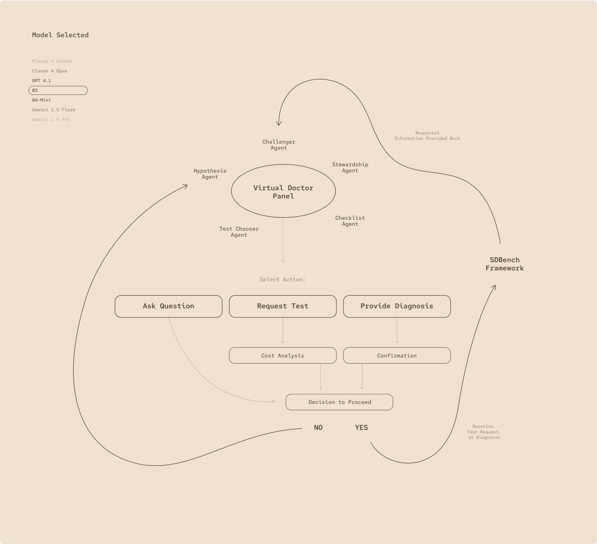
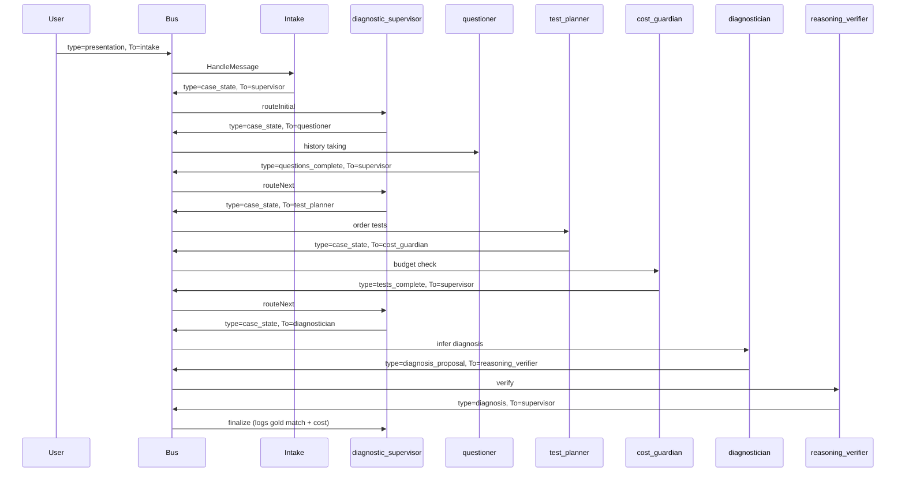

# Bodh — Medical Diagnostic Orchestrator (Go)

> **Bodh** (Sanskrit: *bodhi* — knowledge, awakening, insight) is an open-source **medical diagnostic assistant** implemented in **Go**. It follows Microsoft’s [**Multi-Agent Reference Architecture (MARA)**](https://microsoft.github.io/multi-agent-reference-architecture/) and implements a **virtual physician panel** inspired by [**MAI-DxO**](https://microsoft.ai/news/the-path-to-medical-superintelligence/) (Microsoft AI Diagnostic Orchestrator) and the [**Sequential Diagnosis Benchmark (SD Bench)**](https://microsoft.ai/news/the-path-to-medical-superintelligence/).

Go · MARA · Medical AI · Sequential Diagnosis · Open Source

**Module path:** `github.com/PratikDhanave/bodh`

**Architecture diagrams:** [Architecture.png](Architecture.png) (MARA platform) · [architectureflow.webp](architectureflow.webp) (sequential diagnosis flow)

---

## Table of contents

1. [Architecture diagrams](#architecture-diagrams) — [`Architecture.png`](Architecture.png) · [`architectureflow.webp`](architectureflow.webp)
2. [Start here (new contributors)](#start-here-new-contributors)
3. [What is Bodh?](#what-is-bodh)
4. [Research disclaimer](#research-disclaimer)
5. [Background: MAI-DxO, SD Bench, and why not USMLE-only?](#background-mai-dxo-sd-bench-and-why-not-usmle-only)
6. [Why MARA (and not one big LLM call)?](#why-mara-and-not-one-big-llm-call)
7. [Architecture overview](#architecture-overview)
8. [MARA concepts → Go packages](#mara-concepts--go-packages)
9. [Virtual physician panel (MAI-DxO mapping)](#virtual-physician-panel-mai-dxo-mapping)
10. [Clinical message protocol](#clinical-message-protocol)
11. [Domain model (`pkg/medical`)](#domain-model-pkgmedical)
12. [Package guide (read before writing code)](#package-guide-read-before-writing-code)
13. [Governance and safety policies](#governance-and-safety-policies)
14. [Walkthrough: `cmd/demo` (line by line)](#walkthrough-cmddemo-line-by-line)
15. [Complete message trace (demo case)](#complete-message-trace-demo-case)
16. [Diagnostic test catalog and costs](#diagnostic-test-catalog-and-costs)
17. [Sample cases and fixtures](#sample-cases-and-fixtures)
18. [Evaluation (SD Bench alignment)](#evaluation-sd-bench-alignment)
19. [Add your first Bodh agent (tutorial)](#add-your-first-bodh-agent-tutorial)
20. [Design rules (from MARA)](#design-rules-from-mara)
21. [Security, PHI, and compliance notes](#security-phi-and-compliance-notes)
22. [FAQ](#faq)
23. [What is implemented today vs planned](#what-is-implemented-today-vs-planned)
24. [Roadmap](#roadmap)
25. [Repository layout](#repository-layout)
26. [MARA chapters — what to read and when](#mara-chapters--what-to-read-and-when)
27. [Contributing](#contributing)
28. [References](#references)
29. [License / status](#license--status)

---

## Start here (new contributors)

Read this README in order. You do **not** need prior LLM framework experience. You **do** need:

- Basic **Go** (interfaces, goroutines, `context`)
- The idea that **agents coordinate by sending messages**, not by calling each other’s functions directly
- Familiarity with **clinical workflow** at a high level (presentation → history → tests → diagnosis) helps, but is not required

**First, open the two diagrams** (also linked at the top of this file):

1. [`Architecture.png`](Architecture.png) — how Bodh fits Microsoft MARA (orchestrator, registry, bus, eval).
2. [`architectureflow.webp`](architectureflow.webp) — how one case moves through the virtual physician panel.

Full legend tables: [Architecture diagrams](#architecture-diagrams).

### The one-sentence model

**A user (or API) publishes a clinical message → the orchestrator delivers it to the right agent → the agent returns zero or more new messages → the orchestrator publishes those → the workflow continues until the diagnostic supervisor emits a final report (or no more messages are emitted).**

That pattern is exactly what MARA’s building blocks describe: an **orchestrator**, **specialized agents**, a **registry**, and shared **memory** / **governance** / **observability**.

### Run the demo in 30 seconds

```bash
git clone https://github.com/PratikDhanave/bodh.git
cd bodh
go run ./cmd/demo
go test ./...
```

You should see logs like:

```
[bodh] [intake] case=demo-case-001 chief_complaint="Cough and fever"
[bodh] [supervisor] starting sequential diagnosis for case demo-case-001
[bodh] [questioner] ask: Duration and character of cough?
[bodh] [test_planner] ordering complete_blood_count ($45)
[bodh] [cost_guardian] APPROVE: $220.00 / $500.00 budget (44% utilized)
[bodh] [diagnostician] diagnosis="Community-acquired pneumonia" confidence=87%
[bodh] [reasoning_verifier] VERIFIED diagnosis "Community-acquired pneumonia"
[bodh] [supervisor] ═══ FINAL DIAGNOSIS for case demo-case-001 ═══
[bodh] [supervisor] gold standard: Community-acquired pneumonia | match=true
```

That is a **full sequential diagnosis flow** using the same machinery you will use for LLM-backed agents, NEJM-style cases, and HTTP APIs.

---

## What is Bodh?

### Product vision

Bodh helps explore:

> **“What is the most likely diagnosis, and what did it cost to get there?”**

—not only **“What are the patient’s symptoms?”**

Real-world medicine is **sequential**: clinicians start with a presentation, ask targeted questions, order tests when justified, update their differential, and only then commit to a diagnosis. Costs matter: unnecessary imaging and labs are a known source of waste (Microsoft cites up to ~25% of U.S. health spending as low-value or wasted in their [MAI-DxO research post](https://microsoft.ai/news/the-path-to-medical-superintelligence/)).

Bodh encodes that workflow as a **governed multi-agent system**:

| Layer | Role |
|-------|------|
| **Deterministic clinical logic** (today) | Rule-based history, test selection, inference, cost totals |
| **Specialist agents** | Intake, history, tests, cost, diagnosis, verification, supervision |
| **Orchestrated message flows** | Traceable steps; policies run before every `HandleMessage` |
| **LLM layer** (planned) | Model-agnostic prompts per agent, like MAI-DxO + OpenAI o3 |

### Engineering reality in this repo

Bodh is a **Go codebase** that implements the **multi-agent platform** from MARA. Medical behavior lives in **`agents/`** and **`pkg/medical/`**; the platform in **`pkg/protocol`**, **`pkg/comm`**, **`pkg/orchestration`**, etc. stays stable as you add LLMs, APIs, and benchmarks.

---

## Research disclaimer

**Bodh is a research and engineering demonstration. It is not approved for clinical use.**

- Do not use Bodh for real patient care, triage, or treatment decisions.
- Demo agents use **simulated** answers and **rule-based** inference—not validated models.
- Microsoft’s [MAI-DxO work](https://microsoft.ai/news/the-path-to-medical-superintelligence/) explicitly states that SD Bench and MAI-DxO are research demonstrations requiring clinical validation, governance, and regulatory review before deployment.

At the heart of any future clinical product must be: **safety, trust, transparency, and human oversight.**

---

## Background: MAI-DxO, SD Bench, and why not USMLE-only?

### The limitation of multiple-choice medical AI benchmarks

For years, **USMLE-style** multiple-choice questions were the standard AI medical benchmark. Frontier models now score near-perfect on such exams. Microsoft and others argue these benchmarks **overstate** competence because they reward memorization over **iterative clinical reasoning**—the kind required in real cases.

### Sequential Diagnosis Benchmark (SD Bench)

From [The Path to Medical Superintelligence](https://microsoft.ai/news/the-path-to-medical-superintelligence/):

- **304** recent **New England Journal of Medicine (NEJM)** Case Records were transformed into **stepwise diagnostic encounters**.
- An agent (or physician) may **ask questions**, **order tests** (with virtual **cost**), and **update reasoning** until it provides a final diagnosis.
- Performance is measured on **accuracy** and **resource expenditure**—a **Pareto frontier** of diagnosis vs. cost.

MAI-DxO paired with OpenAI’s **o3** reportedly reached **~85.5%** accuracy on these cases, vs. **~20%** mean for experienced physicians in their study setup (see the blog for methodology caveats).

### What Bodh implements today

| SD Bench / MAI-DxO idea | Bodh status |
|-------------------------|-------------|
| Sequential ask → test → diagnose | ✅ Demo workflow |
| Virtual cost per test | ✅ `medical.TestCatalog` |
| Cost budget / guardian | ✅ `cost_guardian` + `MaxDiagnosticCostPolicy` |
| Self-verification before final diagnosis | ✅ `reasoning_verifier` |
| Virtual physician panel | ✅ 7 agents |
| NEJM case loader / 304 cases | 🔲 Planned |
| LLM-backed agents | 🔲 Planned |
| Public benchmark runner | 🔲 Planned |

---

## Why MARA (and not one big LLM call)?)

Microsoft’s [Multi-Agent Reference Architecture](https://microsoft.github.io/multi-agent-reference-architecture/) focuses on systems where **many specialized agents** interact. The hard problems are not “write a prompt,” but:

| Problem | Why it matters in medicine |
|---------|---------------------------|
| **Routing** | Should this message go to history, labs, or diagnosis? |
| **Decomposition** | Who owns step 1 vs. step 2 in a long case? |
| **Governance** | PHI, budget caps, disallowed actions—**before** any agent runs |
| **State** | Case progression, prior questions, test results |
| **Operations** | Audit logs, evaluation vs. gold diagnosis, regression tests |
| **Safety** | Fail closed; explainable denials; human-in-the-loop hooks |

A single monolithic LLM call is difficult to **audit**, **cap cost**, **swap models per step**, or **regression-test** when clinical guidelines change. Bodh keeps the **orchestrator generic** and puts clinical policy in **agents + governance**.

**Further reading:** [MARA Reference Architecture](https://microsoft.github.io/multi-agent-reference-architecture/docs/reference-architecture/Reference-Architecture.html) · [Building blocks](https://microsoft.github.io/multi-agent-reference-architecture/docs/building-blocks/Building-Blocks.html)

---

## Architecture diagrams

This repository includes **two architecture images** at the repo root. Use them together: one for the **platform** (MARA), one for the **clinical workflow** (Bodh / MAI-DxO sequential diagnosis).

| File | What it shows | When to use it |
|------|----------------|----------------|
| [**Architecture.png**](Architecture.png) | Microsoft-style **Multi-Agent Reference Architecture** — user app, orchestrator, classifier, registry, knowledge, storage, local/remote agent layers, MCP, observability, evaluation | Onboarding to **platform** packages (`pkg/orchestration`, `pkg/registry`, `pkg/comm`, …) |
| [**architectureflow.webp**](architectureflow.webp) | **Bodh sequential diagnosis flow** — virtual physician panel, message path from presentation to final diagnosis | Onboarding to **`agents/`** and `cmd/demo` clinical routing |

> **Maintainers:** When box-level architecture or the diagnosis pipeline changes, update the matching image so it stays the visual source of truth.

### Platform architecture — `Architecture.png`

High-level MARA stack: user → application → orchestration (classifier, registry) → knowledge & storage → supervisor/worker agents (MCP) → tools → observability → evaluation feedback.


**How to read this diagram with the code**

| Area on the diagram | What it is in Bodh | Where it lives in Go |
|---------------------|--------------------|----------------------|
| User / User Application | Entry that publishes the first `protocol.Message` | Today: `cmd/demo` · planned: `cmd/api` |
| Orchestrator | Subscribes agents, runs governance, calls `HandleMessage`, republishes outputs | `pkg/orchestration` |
| Classifier | Route intent (e.g. new case vs. follow-up) | Planned: router agent or `pkg/classifier` |
| Agent Registry | Lists agents and resolves capabilities | `pkg/registry` |
| Knowledge Layer | Guidelines, differentials, RAG over clinical text | Planned: DB + vector index |
| Storage Layer | Conversation history, agent/case state, registry backing store | `pkg/memory` (KV today) · planned: PostgreSQL |
| Supervisor Agent | Decompose diagnosis into steps | `agents/supervisor.go` (`diagnostic_supervisor`) |
| Agent #1 … #N (workers) | Intake, questioner, test planner, diagnostician, … | `agents/*.go` |
| Integration / MCP / External Tools | Labs, imaging, LLM APIs | Planned: tools via extended `Environment` |
| Observability | Logs, traces, clocks | `pkg/observability` |
| Evaluation | Accuracy vs. gold diagnosis, cost metrics | `pkg/eval` · planned: `cmd/bench` |

### Clinical flow — `architectureflow.webp`

End-to-end **sequential diagnosis** for one case: presentation → history → tests (with cost check) → diagnosis → reasoning verification → final report. This is the Bodh mapping of [MAI-DxO](https://microsoft.ai/news/the-path-to-medical-superintelligence/)’s virtual physician panel and [SD Bench](https://microsoft.ai/news/the-path-to-medical-superintelligence/)’s stepwise encounters.



**How to read this diagram with the code**

| Step on the flow | Agent ID | Message `Type` (typical) | Source file |
|------------------|----------|--------------------------|-------------|
| Case intake | `intake` | `presentation` → `case_state` | `agents/intake.go` |
| Panel coordination | `diagnostic_supervisor` | `case_state`, `questions_complete`, `tests_complete`, `diagnosis` | `agents/supervisor.go` |
| Ask question (MAI-DxO) | `questioner` | `case_state` → `questions_complete` | `agents/questioner.go` |
| Request test (MAI-DxO) | `test_planner` | `case_state` | `agents/test_planner.go` |
| Cost check (MAI-DxO) | `cost_guardian` | `case_state` → `tests_complete` | `agents/cost_guardian.go` |
| Provide diagnosis (MAI-DxO) | `diagnostician` | `case_state` → `diagnosis_proposal` | `agents/diagnostician.go` |
| Verify reasoning (MAI-DxO) | `reasoning_verifier` | `diagnosis_proposal` → `diagnosis` | `agents/reasoning_verifier.go` |
| Domain state in every hop | — | JSON in `Content` | `pkg/medical` (`CaseState`) |

The ASCII diagrams in [Architecture overview](#architecture-overview) below duplicate this flow in text form for terminals and diffs; prefer **`architectureflow.webp`** for slides and **`Architecture.png`** for platform discussions.

---

## Architecture overview

> **Visual references:** Platform boxes → [`Architecture.png`](Architecture.png). Clinical message path → [`architectureflow.webp`](architectureflow.webp). See [Architecture diagrams](#architecture-diagrams) for full legend tables.

### System diagram (how pieces connect)

```
                    ┌──────────────────────┐
                    │  cmd/demo or future  │
                    │  cmd/api / FHIR hook │
                    │  bus.Publish(msg)    │
                    └──────────┬───────────┘
                               │
                    ┌──────────▼───────────┐
                    │  pkg/comm (Bus)      │
                    │  route by msg.To     │
                    └──────────┬───────────┘
                               │
         ┌─────────────────────┼─────────────────────┐
         │                     │                     │
┌────────▼────────┐   ┌────────▼────────┐   ┌──────▼──────┐
│ Orchestrator    │   │ Governance      │   │ Registry    │
│ pkg/orchestration│  │ pkg/governance  │   │ pkg/registry│
│                 │   │ + medical_policy│   │             │
└────────┬────────┘   └─────────────────┘   └─────────────┘
         │
         │  for each message to agent X:
         │    1) policy.Evaluate(msg)  → deny stops processing
         │    2) agent.HandleMessage(msg, env)
         │    3) bus.Publish(each output)
         │
┌────────▼────────────────────────────────────────────────────┐
│  Virtual physician panel (agents/)                         │
│                                                            │
│  intake ──► diagnostic_supervisor ──► questioner           │
│         ◄──                         ◄──                    │
│              ├──► test_planner ──► cost_guardian           │
│              ├──► diagnostician ──► reasoning_verifier     │
│              └──► (final report)                           │
└────────────────────────────────────────────────────────────┘
         │
┌────────▼────────┐
│ pkg/medical     │  CaseState, TestCatalog, DiagnosisProposal
│ pkg/memory      │  (future: per-case KV / session store)
│ pkg/eval        │  (future: accuracy + cost metrics)
└─────────────────┘
```

### MAI-DxO “Virtual Doctor Panel” → Bodh agents

Microsoft’s diagram describes a panel that can **Ask Question**, **Request Test**, or **Provide Diagnosis**, with **cost check** and **reasoning verification** before proceeding. Bodh maps each action to a dedicated agent:

```
                    ┌─────────────────────────┐
                    │ diagnostic_supervisor │
                    │ (orchestration agent) │
                    └───────────┬─────────────┘
                                │
        ┌───────────┬───────────┼───────────┬───────────┐
        ▼           ▼           ▼           ▼           ▼
   questioner  test_planner  cost_guardian  diagnostician  reasoning_verifier
   Ask Q        Request Test  Cost check     Diagnose       Verify
```

**Important:** `diagnostic_supervisor` is an **agent-level** coordinator (MARA **supervisor** pattern). It does **not** replace `pkg/orchestration.Orchestrator`—the platform orchestrator still handles bus wiring and governance.

### Sequential diagnosis sequence (mermaid)

Same flow as [`architectureflow.webp`](architectureflow.webp) (recommended for slides and docs); mermaid below is for GitHub/GitLab rendering in-repo.



---

## MARA concepts → Go packages

This table is the **map of the codebase**. Each row is a MARA idea; the **Go package** is where it lives. Box-level layout: [`Architecture.png`](Architecture.png) and its table in [Architecture diagrams](#architecture-diagrams).

| MARA concept | What it does | Go package | Key types / files |
|--------------|--------------|------------|-------------------|
| **Message / protocol** | Common wire format for all interaction | `pkg/protocol` | `Message`, `MessageRole`, `NewMessage` |
| **Agent** | Domain worker: handle one message, emit follow-ups | `pkg/agent` | `Agent`, `Environment` |
| **Agent registry** | Who exists? What can they do? | `pkg/registry` | `Registry`, `InMemoryRegistry`, `FindByCapability` |
| **Communication bus** | Routes by `Message.To` (agent ID) | `pkg/comm` | `Bus`, `InMemoryBus` |
| **Orchestrator** | Subscribe agents, apply policy, dispatch | `pkg/orchestration` | `Orchestrator`, `SimpleEnvironment` |
| **Governance** | Allow/deny before an agent sees a message | `pkg/governance` | `Policy`, `CompositePolicy`, `medical_policy.go` |
| **Memory** | Short/long-term context (KV today) | `pkg/memory` | `KeyValueStore`, `InMemoryKV` |
| **Observability** | Logs, clocks (testable) | `pkg/observability` | `Logger`, `Clock`, `[bodh]` prefix |
| **Evaluation** | Record runs for offline/online eval | `pkg/eval` | `InteractionRecord`, `Store` |
| **Medical domain** | Case state, tests, diagnoses | `pkg/medical` | `CaseState`, `TestCatalog`, `DiagnosisProposal` |
| **Clinical agents** | Virtual physician panel | `agents/` | `IntakeAgent`, `QuestionerAgent`, … |

MARA components you will **add for Bodh** (not all are code yet):

| MARA concept | Bodh role | Planned location |
|--------------|-----------|------------------|
| **User application** | Clinician UI, patient triage API | `cmd/api`, `dashboard/` |
| **Classifier / router** | Route “chest pain” vs “rash” workflows | Router agent or `pkg/classifier` |
| **Supervisor agent** | Multi-step diagnosis decomposition | `agents/supervisor.go` ✅ |
| **Knowledge layer** | Guidelines, differentials, drug interactions | DB + optional vector index |
| **MCP / tools** | Lab interfaces, imaging, LLM APIs | Tools via extended `Environment` |
| **Evaluation harness** | SD Bench accuracy + cost metrics | `pkg/eval` + `cmd/bench` |

---

## Virtual physician panel (MAI-DxO mapping)

> **Visual:** Agent order and message hops — [`architectureflow.webp`](architectureflow.webp). Platform wiring (orchestrator, registry, bus) — [`Architecture.png`](Architecture.png).

### Agent registry table

| Agent ID | Human name | MAI-DxO action | Capability strings | Input `Type` | Output `Type` | Sends to |
|----------|------------|----------------|-------------------|--------------|---------------|----------|
| `intake` | Clinical Intake | (case entry) | `intake_presentation` | `presentation` | `case_state` | `diagnostic_supervisor` |
| `diagnostic_supervisor` | Diagnostic Orchestrator | Panel coordination | `supervise_diagnosis`, `sequential_diagnosis` | `case_state`, `questions_complete`, `tests_complete`, `diagnosis` | `case_state`, (terminal) | `questioner`, `test_planner`, `diagnostician` |
| `questioner` | History & Symptom Questioner | **Ask Question** | `ask_question`, `history_taking` | `case_state` | `questions_complete` | `diagnostic_supervisor` |
| `test_planner` | Diagnostic Test Planner | **Request Test** | `order_test`, `interpret_results` | `case_state` | `case_state` | `cost_guardian` |
| `cost_guardian` | Diagnostic Cost Guardian | **Cost check** | `cost_check`, `pareto_optimization` | `case_state` | `tests_complete` | `diagnostic_supervisor` |
| `diagnostician` | Diagnostician | **Provide Diagnosis** | `provide_diagnosis`, `differential_diagnosis` | `case_state` | `diagnosis_proposal` | `reasoning_verifier` |
| `reasoning_verifier` | Clinical Reasoning Verifier | **Verify reasoning** | `verify_reasoning`, `safety_check` | `diagnosis_proposal` | `diagnosis` | `diagnostic_supervisor` |

### Per-agent behavior (implementation detail)

#### `intake`

- **File:** `agents/intake.go`
- Parses `Content` as JSON `PatientPresentation` (`chief_complaint`, `hpi`, `demographics`, `vitals`).
- Builds initial `CaseState`: merges complaint + HPI into `Presentation`, reads `case_id`, `max_cost_usd`, `gold_diagnosis` from **metadata** (not from raw PHI in logs).
- Initializes empty `Answers` and `TestResults` maps (required—JSON round-trip can yield `nil` maps).

#### `diagnostic_supervisor`

- **File:** `agents/supervisor.go`
- **State machine** on `msg.Type`:
  - `case_state` (from intake) → forward to `questioner`
  - `questions_complete` → forward to `test_planner`
  - `tests_complete` → forward to `diagnostician`
  - `diagnosis` (verified) → **finalize**: log working diagnosis, total cost, gold-standard match, hypotheses
- Does **not** import other agents—only emits messages with `To:` set.
- `PanelReport(state)` helper for future HTTP responses.

#### `questioner`

- **File:** `agents/questioner.go`
- Demo: four fixed history questions; `simulatedAnswer()` returns canned text (stand-in for patient LLM or EHR).
- Sets `Hypotheses` to `community_acquired_pneumonia`, `viral_upper_respiratory_infection`, `pulmonary_embolism`.
- Production: one question per message turn, or batched LLM call with structured JSON output.

#### `test_planner`

- **File:** `agents/test_planner.go`
- Demo workup for respiratory case: `complete_blood_count`, `chest_xray`, `basic_metabolic_panel`.
- Accumulates `TotalCostUSD` from `medical.TestCatalog`.
- Populates `TestResults` via `simulatedTestResult()` (demo only).
- Always routes through `cost_guardian` before supervisor sees `tests_complete`.

#### `cost_guardian`

- **File:** `agents/cost_guardian.go`
- Compares `state.TotalCostUSD` to `state.MaxCostUSD`.
- On deny: logs and returns **no messages** (supervisor should eventually handle rework—planned).
- On approve: emits `tests_complete` to supervisor.

#### `diagnostician`

- **File:** `agents/diagnostician.go`
- `inferDiagnosis()`: if CXR mentions infiltrate and CBC mentions WBC → **Community-acquired pneumonia** at 0.87 confidence; else low-confidence undifferentiated diagnosis.
- Sends `diagnosis_proposal` JSON to `reasoning_verifier` with full `case_state` embedded in metadata key `case_state`.

#### `reasoning_verifier`

- **File:** `agents/reasoning_verifier.go`
- Demo rule: `confidence >= 0.5` and non-empty `rationale`.
- On success: sets `WorkingDiagnosis`, emits `diagnosis` to supervisor.
- Production: LLM rubric, second model, or rules + human escalation.

---

## Clinical message protocol

All coordination uses `pkg/protocol.Message` (re-exported as `agent.Message`).

### `Message` struct

```go
type Message struct {
    ID        string            // UUID — audit / causal graph
    From      string            // sender agent id or "user"
    To        string            // recipient agent id (routing address)
    Role      MessageRole       // user | system | agent | tool | observer | evaluator
    Type      string            // handler branch (see tables below)
    Content   string            // primary payload (JSON for clinical data)
    CreatedAt time.Time         // UTC
    Metadata  map[string]any    // case_id, trace_id, costs, ...
}
```

### Message roles

| Role | Typical use in Bodh |
|------|---------------------|
| `user` | Initial `presentation` from API/CLI |
| `agent` | Plans, case state, delegations, diagnosis steps |
| `tool` | Future: lab result feed, imaging AI output |
| `system` | Policy broadcasts, shutdown, config |
| `observer` | Audit / telemetry events on the bus |
| `evaluator` | Automated rubric scores vs. gold diagnosis |

### Clinical `Type` values (complete list)

| Type | Direction | Content shape | Governance notes |
|------|-----------|---------------|------------------|
| `presentation` | user → `intake` | `PatientPresentation` JSON | Requires `metadata.case_id` |
| `case_state` | various | `CaseState` JSON | Requires `case_id` |
| `questions_complete` | `questioner` → supervisor | `CaseState` JSON | Requires `case_id` |
| `tests_complete` | `cost_guardian` → supervisor | `CaseState` JSON | Requires `case_id` |
| `diagnosis_proposal` | `diagnostician` → verifier | `DiagnosisProposal` JSON | Requires `case_id`; metadata includes `case_state` |
| `diagnosis` | verifier → supervisor | `CaseState` JSON (final) | Requires `case_id` |
| `order_test` | (future per-test messages) | test request JSON | `MaxDiagnosticCostPolicy` applies |
| `ask_question` | (future single-question turn) | question string | Requires `case_id` |
| `verify_reasoning` | (reserved) | rubric payload | Requires `case_id` |

### Required metadata keys

| Key | Type | Required when | Purpose |
|-----|------|---------------|---------|
| `case_id` | string | All clinical `Type`s above | Correlation; **never** log MRNs in clear text—use opaque ids |
| `trace_id` | string | Recommended | Distributed tracing |
| `max_cost_usd` | float64 | Intake / case budget | SD Bench-style cost ceiling |
| `gold_diagnosis` | string | Benchmarks only | Offline eval vs. NEJM outcome |
| `spent_usd` | float64 | Test ordering | Running total for policy |
| `test_cost_usd` | float64 | Per-test `order_test` | Incremental budget check |

### Example: starting a case

```json
{
  "from": "user",
  "to": "intake",
  "role": "user",
  "type": "presentation",
  "content": "{\"chief_complaint\":\"Cough and fever\",\"hpi\":\"58-year-old presents with 5 days productive cough and fever to 38.9°C\",\"demographics\":\"58M\",\"vitals\":\"T 38.9°C, HR 98, RR 22, SpO2 94% on room air\"}",
  "metadata": {
    "case_id": "demo-case-001",
    "trace_id": "trace-demo-001",
    "max_cost_usd": 500,
    "gold_diagnosis": "Community-acquired pneumonia"
  }
}
```

### Example: `CaseState` after history and tests

```json
{
  "case_id": "demo-case-001",
  "presentation": "Cough and fever; 58-year-old presents with 5 days productive cough and fever to 38.9°C",
  "questions_asked": ["Duration and character of cough?", "Any fever, chills, or night sweats?"],
  "answers": {
    "Duration and character of cough?": "Productive cough for 5 days, yellow sputum"
  },
  "tests_ordered": [
    {"name": "complete_blood_count", "cost_usd": 45, "ordered": true},
    {"name": "chest_xray", "cost_usd": 120, "ordered": true}
  ],
  "test_results": {
    "complete_blood_count": "WBC 14.2 K, neutrophil predominance",
    "chest_xray": "Right lower lobe infiltrate consistent with consolidation"
  },
  "hypotheses": ["community_acquired_pneumonia", "viral_upper_respiratory_infection", "pulmonary_embolism"],
  "working_diagnosis": "Community-acquired pneumonia",
  "total_cost_usd": 220,
  "max_cost_usd": 500,
  "gold_diagnosis": "Community-acquired pneumonia"
}
```

---

## Domain model (`pkg/medical`)

### `PatientPresentation`

| Field | Description |
|-------|-------------|
| `chief_complaint` | Primary reason for encounter |
| `hpi` | History of present illness (narrative) |
| `demographics` | Age/sex summary (demo string, not structured FHIR yet) |
| `vitals` | Free-text vitals line |

Helpers: `EncodePresentation`, `DecodePresentation`.

### `CaseState`

The **single source of truth** carried through the sequential diagnosis pipeline.

| Field | Description |
|-------|-------------|
| `case_id` | Opaque case identifier |
| `presentation` | Combined complaint + HPI summary |
| `questions_asked` / `answers` | History loop |
| `tests_ordered` / `test_results` | Investigations |
| `hypotheses` | Working differential (SNOMED/ICD codes planned) |
| `working_diagnosis` | Final label after verification |
| `total_cost_usd` / `max_cost_usd` | SD Bench-style economics |
| `gold_diagnosis` | Benchmark only—not shown to agents in production eval |

Helpers: `EncodeState`, `DecodeState`.

### `DiagnosisProposal`

| Field | Description |
|-------|-------------|
| `diagnosis` | Primary label |
| `confidence` | 0.0–1.0 (demo threshold 0.5 in verifier) |
| `differential` | List of alternatives |
| `rationale` | Human-readable reasoning chain |

### `DiagnosticTest`

| Field | Description |
|-------|-------------|
| `name` | Catalog key (e.g. `chest_xray`) |
| `cost_usd` | Virtual USD charge |
| `result` | Interpretation text |
| `ordered` | Whether test was selected |

---

## Package guide (read before writing code)

### `pkg/protocol` — the wire format

- **No import cycles:** `pkg/agent` re-exports types; low-level packages import `protocol` only.
- **Contributor tip:** Put structured clinical data in `Content` as JSON; use `Type` to branch in `HandleMessage`.

### `pkg/agent` — the worker contract

```go
type Agent interface {
    ID() string
    Name() string
    Capabilities() []string
    HandleMessage(ctx context.Context, msg Message, env Environment) ([]Message, error)
}

type Environment interface {
    Now() time.Time
    Logf(format string, args ...any)
}
```

- **`ID()`** must match `Message.To` when other components address this agent.
- **`Capabilities()`** supports `registry.FindByCapability("order_test")` for dynamic routing.
- **`HandleMessage`** returns **0..N** messages; zero means no follow-up.

Extend `Environment` via composition (memory, LLM client, FHIR client)—do not bloat the interface for every integration.

### `pkg/registry` — discovery

```go
type Registry interface {
    Register(ctx context.Context, a agent.Agent) error
    Get(ctx context.Context, id string) (agent.Agent, error)
    List(ctx context.Context) []agent.Agent
    FindByCapability(ctx context.Context, capability string) []agent.Agent
}
```

- Register all agents **before** `orch.Start(ctx)`.
- Registry does **not** transport messages—that is the bus.

### `pkg/comm` — message bus

```go
type Bus interface {
    Subscribe(agentID string, h Handler) (unsubscribe func())
    Publish(ctx context.Context, msg protocol.Message)
}
```

**Routing (`InMemoryBus`):**

- `msg.To` non-empty → subscribers for that agent ID (async goroutines).
- `agentID == ""` subscription → broadcast.

**Production swap:** Kafka, NATS, RabbitMQ implement `Bus` without changing agent code.

**Demo caveat:** `cmd/demo` sleeps 3 seconds so `main` does not exit before async handlers finish. Use `WaitGroup`, done messages, or context cancellation in production.

### `pkg/orchestration` — the platform coordinator

`Orchestrator.Start`:

1. `List()` all agents from registry.
2. `bus.Subscribe(agentID, handler)` for each.
3. On message: `policy.Evaluate` → deny stops; else `HandleMessage` → `Publish` each output.

**No clinical logic inside**—matches MARA orchestrator role.

### `pkg/governance` — safety at the boundary

Policies implement:

```go
Evaluate(ctx context.Context, msg protocol.Message) (PolicyResult, error)
```

`CompositePolicy` denies if **any** child denies (fail fast).

**Always evaluate before `HandleMessage`** so agents never see illegal payloads.

### `pkg/memory`, `pkg/observability`, `pkg/eval`

| Package | Today | Bodh direction |
|---------|-------|----------------|
| `memory` | `InMemoryKV` | Per-case scratchpad; conversation STM ([MARA Memory](https://microsoft.github.io/multi-agent-reference-architecture/docs/memory/Memory.html)) |
| `observability` | `[bodh]` stdout logger | `trace_id`, OpenTelemetry ([MARA Observability](https://microsoft.github.io/multi-agent-reference-architecture/docs/observability/Observability.html)) |
| `eval` | `InteractionRecord` store | Accuracy vs. `gold_diagnosis`, cost Pareto metrics ([MARA Evaluation](https://microsoft.github.io/multi-agent-reference-architecture/docs/evaluation/Evaluation.html)) |

---

## Governance and safety policies

### Policy stack in `cmd/demo`

```go
policy := governance.NewComposite(
    governance.MaxContentLengthPolicy{Max: 65536},
    governance.RequireCaseIDPolicy{},
    governance.MaxDiagnosticCostPolicy{},
    governance.ResearchDisclaimerPolicy{},
)
```

### `RequireCaseIDPolicy`

- Applies to clinical types: `presentation`, `case_state`, `ask_question`, `order_test`, `diagnosis`, `verify_reasoning`.
- Denies if `metadata` is nil or `case_id` is missing/not a string.
- **Rationale:** every PHI-bearing payload must be correlatable for audit without logging content.

### `MaxDiagnosticCostPolicy`

- Applies when `type == order_test`.
- Denies if `spent_usd + test_cost_usd > max_cost_usd` in metadata.
- **Rationale:** encodes MAI-DxO’s explicit cost constraints—not “order every test.”

### `MaxContentLengthPolicy`

- Denies oversized `Content` (prompt bombing / accidental huge payloads).

### `ResearchDisclaimerPolicy`

- Always allows; documents that the stack is a research demo.

### Tests

```bash
go test ./pkg/governance/... -v
go test ./pkg/medical/... -v
```

---

## Walkthrough: `cmd/demo` (line by line)

Open `cmd/demo/main.go` alongside this section and [`architectureflow.webp`](architectureflow.webp) so each `bus.Publish` step maps to an arrow on the flow diagram.

### Step 1 — Observability and environment

```go
logger := observability.NewStdLogger()
env := &orchestration.SimpleEnvironment{Logger: logger, Clock: observability.SystemClock{}}
```

Agents log via `env.Logf`. Tests can inject a fake `Clock`.

### Step 2 — Platform building blocks

```go
reg := registry.NewInMemory()
bus := comm.NewInMemoryBus()
policy := governance.NewComposite(...)
```

Three concerns: **discovery**, **transport**, **policy**.

### Step 3 — Register the virtual physician panel

```go
agentList := []agent.Agent{
    &agents.IntakeAgent{},
    &agents.DiagnosticSupervisor{},
    &agents.QuestionerAgent{},
    &agents.TestPlannerAgent{},
    &agents.CostGuardianAgent{},
    &agents.DiagnosticianAgent{},
    &agents.ReasoningVerifierAgent{},
}
for _, a := range agentList {
    _ = reg.Register(ctx, a)
}
```

### Step 4 — Start orchestration

```go
orch := orchestration.NewOrchestrator(reg, bus, policy, env)
orch.Start(ctx)
```

Wires bus subscriptions; no clinical traffic yet.

### Step 5 — Publish initial presentation

```go
start := agent.NewMessage("user", "intake", agent.RoleUser, "presentation",
    medical.EncodePresentation(presentation), meta)
bus.Publish(ctx, start)
```

Everything after this is **message-driven**—no direct agent calls.

### Step 6 — Wait for async handlers

```go
time.Sleep(3 * time.Second)
```

---

## Complete message trace (demo case)

For `demo-case-001` (cough/fever → pneumonia), the following messages are emitted (simplified). This table matches the numbered path in [`architectureflow.webp`](architectureflow.webp):

| Step | From | To | Type | Notes |
|------|------|-----|------|-------|
| 1 | `user` | `intake` | `presentation` | Chief complaint + HPI |
| 2 | `intake` | `diagnostic_supervisor` | `case_state` | Initial state, max cost $500 |
| 3 | `diagnostic_supervisor` | `questioner` | `case_state` | Start history |
| 4 | `questioner` | `diagnostic_supervisor` | `questions_complete` | 4 Q&A, 3 hypotheses |
| 5 | `diagnostic_supervisor` | `test_planner` | `case_state` | Order labs/imaging |
| 6 | `test_planner` | `cost_guardian` | `case_state` | Total $220 |
| 7 | `cost_guardian` | `diagnostic_supervisor` | `tests_complete` | Budget OK |
| 8 | `diagnostic_supervisor` | `diagnostician` | `case_state` | Infer |
| 9 | `diagnostician` | `reasoning_verifier` | `diagnosis_proposal` | 87% CAP |
| 10 | `reasoning_verifier` | `diagnostic_supervisor` | `diagnosis` | Verified |
| 11 | `diagnostic_supervisor` | — | (terminal) | Logs final + gold match |

**Total virtual diagnostic cost:** $220 (CBC $45 + CXR $120 + BMP $55).

---

## Diagnostic test catalog and costs

Defined in `pkg/medical/types.go` as `TestCatalog` (illustrative USD, research demo—not billing codes):

| Test key | Virtual cost (USD) | Demo result summary |
|----------|-------------------|---------------------|
| `complete_blood_count` | 45 | WBC 14.2 K, neutrophil predominance |
| `basic_metabolic_panel` | 55 | Within normal limits |
| `chest_xray` | 120 | RLL infiltrate / consolidation |
| `ecg` | 80 | (not used in default demo) |
| `urinalysis` | 35 | — |
| `ct_chest` | 850 | High cost—use when budget allows |
| `blood_culture` | 95 | — |
| `arterial_blood_gas` | 75 | — |

**MAI-DxO insight:** the best agents sit on the **Pareto frontier**—high accuracy, **lower** average test cost than humans who may over-order. Bodh’s `cost_guardian` is the hook for that trade-off.

---

## Sample cases and fixtures

| File | Description |
|------|-------------|
| [`data/cases/demo_pneumonia.json`](data/cases/demo_pneumonia.json) | 58M with cough/fever; gold diagnosis CAP; $500 budget |

Future layout:

```
data/cases/
├── demo_pneumonia.json
├── nejm_001.json          # (planned) NEJM-style narrative
└── manifest.json          # (planned) SD Bench index
```

---

## Evaluation (SD Bench alignment)

### Metrics (planned `cmd/bench`)

| Metric | Definition |
|--------|------------|
| **Diagnostic accuracy** | `working_diagnosis` matches `gold_diagnosis` (exact or normalized ICD-10) |
| **Mean test cost** | `total_cost_usd` averaged over cases |
| **Pareto score** | Accuracy vs. cost scatter; compare configurations |
| **Steps to diagnosis** | Count of messages / questions / tests |

### Using `pkg/eval`

```go
record := eval.InteractionRecord{
    ID:       "eval-001",
    Scenario: "demo_pneumonia",
    Success:  match,
    Metrics: map[string]float64{
        "accuracy": 1.0,
        "cost_usd": 220,
    },
    Metadata: map[string]any{"case_id": "demo-case-001"},
}
store.Save(record)
```

---

## Add your first Bodh agent (tutorial)

### 1. Create `agents/radiologist.go`

```go
package agents

import (
    "context"
    "github.com/PratikDhanave/bodh/pkg/agent"
    "github.com/PratikDhanave/bodh/pkg/medical"
)

type RadiologistAgent struct{}

func (a *RadiologistAgent) ID() string   { return "radiologist" }
func (a *RadiologistAgent) Name() string { return "Imaging Specialist" }
func (a *RadiologistAgent) Capabilities() []string {
    return []string{"interpret_imaging"}
}

func (a *RadiologistAgent) HandleMessage(ctx context.Context, msg agent.Message, env agent.Environment) ([]agent.Message, error) {
    state, err := medical.DecodeState(msg.Content)
    if err != nil {
        return nil, err
    }
    env.Logf("[radiologist] reviewing %d studies", len(state.TestsOrdered))
    // TODO: LLM or PACS integration
    out := agent.NewMessage(a.ID(), "diagnostic_supervisor", agent.RoleAgent,
        "imaging_complete", medical.EncodeState(state), copyMeta(msg.Metadata))
    return []agent.Message{out}, nil
}
```

### 2. Register in `cmd/demo/main.go`

```go
_ = reg.Register(ctx, &agents.RadiologistAgent{})
```

### 3. Route from supervisor

Add a branch in `DiagnosticSupervisor.routeNext` for `imaging_complete`, or delegate only when `ct_chest` appears in `tests_ordered`.

### 4. PR checklist

- [ ] Table-driven test for `HandleMessage` on each `msg.Type`
- [ ] Capability documented in README agent table
- [ ] No direct agent-to-agent function calls
- [ ] Governance: `case_id`, budget, content length
- [ ] Logs use `env.Logf`; no raw MRN/SSN

---

## Design rules (from MARA)

1. **Orchestrator coordinates; agents do not call each other.** Use `Message.To`.
2. **One agent = one meaningful clinical capability**, not one FHIR endpoint.
3. **Registry for discovery; bus for delivery.** Do not mix responsibilities.
4. **Governance runs before `HandleMessage`.** Fail closed.
5. **Prefer message-driven flows** for multi-step diagnosis; supervisor agent plans steps.
6. **Version agents and prompts**; rollback when eval metrics drop ([MARA Security](https://microsoft.github.io/multi-agent-reference-architecture/docs/security/Security.html)).
7. **Clinical safety:** outputs are decision **support**, not autonomous care; human attestation required for production.
8. **Cost-aware:** explicit `max_cost_usd`; avoid defaulting to “order everything.”
9. **PHI hygiene:** opaque `case_id`; never log full narrative in production info-level logs.

---

## Security, PHI, and compliance notes

| Topic | Guidance |
|-------|----------|
| **PHI in logs** | Demo logs chief complaint for readability—**disable in production** or redact |
| **Identifiers** | Use `case_id` tokens; hash patient ids in `Metadata` |
| **HIPAA / GDPR** | Bodh does not provide BAA, encryption at rest, or access controls—bring your own platform |
| **FDA / SaMD** | Clinical decision support may be regulated depending on jurisdiction and claims |
| **Gold labels** | `gold_diagnosis` is for **offline eval only**—do not leak into agent prompts during blind benchmarks |
| **Fail closed** | Policy deny → agent never runs; log `Reason` for audit |

---

## FAQ

### Is Bodh safe to use for healthcare?

**No—not in its current form.** It is an engineering reference. Clinical use requires validation, IRB/ethics where applicable, regulatory pathway, and operational safety controls. See Microsoft’s [MAI-DxO Q&A](https://microsoft.ai/news/the-path-to-medical-superintelligence/).

### Will AI replace doctors?

Bodh is designed as **decision support** and **research infrastructure**, not a replacement for clinicians. Trust, empathy, procedural skill, and accountability remain human responsibilities.

### What is an AI orchestrator?

Two levels in Bodh:

1. **`pkg/orchestration.Orchestrator`** — platform: governance, bus, dispatch.
2. **`diagnostic_supervisor` agent** — clinical: which panelist acts next.

MAI-DxO combines both ideas; Bodh separates them to keep the platform stable.

### Why track costs?

To detect agents that “cheat” with exhaustive testing. MAI-DxO found orchestration could be **more accurate with lower cost** than physicians in their benchmark setup. Bodh encodes that via `TestCatalog`, `cost_guardian`, and `MaxDiagnosticCostPolicy`.

### How do I plug in OpenAI / Azure / local models?

Add an `LLMClient` to a custom `Environment`; call it from `questioner`, `diagnostician`, etc. Keep **one model per agent** optional—MAI-DxO is model-agnostic.

---

## What is implemented today vs planned

| Layer | Status | Where |
|-------|--------|-------|
| **MARA platform** | ✅ Implemented | `pkg/protocol`, `pkg/agent`, `pkg/registry`, `pkg/comm`, `pkg/orchestration`, `pkg/governance`, `pkg/observability`, `pkg/memory`, `pkg/eval` — see [`Architecture.png`](Architecture.png) |
| **Architecture diagrams** | ✅ In repo | [`Architecture.png`](Architecture.png), [`architectureflow.webp`](architectureflow.webp) |
| **Medical domain** | ✅ Implemented | `pkg/medical` |
| **Medical governance** | ✅ Implemented | `pkg/governance/medical_policy.go` |
| **Virtual physician panel** | ✅ Demo (rule-based) | `agents/*.go` |
| **Sequential diagnosis demo** | ✅ Implemented | `cmd/demo` |
| **Sample case fixture** | ✅ Implemented | `data/cases/demo_pneumonia.json` |
| **Unit tests** | ✅ Partial | `pkg/governance`, `pkg/medical` |
| **LLM-backed agents** | 🔲 Planned | Per-agent prompts + tool use |
| **NEJM / SD Bench loader** | 🔲 Planned | `cmd/bench`, `data/cases/` |
| **HTTP API / FHIR** | 🔲 Planned | `cmd/api` |
| **Persistence** | 🔲 Planned | PostgreSQL case store |
| **Dashboard** | 🔲 Planned | Case timeline UI |

---

## Roadmap

| Phase | Goal | Deliverables |
|-------|------|--------------|
| **1** ✅ | MARA platform + demo panel | `cmd/demo`, 7 agents, governance tests |
| **2** | LLM integration | `Environment` with model router; prompt templates per agent |
| **3** | SD Bench-style eval | Case manifest, accuracy + cost report, Pareto plots |
| **4** | API + persistence | REST/gRPC, case CRUD, audit log |
| **5** | Clinical partnerships | Validation protocol, human-in-the-loop review queue |

---

## Repository layout

```
bodh/
├── Architecture.png             # MARA platform map (orchestrator, registry, agents, eval)
├── architectureflow.webp        # Sequential diagnosis message flow (virtual physician panel)
├── cmd/
│   └── demo/                    # Sequential diagnosis entrypoint
├── agents/                      # Virtual physician panel
│   ├── intake.go
│   ├── supervisor.go            # diagnostic_supervisor (MAI-DxO-style)
│   ├── questioner.go
│   ├── test_planner.go
│   ├── cost_guardian.go
│   ├── diagnostician.go
│   └── reasoning_verifier.go
├── pkg/
│   ├── protocol/                # Message schema (shared wire format)
│   ├── agent/                   # Agent + Environment interfaces
│   ├── registry/                # Agent discovery
│   ├── comm/                    # Bus (in-memory; swappable)
│   ├── orchestration/           # Platform orchestrator
│   ├── governance/              # Policies + medical_policy.go
│   ├── medical/                 # CaseState, TestCatalog, diagnoses
│   ├── memory/
│   ├── observability/
│   └── eval/
├── data/
│   └── cases/                   # Fixture cases (SD Bench style)
│       └── demo_pneumonia.json
├── go.mod
├── go.sum
└── README.md
```

---

## MARA chapters — what to read and when

| MARA chapter | Link | When you need it |
|--------------|------|------------------|
| Overview | [index](https://microsoft.github.io/multi-agent-reference-architecture/index.html) | Day 1 — vocabulary |
| Building blocks | [Building blocks](https://microsoft.github.io/multi-agent-reference-architecture/docs/building-blocks/Building-Blocks.html) | Before your first agent |
| Design options | [Design options](https://microsoft.github.io/multi-agent-reference-architecture/docs/design-options/Design-Options.html) | Monolith vs services |
| Agent registry | [Agent registry](https://microsoft.github.io/multi-agent-reference-architecture/docs/agent-registry/Agent-Registry.html) | Dynamic routing |
| Memory | [Memory](https://microsoft.github.io/multi-agent-reference-architecture/docs/memory/Memory.html) | Per-case session state |
| Agents communication | [Agents communication](https://microsoft.github.io/multi-agent-reference-architecture/docs/agents-communication/Agents-Communication.html) | Bus vs RPC |
| Observability | [Observability](https://microsoft.github.io/multi-agent-reference-architecture/docs/observability/Observability.html) | Tracing clinical flows |
| Evaluation | [Evaluation](https://microsoft.github.io/multi-agent-reference-architecture/docs/evaluation/Evaluation.html) | SD Bench metrics |
| Security | [Security](https://microsoft.github.io/multi-agent-reference-architecture/docs/security/Security.html) | PHI, tool authz |
| Governance | [Governance](https://microsoft.github.io/multi-agent-reference-architecture/docs/governance/Governance.html) | Responsible AI |
| Reference Architecture | [Reference Architecture](https://microsoft.github.io/multi-agent-reference-architecture/docs/reference-architecture/Reference-Architecture.html) | Full diagram |

---

## Contributing

- Open issues for bugs, agent ideas, and benchmark integrations.
- **Diagram hygiene:** If a PR changes platform boxes or agent flow, update [`Architecture.png`](Architecture.png) and/or [`architectureflow.webp`](architectureflow.webp) and the matching tables in [Architecture diagrams](#architecture-diagrams).
- **Good first tasks:**
  - Loader: read `data/cases/*.json` and publish `presentation` messages
  - Table-driven tests for each agent’s `HandleMessage`
  - `docs/messages.md` generated from README clinical types table
  - Stricter `inferDiagnosis` using SNOMED codes
- Follow [Design rules](#design-rules-from-mara) and run `go test ./...` before PRs.

---

## References

### Microsoft research & architecture

- [The Path to Medical Superintelligence (MAI-DxO, SD Bench)](https://microsoft.ai/news/the-path-to-medical-superintelligence/)
- [Multi-Agent Reference Architecture (overview)](https://microsoft.github.io/multi-agent-reference-architecture/)
- [Reference Architecture chapter](https://microsoft.github.io/multi-agent-reference-architecture/docs/reference-architecture/Reference-Architecture.html)

### In-repo visuals

| Asset | Path |
|-------|------|
| MARA platform architecture | [`Architecture.png`](Architecture.png) |
| Sequential diagnosis flow | [`architectureflow.webp`](architectureflow.webp) |

### Clinical AI context (external)

- NEJM Case Records of the MGH (source material for SD Bench—used with permission per Microsoft blog)
- U.S. medical licensing (USMLE) as contrast to sequential diagnosis benchmarks

---

## License / status

Reference **Go** implementation of MARA patterns for **medical sequential diagnosis**. Extend agents and policies incrementally; keep `pkg/orchestration` thin and stable.

**Not a medical device. Not clinical software. Research and education only.**
# bodh
