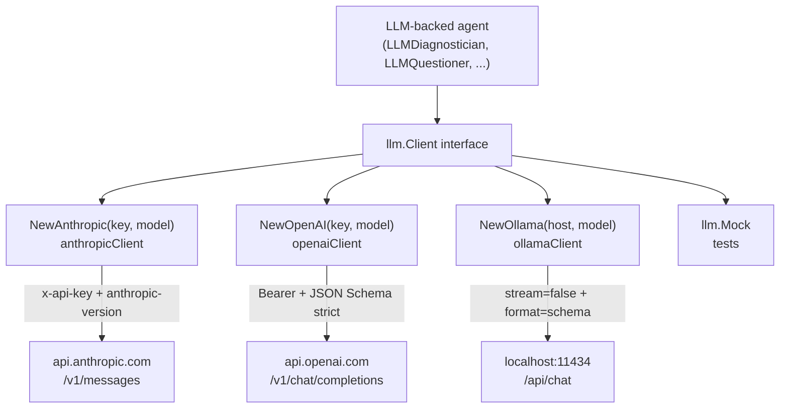
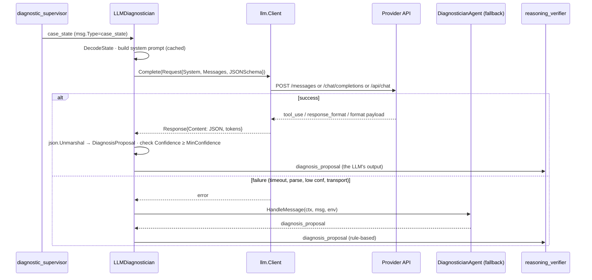
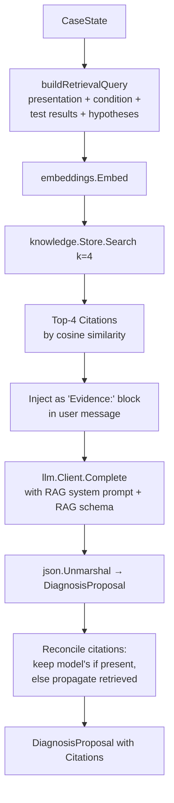
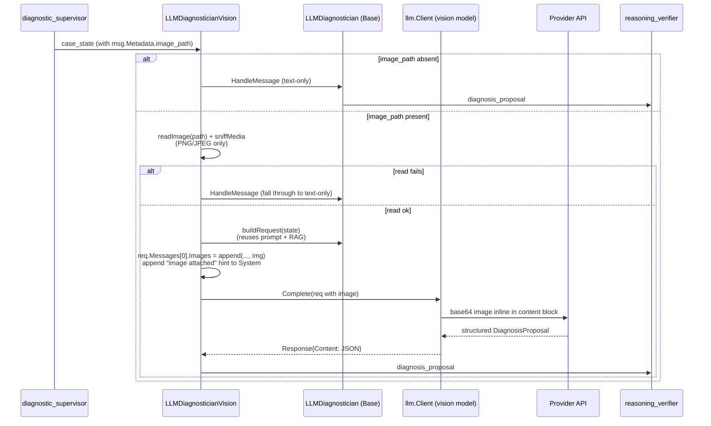
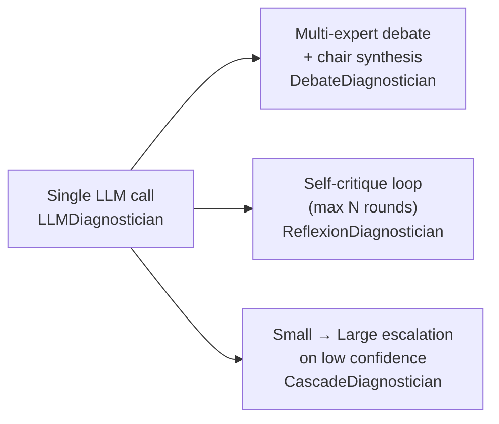

# Bodh — AI features deep-dive

This document is the architectural walkthrough of every AI feature Bodh ships today. It is the deep companion to the [`AI features`](../README.md#ai-features) section of the README, which is the elevator-pitch view. Here we cover internals, sample inputs and outputs, env vars, and gotchas for every feature in one place.

> Bodh is a research and engineering reference. It is not approved for clinical use. See the research disclaimer in the [main README](../README.md#%EF%B8%8F-research-disclaimer-read-first).

## Contents

1. [Provider matrix](#provider-matrix)
2. [LLM client abstraction (`pkg/llm`)](#llm-client-abstraction-pkgllm)
3. [LLM-backed diagnostician](#llm-backed-diagnostician)
4. [Retrieval-Augmented Generation (RAG)](#retrieval-augmented-generation-rag)
5. [Vision diagnostician](#vision-diagnostician)
6. [LLM-as-judge (`pkg/eval`)](#llm-as-judge-pkgeval)
7. [Safety guardrails (`pkg/safety`)](#safety-guardrails-pkgsafety)
8. [LLM call tracing (`pkg/observability`)](#llm-call-tracing-pkgobservability)
9. [Other LLM-backed agents](#other-llm-backed-agents)
10. [Agentic patterns: Debate, Reflexion, Cascade](#agentic-patterns-debate-reflexion-cascade)
11. [Environment variable reference](#environment-variable-reference)

---

## Provider matrix

The factory ([`agents/diagnostician_factory.go`](../agents/diagnostician_factory.go)) routes the `-diagnostician` flag to one of four backends. Embedding adapters live in [`pkg/embeddings`](../pkg/embeddings/) and follow the same pattern.

| Provider | Chat | Embeddings | Vision | API key env | Default chat model | Default embed model | Endpoint |
|----------|------|-----------|--------|-------------|--------------------|---------------------|----------|
| Anthropic | yes | via Voyage | yes (Sonnet, Opus) | `ANTHROPIC_API_KEY` | `claude-sonnet-4-6` | — (use Voyage) | `https://api.anthropic.com/v1/messages` |
| Voyage AI | — | yes | — | `VOYAGE_API_KEY` | — | `voyage-3` | `https://api.voyageai.com/v1/embeddings` |
| OpenAI | yes | yes | yes (`gpt-4o`) | `OPENAI_API_KEY` | `gpt-4o` | `text-embedding-3-small` (1536d) | `https://api.openai.com/v1/...` |
| Ollama (local) | yes | yes | yes (`llama3.2-vision`, `bakllava`) | — | `llama3.2` | `nomic-embed-text` (768d) | `http://localhost:11434` |

Capability detail:

- **Anthropic vision** — Claude Sonnet 4.6 / Opus accept inline base64 PNG/JPEG in the message content block.
- **Anthropic structured output** — implemented via a forced single-tool call (`tool_choice: {type: tool, name: ...}`). The adapter unwraps it into `Response.Content` as JSON.
- **OpenAI strict JSON Schema** — uses `response_format: {type: "json_schema", strict: true}` so the model is guaranteed to return valid JSON.
- **OpenAI tool use** — `tools` array with `type: function`. Adapter normalises both `tool_use` and `tools_calls` shapes.
- **Ollama JSON schema** — passed via `format` field (Ollama 0.5+). The adapter does a second `json.Unmarshal` on `Content` to verify validity before returning.
- **Ollama vision** — model must be vision-capable (`llama3.2-vision`, `bakllava`, `llava:13b`); images are base64-encoded into the `images` array on the message.

---

## LLM client abstraction (`pkg/llm`)

A single `Client` interface, three real adapters plus a `Mock` for tests.

```go
type Client interface {
    Provider() string
    Model() string
    Complete(ctx context.Context, req Request) (*Response, error)
}
```



`Request` carries the system prompt (with optional caching), a list of `Message{Role, Content, Images}`, max tokens, temperature, an optional `JSONSchema`, and an optional `Tools` array. `Response` carries the assistant text (or extracted JSON document), input/output/cached token counts, model identifier, stop reason, and any `ToolCalls` the model produced.

**Caveats:**
- No retry / rate-limit backoff. The `http.Client` has a 60s (Anthropic, OpenAI) or 120s (Ollama) timeout — callers (e.g. `LLMDiagnostician.Timeout`) wrap a shorter context.
- No streaming. Bus messages are request/response per agent step.
- When both `Tools` and `JSONSchema` are set, Anthropic prefers `JSONSchema` and silently ignores `Tools`.

---

## LLM-backed diagnostician

### Purpose
Replace the rule-based [`DiagnosticianAgent`](../agents/diagnostician.go) with one that asks an LLM to produce a structured `DiagnosisProposal` (diagnosis + confidence + differential + rationale, optionally citations). On any failure (timeout, JSON parse, transport, confidence below `MinConfidence`), it falls back to the rule-based agent — the case always finalizes.

### How to enable

```bash
# Anthropic
export ANTHROPIC_API_KEY=sk-ant-...
go run ./cmd/demo -diagnostician=llm-anthropic

# OpenAI
export OPENAI_API_KEY=sk-...
go run ./cmd/demo -diagnostician=llm-openai

# Ollama
ollama pull llama3.2
go run ./cmd/demo -diagnostician=llm-ollama
```

In Go:

```go
diag, err := agents.NewDiagnostician(agents.ProviderLLMAnthropic) // returns agent.Agent
_ = reg.Register(ctx, diag)
```

### Internals



The agent's ID is `"diagnostician"` — same as the rule-based one — so the supervisor's routing does not change. `CacheSystem: true` is set on the request so Anthropic and OpenAI bill cache reads after the first call.

### Sample input (CaseState passed to the LLM, abbreviated)

```json
{
  "case_id": "demo-case-001",
  "presentation": "58M, 5d productive cough, fever 38.9°C, SpO2 94% RA",
  "vitals": "T 38.9°C, HR 98, RR 22, SpO2 94%",
  "questions_asked": ["fever pattern?", "sick contacts?", "...", "..."],
  "answers": {"fever pattern?": "intermittent, peaks pm", "...": "..."},
  "tests_ordered": ["complete_blood_count", "chest_xray", "basic_metabolic_panel"],
  "test_results": {
    "complete_blood_count": "WBC 14.2 K, neutrophil predominance",
    "chest_xray": "RLL infiltrate / consolidation",
    "basic_metabolic_panel": "Within normal limits"
  },
  "hypotheses": ["CAP", "viral URI", "PE"],
  "total_cost_usd": 220,
  "max_cost_usd": 500
}
```

### Sample output (DiagnosisProposal, no RAG)

```json
{
  "diagnosis": "Community-acquired pneumonia",
  "confidence": 0.87,
  "differential": ["Community-acquired pneumonia", "Viral lower respiratory tract infection", "Influenza pneumonitis"],
  "rationale": "Productive cough with fever, SpO2 94% on RA, neutrophilic leukocytosis on CBC, and RLL consolidation on CXR are consistent with bacterial CAP. No findings to suggest CHF or PE."
}
```

### Sample log lines

```
[bodh] [diagnostician/llm] provider=anthropic model=claude-sonnet-4-6 diagnosis="Community-acquired pneumonia" confidence=87%
[bodh] [diagnostician/llm] rationale: Productive cough with fever, SpO2 94% on RA, ...
[bodh] [diagnostician/llm] tokens in=812 out=146 cached=624 stop=tool_use
[llm-trace] {"started_at":"2026-05-23T09:14:21Z","duration_ms":2438,"provider":"anthropic","model":"claude-sonnet-4-6","agent_id":"diagnostician","case_id":"demo-case-001","trace_id":"trace-demo-001","input_tokens":812,"output_tokens":146,"cached_tokens":624,"stop_reason":"tool_use","kind":"completion"}
```

### Caveats

- `MinConfidence` defaults to **0.3**. The LLM falls through to rule-based when the model emits a score below this — usually a sign of insufficient evidence in the CaseState.
- `Timeout` defaults to **30 seconds** for the LLM call (the surrounding HTTP client allows up to 60s for Anthropic/OpenAI, 120s for Ollama). Tune `LLMDiagnostician.Timeout` if you're using a slow local model.
- Prompt is **cached** (`CacheSystem: true`). First call on a fresh cache pays full input tokens; subsequent calls within the TTL pay cache-read tokens only.

---

## Retrieval-Augmented Generation (RAG)

### Purpose
Ground the diagnostician's rationale in retrieved clinical references so every claim is traceable to a source. Each [`DiagnosisProposal`](../pkg/medical/types.go) gains a `Citations[]` array with `{source, title, snippet, score}`.

### How to enable

```bash
# Anthropic + Voyage (recommended pairing)
export ANTHROPIC_API_KEY=sk-ant-...
export VOYAGE_API_KEY=pa-...
export BODH_KNOWLEDGE_CORPUS=./data/knowledge/corpus.json
go run ./cmd/demo -diagnostician=llm-anthropic
```

```bash
# OpenAI all-in-one (chat + embeddings under one key)
export OPENAI_API_KEY=sk-...
export BODH_KNOWLEDGE_CORPUS=./data/knowledge/corpus.json
go run ./cmd/demo -diagnostician=llm-openai
```

```bash
# Ollama all-local
ollama pull llama3.2
ollama pull nomic-embed-text
export BODH_KNOWLEDGE_CORPUS=./data/knowledge/corpus.json
go run ./cmd/demo -diagnostician=llm-ollama
```

The startup log confirms:

```
[demo] RAG enabled with 15 docs
[diagnostician/llm] rag retrieved 4 citations
```

### Internals



Salient code (`agents/diagnostician_llm.go`):

```go
query := buildRetrievalQuery(state)        // "presentation + condition + tests + hypotheses"
cits, _ := a.Knowledge.Search(ctx, query, k)  // k defaults to 4
// Inject as "Evidence:" prefix on user message
// Set RAG-aware system prompt + extended JSON schema
// Reconcile citations on output
```

When the model surfaces its own `citations` array, those win (the model picked exactly which references it used). When the model returns `citations` empty, the retrieved citations are propagated automatically so provenance is preserved regardless of model behaviour.

### `BODH_KNOWLEDGE_CORPUS`

The env var points at a JSON file. The shipped corpus ([`data/knowledge/corpus.json`](../data/knowledge/corpus.json)) contains 15 synthetic teaching documents (CAP × 2, ADHF × 2, PE × 2, sepsis × 2, T2DM, COPD, HTN, ACS, CKD, AKI, asthma) labelled `demo-synth`. Swap to your own corpus by setting the env var to a different path — no rebuild required.

### Corpus format

```json
{
  "_notice": "demo-synth — these documents are synthetic teaching prose...",
  "documents": [
    {
      "id": "cap-001",
      "source": "demo-synth",
      "title": "Community-Acquired Pneumonia — Diagnosis & Severity (CURB-65)",
      "content": "Suspect CAP in adults with new cough, fever, ...",
      "metadata": {
        "source": "demo-synth",
        "condition": "cap",
        "year": "2024",
        "tags": "cap,respiratory,severity,curb65"
      }
    }
  ]
}
```

To add documents: append entries to `documents`, ensure each `id` is unique, ensure `title` and `content` are non-empty. Restart the process — the store re-indexes at startup.

### Sample DiagnosisProposal with citations

```json
{
  "diagnosis": "Community-acquired pneumonia",
  "confidence": 0.89,
  "differential": ["Community-acquired pneumonia", "Viral lower respiratory infection", "Atypical pneumonia"],
  "rationale": "RLL consolidation on CXR with neutrophilic leukocytosis and SpO2 94% on RA matches the CURB-65 / IDSA CAP criteria. Severity is mild (CURB-65 likely 0–1), supporting outpatient management per the retrieved guideline.",
  "citations": [
    {
      "source": "demo-synth",
      "title": "Community-Acquired Pneumonia — Diagnosis & Severity (CURB-65)",
      "snippet": "Suspect CAP in adults with new cough, fever, pleuritic chest pain, or focal crackles, supported by a new infiltrate on chest radiograph…",
      "score": 0.81
    },
    {
      "source": "demo-synth",
      "title": "Community-Acquired Pneumonia — Outpatient Treatment",
      "snippet": "For previously healthy adults with mild CAP and no comorbidities, empirical outpatient therapy is amoxicillin 1 g three times daily…",
      "score": 0.74
    }
  ]
}
```

### Hybrid retrieval (vector + BM25 + RRF)

[`pkg/knowledge/hybrid.go`](../pkg/knowledge/hybrid.go) provides `NewHybridStore`, which runs both a cosine-similarity vector search and an Okapi BM25 lexical pass, then merges the two rankings via reciprocal-rank fusion (k=60). This catches **rare clinical terms** that pure vector search misses (e.g. specific drug names, ICD codes, acronyms like `BNP` or `LACE`). Use it by swapping `knowledge.NewInMemoryStore(embedder)` → `knowledge.NewHybridStore(embedder)` in the factory wiring.

### Caveats

- The shipped corpus is **demo-synth** — written for teaching, not clinical use. Replace with vetted content before any real evaluation.
- Search is **in-process** — RAM-bound. For >10k documents, swap the in-memory store for pgvector / Qdrant / Weaviate (Store interface is intentionally narrow).
- The retrieval query is composed deterministically from CaseState fields. If your case lacks `Condition` and `TestResults`, the query may be too generic for narrow matches.

---

## Vision diagnostician

### Purpose
Let the LLM diagnostician inspect a medical image (chest X-ray, ECG strip, dermatologic photo) alongside the text CaseState. The vision agent wraps `LLMDiagnostician` — same prompt, same fallback, same RAG.

### How to enable

The vision agent is opt-in by constructor (it does not replace `LLMDiagnostician`):

```go
diag, _ := agents.NewDiagnosticianVision(agents.ProviderLLMAnthropic, store)
```

Then pass `image_path` in the message metadata:

```json
{
  "case_id": "demo-img-001",
  "image_path": "/path/to/cxr.png",
  "max_cost_usd": 500,
  ...
}
```

The agent reads the file, sniffs MIME (PNG or JPEG only — what providers reliably support), and attaches it as an inline image on the (single) user message.

### Internals



The vision agent's ID is still `"diagnostician"` so routing is unchanged. The system prompt gets one extra line appended noting that an image is attached — the schema, RAG injection, and citation reconciliation logic are inherited from `LLMDiagnostician` verbatim.

### Sample case JSON with image

```json
{
  "case_id": "demo-img-001",
  "chief_complaint": "Cough and fever",
  "condition": "cap",
  "image_path": "/Users/me/cxr_rll_infiltrate.png",
  "gold_diagnosis": "Community-acquired pneumonia",
  "max_cost_usd": 500
}
```

### Sample log lines

```
[bodh] [diagnostician/vision] provider=anthropic model=claude-sonnet-4-6 diagnosis="Community-acquired pneumonia" confidence=90% image=image/png
[bodh] [diagnostician/vision] rationale: Right lower lobe airspace opacity on the attached PA chest radiograph, combined with leukocytosis and fever, supports CAP.
```

### Provider notes

| Provider | Vision models | Caveat |
|---|---|---|
| Anthropic | `claude-sonnet-4-6`, `claude-opus-4-x` | Up to 5 MB per image; PNG / JPEG / GIF / WEBP |
| OpenAI | `gpt-4o`, `gpt-4o-mini` | Supports multiple images per call |
| Ollama | `llama3.2-vision`, `bakllava`, `llava:13b` | Must explicitly pull a vision-capable model; default `llama3.2` is text-only |

### Caveats

- Bodh restricts MIME sniff to **PNG and JPEG** for portability. Other formats fall through to text-only.
- Failed reads (file missing, unsupported format) **log a warning and fall through to text-only** — they do not error out the case.
- DICOM is **not** decoded. Convert DICOM to JPEG before passing it (planned `pkg/imaging` would handle this for clinical use).

---

## LLM-as-judge (`pkg/eval`)

### Purpose
Grade a diagnostician's output against a gold-standard reference, returning a structured `Grade{Score, Pass, Rationale, DimensionalScores}`. Useful as a CI gate or in batch evaluation runs.

### How to enable

```go
import "github.com/PratikDhanave/bodh/pkg/eval"
import "github.com/PratikDhanave/bodh/pkg/llm"

client := llm.NewAnthropic(os.Getenv("ANTHROPIC_API_KEY"), "claude-sonnet-4-6")
judge := eval.NewLLMJudge(client)

grade, err := judge.Grade(ctx, eval.GradeItem{
    Scenario: "demo-case-001",
    Expected: "Community-acquired pneumonia",
    Actual:   "Community-acquired pneumonia",
    Context:  "CXR showed RLL infiltrate; WBC 14.2K",
})
```

For many items in parallel:

```go
grades, errs := eval.BatchGrade(ctx, judge, items) // fixed 4-worker pool
```

### Internals

```mermaid
flowchart TB
    Item[GradeItem<br/>scenario, expected, actual, context] --> Build[buildJudgePrompt<br/>user message]
    Build --> Call[llm.Client.Complete<br/>System=JudgeSystemPrompt (cached)<br/>JSONSchema=judgeSchema (strict)]
    Call --> Parse[json.Unmarshal]
    Parse --> Clamp[clamp01 each dimensional_score]
    Clamp --> Recompute[Pass = score >= PassThreshold (0.6)]
    Recompute --> Grade[Grade{Score, Pass, Rationale,<br/>DimensionalScores, Provider, Model}]
```

The system prompt is the literal `JudgeSystemPrompt` constant in [`pkg/eval/judge.go`](../pkg/eval/judge.go) — readable, auditable, version-controlled. Four rubric dimensions:

- **correctness** — does the working diagnosis match the gold standard (synonyms count)?
- **specificity** — is the diagnosis actionable, or a vague catch-all?
- **safety** — does the rationale stay within evidence? Penalise unsupported claims and missed red flags.
- **differential_quality** — did the output include a plausible differential?

`Pass` is **always recomputed** from `score >= PassThreshold` (`0.6`) — the model can't lie about passing.

### Sample Grade JSON

```json
{
  "score": 0.84,
  "pass": true,
  "rationale": "Diagnosis matches gold; rationale grounded in supplied evidence; differential is appropriately specific. Minor markdown: no severity stratification was given.",
  "dimensional_scores": {
    "correctness": 1.0,
    "specificity": 0.85,
    "safety": 0.9,
    "differential_quality": 0.7
  },
  "provider": "anthropic",
  "model": "claude-sonnet-4-6"
}
```

### Caveats

- The judge runs at `Temperature: 0.0` and `MaxTokens: 600` — deterministic and short.
- The default `PassThreshold` (0.6) is illustrative. Pick your own threshold per use case (regression gate vs. promotion gate).
- The rubric system prompt is `CacheSystem: true` — large batches pay cache-read tokens after the first call.

---

## Safety guardrails (`pkg/safety`)

### Purpose
Cheap, deterministic, in-process checks that run AFTER the LLM returns and BEFORE the agent emits. Not a replacement for HITL or model-level safety training — defence in depth.

### Three checks

| Function | Detects | Notes |
|---|---|---|
| `IsRefusal(text) bool` | Common refusal phrases (`"I cannot provide..."`, `"as an AI language model..."`, ...) | Substring match; tune `refusalPatterns` for false-positive rate |
| `CheckHallucination(claim, citations) Verdict` | Claim terms not grounded in any citation's snippet/title | Configurable threshold via `CheckHallucinationThreshold`; default 0.5 |
| `ContainsPHIPatterns(text) Verdict` | SSN (`123-45-6789`), MRN (`MRN: 1234567`), US phone shapes in model output | Conservative regex set — primary PHI defence is `pkg/phi.Redact` on inputs |

### Layering

```mermaid
flowchart TB
    Resp[LLM Response] --> Refuse{IsRefusal?}
    Refuse -->|yes| Fallback[Run rule-based fallback]
    Refuse -->|no| Hall{CheckHallucination<br/>(when RAG enabled)}
    Hall -->|low grounding| Fallback
    Hall -->|grounded| PHI{ContainsPHIPatterns?}
    PHI -->|yes| Reject[Reject + log + fallback]
    PHI -->|no| Emit[Emit diagnosis_proposal]

    Input[Agent input] -.redact first.-> Phi[pkg/phi.Redact] -.-> LLM[LLM call]
```

The two layers are complementary: **inputs are redacted by `pkg/phi.Redact` before reaching the LLM**; **outputs are scanned by `safety.ContainsPHIPatterns` after the LLM returns**. Neither alone is sufficient.

### Sample Verdict

```json
{"ok": false, "reason": "low grounding fraction 0.300 (< 0.500)"}
```

### Caveats

- `CheckHallucination` is a **term-overlap heuristic**, not NLI. Production deployments typically swap in a stricter checker (a second model or a dedicated NLI judge).
- Refusal patterns are tuned for current model phrasing; new model families may need additions.
- The PHI regexes are intentionally conservative — false positives are preferred to false negatives in clinical contexts.

---

## LLM call tracing (`pkg/observability`)

### Purpose
Emit one structured trace per LLM (or embedding) call, with provider, model, latency, token counts, cache hits, and stop reason. Default sink is stdout JSON; opt-in OTel forwarding for OTLP export.

### Internals

```mermaid
flowchart TB
    Agent[LLM-backed agent] --> Call[llm.Complete]
    Call --> Build[Build LLMTrace<br/>provider, model, duration_ms, tokens,<br/>cached, stop_reason, agent_id, case_id, trace_id]
    Build --> Log["StdLogger.RecordLLMCall<br/>emits as '[llm-trace] {json}' line"]
    Log --> Otel{BODH_OTEL_ENABLED=1<br/>AND otelHook installed?}
    Otel -->|yes| Hook[otelHook(LLMTrace)]
    Hook --> OTLP[(OTLP exporter<br/>→ OTel collector)]
    Otel -->|no| Done[no-op]
```

### Sample log line (one per call)

```
[llm-trace] {"started_at":"2026-05-23T09:14:21.143Z","duration_ms":2438,"provider":"anthropic","model":"claude-sonnet-4-6","agent_id":"diagnostician","case_id":"demo-case-001","trace_id":"trace-demo-001","input_tokens":812,"output_tokens":146,"cached_tokens":624,"stop_reason":"tool_use","kind":"completion"}
```

Decoded:

```json
{
  "started_at": "2026-05-23T09:14:21.143Z",
  "duration_ms": 2438,
  "provider": "anthropic",
  "model": "claude-sonnet-4-6",
  "agent_id": "diagnostician",
  "case_id": "demo-case-001",
  "trace_id": "trace-demo-001",
  "input_tokens": 812,
  "output_tokens": 146,
  "cached_tokens": 624,
  "stop_reason": "tool_use",
  "kind": "completion"
}
```

### Enabling OTel export

```go
// in cmd/*/main.go
otel := observability.NewOTLPLLMExporter("http://localhost:4318") // planned helper
observability.SetLLMOTelHook(otel.Record)
defer otel.Shutdown(ctx)
```

```bash
BODH_OTEL_ENABLED=1 go run ./cmd/care
```

Without `BODH_OTEL_ENABLED=1` the hook is skipped even if `SetLLMOTelHook` was called — opt-in at runtime.

### Caveats

- Default builds **do not link the OTel SDK** to keep the binary small and the dep graph minimal.
- `kind` is `"completion"` for chat calls and `"embedding"` for embedding calls (when callers populate it).
- The hook is process-global; one exporter per process.

---

## Other LLM-backed agents

Three more agents have drop-in LLM variants. Each ships with a rule-based fallback that runs on any per-call failure.

| Agent | LLM type | Factory | Capabilities (LLM build) | Env vars used |
|---|---|---|---|---|
| Questioner | `LLMQuestioner` | `agents.NewQuestioner(provider)` | `ask_question`, `history_taking`, `llm_backed` | `*_API_KEY`, `BODH_*_MODEL`, `OLLAMA_HOST` |
| Inbox Triage | `LLMInboxTriage` | `agents.NewInboxTriage(provider, taskQueue)` | `inbox_triage`, `message_routing`, `llm_backed` | same |
| Reasoning Verifier | `LLMReasoningVerifier` | `agents.NewReasoningVerifier(provider, hitl)` | `verify_reasoning`, `safety_check`, `llm_backed` | same |

### Questioner

Produces 3–5 context-relevant clinical history questions with simulated patient answers plus 3 most likely hypotheses, all in a strict JSON schema. Falls back to the rule-based `QuestionerAgent`'s canned questions on failure.

### Inbox triage

Classifies an inbound patient message into one of `refill | prior_auth | urgent_clinical | general` and extracts the medication (refill) or procedure code (prior auth). Routes to `refill_manager`, `prior_auth`, or the nurse task queue accordingly. Tuned to **prefer `urgent_clinical` when in doubt**.

### Reasoning verifier

Judges whether a `DiagnosisProposal`'s rationale is grounded in the supplied `CaseState` and the confidence isn't over-stated. Returns `{verified: bool, reason: string}`. When `HITL: true`, a verified diagnosis routes through `human_review` instead of going straight to the supervisor.

---

## Agentic patterns: Debate, Reflexion, Cascade

Three multi-call patterns ship alongside the single-call `LLMDiagnostician`. All are constructed via the factory and share the same fallback contract.



### Debate

`agents.NewDiagnosticianDebate(provider, store, specialists)` — runs multiple specialist LLM calls (cardiologist, pulmonologist, hospitalist, …), each emits a draft proposal, then a chair LLM synthesizes the final answer. Pass `nil` for specialists to use `DefaultSpecialists()`.

### Reflexion

`agents.NewDiagnosticianReflexion(provider, store, maxRounds)` — emit an initial proposal, then loop: ask the model to critique its own output against the CaseState, revise, repeat up to `maxRounds` (default 1). Useful for sharpening rationale and catching internally-inconsistent claims.

### Cascade

`agents.NewDiagnosticianCascade(provider, smallModel, largeModel, store)` — try the cheap/fast tier first; if its confidence is below the escalation threshold, run the large tier. Defaults per provider:

| Provider | Small tier | Large tier |
|---|---|---|
| Anthropic | `claude-haiku-4-5` | `claude-sonnet-4-6` |
| OpenAI | `gpt-4o-mini` | `gpt-4o` |
| Ollama | `llama3.2:3b` | `llama3.2` |

Each tier has its own rule-based fallback. The rule provider does not support cascading and is rejected.

### Status

The three pattern files (`diagnostician_debate.go`, `diagnostician_reflexion.go`, `diagnostician_cascade.go`) and factories ship in the `agents/` package today. Tests cover the happy path. Cross-cutting evaluation (Pareto vs. single-call latency / cost) and CLI flag wiring are **Phase 3 / 4 — in flight**.

---

## Environment variable reference

| Variable | Used by | Default | Description |
|---|---|---|---|
| `ANTHROPIC_API_KEY` | `-diagnostician=llm-anthropic`, Anthropic chat | (none) | Anthropic Messages API key |
| `BODH_ANTHROPIC_MODEL` | factory | `claude-sonnet-4-6` | Override Anthropic chat model |
| `OPENAI_API_KEY` | `-diagnostician=llm-openai`, OpenAI embeddings | (none) | OpenAI API key |
| `BODH_OPENAI_MODEL` | factory | `gpt-4o` | Override OpenAI chat model |
| `BODH_OPENAI_EMBED_MODEL` | RAG embedder selection | `text-embedding-3-small` | Override OpenAI embedding model |
| `OLLAMA_HOST` | Ollama chat + embeddings | `http://localhost:11434` | Local Ollama URL |
| `BODH_OLLAMA_MODEL` | factory | `llama3.2` | Override Ollama chat model |
| `BODH_OLLAMA_EMBED_MODEL` | RAG embedder selection | `nomic-embed-text` | Override Ollama embedding model |
| `VOYAGE_API_KEY` | Anthropic-path RAG embedder | (none) | Voyage AI key (Anthropic + Voyage pairing) |
| `BODH_VOYAGE_EMBED_MODEL` | Voyage embedder | `voyage-3` | Override Voyage embedding model |
| `BODH_KNOWLEDGE_CORPUS` | RAG | (unset) | Path to corpus JSON. Unset disables RAG entirely. |
| `BODH_OTEL_ENABLED` | observability | (unset) | `1` forwards LLMTraces to the installed OTel hook |

See [`.env.example`](../.env.example) for a copy-paste template covering the chat-only flow.

---

## Status summary

| Feature | Status | File(s) |
|---|---|---|
| LLM client abstraction | Done | `pkg/llm/` |
| Anthropic / OpenAI / Ollama adapters | Done | `pkg/llm/{anthropic,openai,ollama}.go` |
| Embeddings (OpenAI / Voyage / Ollama) | Done | `pkg/embeddings/` |
| Knowledge store (in-memory + hybrid) | Done | `pkg/knowledge/` |
| LLM diagnostician + RAG | Done | `agents/diagnostician_llm.go`, `diagnostician_factory.go` |
| Vision diagnostician | Done | `agents/diagnostician_vision.go` |
| LLM-as-judge | Done | `pkg/eval/judge.go` |
| Safety guards | Done | `pkg/safety/` |
| LLM trace + OTel hook | Done | `pkg/observability/llm_trace.go` |
| LLM Questioner / InboxTriage / Verifier | Done | `agents/{questioner,inbox_triage,reasoning_verifier}_llm.go` |
| Debate diagnostician | Done — Phase 3 in flight | `agents/diagnostician_debate.go` |
| Reflexion diagnostician | Done — Phase 3 in flight | `agents/diagnostician_reflexion.go` |
| Cascade diagnostician | Done — Phase 3 in flight | `agents/diagnostician_cascade.go` |
| MCP tool use across agents | Planned — Phase 4 | — |
| LLM HITL audit export | Planned — Phase 5 | — |
| HITL export CLI | Done | `cmd/export-hitl-feedback/main.go` |

For the canonical MARA platform / clinical-flow diagrams, see [diagrams.md](diagrams.md) (group **G. AI subsystem** is the LLM-specific view).

---

## Fine-tuning from HITL decisions

### Purpose
Every clinician decision on the HITL review queue ([`pkg/hitl`](../pkg/hitl/) + [`medical.ReviewRequest`](../pkg/medical/review.go)) is labelled training data. `approved` reviews are positive examples for SFT, `approved_with_modifications` are preference signals (the modification is preferred over the original), and `rejected` reviews are hard negatives. The [`cmd/export-hitl-feedback`](../cmd/export-hitl-feedback/main.go) binary replays a JSON dump of the queue into two parallel JSONL files that drop straight into HuggingFace `trl`, OpenAI's fine-tune API, or any messages-shaped SFT / DPO trainer.

### Workflow

```
cmd/care HTTP API   ──► HITL queue (pkg/hitl)
        │                     │
        ▼                     ▼
clinician decides      persisted as JSON dump
(bodhctl reviews ...)  ([]medical.ReviewRequest)
                              │
                              ▼
                  go run ./cmd/export-hitl-feedback
                              │
              ┌───────────────┴───────────────┐
              ▼                               ▼
        sft.jsonl                       dpo.jsonl
   (system/user/assistant)      (prompt/chosen/rejected)
```

### Run it

```bash
go run ./cmd/export-hitl-feedback \
    -in data/hitl-sample.json \
    -format both \
    -out-dir ./fine-tune-data
# Exported 5 SFT lines, 2 DPO pairs, 1 reviews skipped (no decision).
```

Flags: `-in` (defaults to `$HOME/.bodh/hitl-queue.json`), `-format=sft|dpo|both`, `-out-dir`, `-min-reviews=N` (warn-only), `-include-rejected=true|false`.

### Output shapes

`sft.jsonl` — one line per approved / modified / (optionally) rejected review:

```json
{"messages":[
  {"role":"system","content":"<diagnostician system prompt>"},
  {"role":"user","content":"<CaseState JSON>"},
  {"role":"assistant","content":"<approved or modified DiagnosisProposal JSON>"}
],"meta":{"review_id":"rev-cap-001","kind":"diagnosis_review","status":"approved","decided_at":"2026-05-23T09:05:00Z","reviewer_id":"dr-alice"}}
```

`dpo.jsonl` — one line per `{chosen, rejected}` pair (built from `approved_with_modifications` or from an `approved` + `rejected` sharing a `case_id`):

```json
{"prompt":{"system":"<diagnostician system prompt>","user":"<CaseState JSON>"},
 "chosen":"<preferred DiagnosisProposal JSON>",
 "rejected":"<original or rejected DiagnosisProposal JSON>",
 "meta":{"source":"approved_with_modifications","review_id":"rev-chf-001"}}
```

The system prompt is a `const` in `cmd/export-hitl-feedback/main.go` that mirrors `diagnosticianSystemPrompt` in [`agents/diagnostician_llm.go`](../agents/diagnostician_llm.go), so a model fine-tuned on these examples behaves like the LLM diagnostician under the same prompt.

### Caveats

- The current dump format is a static JSON file — convenient for the demo. A future DB-backed exporter will plug into the same `[]medical.ReviewRequest` shape.
- DPO pairs from `(approved, rejected)` are matched by `case_id`. Reviews without a `case_id` cannot be paired across reviewers.
- Empty input or zero decided reviews still produce empty output files and exit 0 so CI pipelines stay green during the bootstrapping phase.

---
