# Bodh — Architecture & Flow Diagrams

Fourteen interactive [Archify](https://github.com/tt-a1i/archify) diagrams covering the
whole system, generated from and validated against the codebase. Each **SVG renders inline
on GitHub**; each links to a **self-contained interactive HTML** (pan, zoom, light/dark
theme, guided views) — open it locally or serve it. Source specs live in
[`diagrams/archify/`](diagrams/archify/).

> Complements the two shipped PNGs ([`Architecture.png`](../Architecture.png),
> [`architectureflow.png`](../architectureflow.png)) and the 25 Mermaid views in
> [`diagrams.md`](diagrams.md).

---

## Platform & core flows

### 1 · Platform architecture (MARA)
One Go binary: clients → orchestrator → in-process bus → agents, gated by governance, HITL and an append-only audit log.

▶ <a href="diagrams/platform.architecture.html">Interactive</a>

### 2 · Sequential diagnosis — virtual physician panel
The MAI-DxO / SD-Bench loop: presentation → history → cost-guarded tests → diagnosis → verify → HITL gate → final diagnosis.

▶ <a href="diagrams/diagnosis.sequence.html">Interactive</a>

### 3 · Human-in-the-loop gate
Fail-closed oversight: every consequential action is wrapped as a `review_request`, queued, and either approved (resumed) or rejected (halted).

▶ <a href="diagrams/hitl.workflow.html">Interactive</a>

### 4 · Care-services workflows
Chronic-disease (CDM), transitions (TCM) and panel pathways run on the same bus and fan into patient engagement.

▶ <a href="diagrams/care-services.dataflow.html">Interactive</a>

### 5 · LLM → rule fallback
Every LLM-backed agent degrades to its deterministic rule sibling on refusal, timeout or failed grounding — so the case always finalizes.

▶ <a href="diagrams/fallback.lifecycle.html">Interactive</a>

### 6 · Audit &amp; observability
Every message forks into a PHI-minimized, append-only audit log (Merkle-chained) and hashed-`case_id` spans — raw MRNs never leave the process.

▶ <a href="diagrams/audit.dataflow.html">Interactive</a>

---

## Subsystems

### 7 · Authentication &amp; session
JWT login (HS256, bcrypt) → Bearer-gated `/api/*` → a 401 clears the token and redirects to login.

▶ <a href="diagrams/auth.sequence.html">Interactive</a>

### 8 · Governance policy chain
Every message passes a fail-closed policy chain (structural → authz → clinical) before it reaches an agent; deny is audited.

▶ <a href="diagrams/governance.workflow.html">Interactive</a>

### 9 · Retrieval-Augmented Generation
Hybrid vector + BM25 retrieval, reciprocal-rank fusion and rerank produce cited clinical context for the diagnostician.

▶ <a href="diagrams/rag.dataflow.html">Interactive</a>

### 10 · LLM provider abstraction
One `llm.Client` interface, a budget-aware cost router, and swappable cloud / local / in-process providers.

▶ <a href="diagrams/llm-providers.architecture.html">Interactive</a>

### 11 · Clinical case lifecycle
A case's status from intake to finalized, pausing at the HITL gate; over-budget or timeout is terminal.

▶ <a href="diagrams/case.lifecycle.html">Interactive</a>

---

## Interop, evaluation &amp; operations

### 12 · Healthcare interop ingest
HL7 v2 and FHIR R4 sources are parsed, normalized to a `PatientPresentation` and published to the bus.

▶ <a href="diagrams/interop.dataflow.html">Interactive</a>

### 13 · SD-Bench evaluation
Case fixtures run through the pipeline; accuracy and cost feed a Pareto view gated on a saved baseline.

▶ <a href="diagrams/sdbench.dataflow.html">Interactive</a>

### 14 · Deployment topology (Kubernetes)
Distroless care pod behind Ingress, guarded by NetworkPolicy, scaled by HPA, with Postgres, ExternalSecrets and OTLP.

▶ <a href="diagrams/deployment.architecture.html">Interactive</a>

---

Diagrams generated with [Archify](https://tt-a1i.github.io/archify/). Every diagram passed
Archify's `showcase` validation (9/9 artifact checks, 0 warnings). To regenerate one, edit its
spec under `diagrams/archify/` and re-run `archify deliver <type> <spec>.json <out>.html`.
