# Bodh — Architecture diagrams

This file is the visual index of the Bodh platform. It is the deep companion to the [main README](../README.md), which keeps the two canonical PNGs and a short summary. The 25 mermaid diagrams below stay in sync with the source tree as agents and packages evolve.

Start with the two PNGs referenced in the README (`Architecture.png` and `architectureflow.png`), then drill into the mermaid views below, grouped A–F by topic.

> **Legend (mermaid sections):** rounded boxes = agents or services · cylinders = data stores · dashed lines = optional / async · solid lines = synchronous calls or message hops · `human_review` gate is always shown explicitly.

---

## 0. Canonical platform diagrams (start here)

### Platform architecture — [`Architecture.png`](../Architecture.png)

The Microsoft-style **Multi-Agent Reference Architecture (MARA)** mapping — user, application, orchestrator, classifier, registry, knowledge/storage, supervisor/worker agents, MCP, observability, evaluation.

<p align="center">
  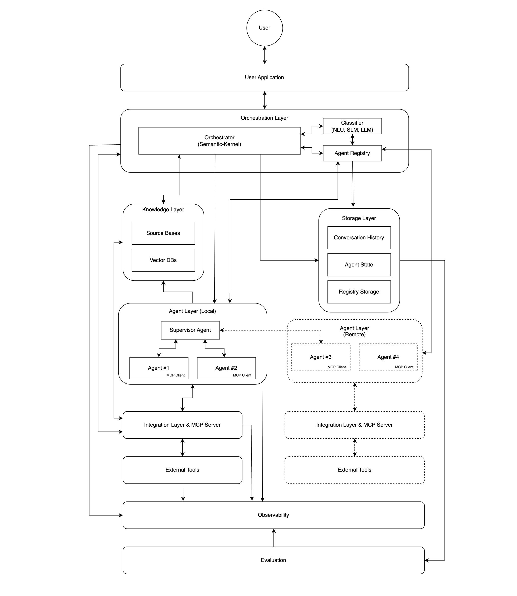
</p>

**How each box maps to the Go code:**

| Area on diagram | Bodh implementation | Go path |
|-----------------|---------------------|---------|
| User / User application | Entry that publishes the first `protocol.Message` | `cmd/demo`, `cmd/caredemo`, `cmd/care` (HTTP), `cmd/bodhctl` (CLI) |
| Orchestrator | Subscribes agents, runs governance, calls `HandleMessage`, republishes outputs | `pkg/orchestration` |
| Classifier | Route intent (chest pain vs rash, refill vs urgent) | `inbox_triage` agent · future `pkg/classifier` |
| Agent registry | Lists agents, resolves capabilities | `pkg/registry` |
| Knowledge layer | Guidelines, differentials, RAG | Planned: DB + vector index |
| Storage layer | Case + roster + queue + reviews + audit | `pkg/memory`, `pkg/persistence` (JSON file), `pkg/audit` (append-only) · planned PostgreSQL |
| Supervisor agent | Decompose diagnosis | `agents/supervisor.go` |
| Workers | Intake, questioner, tests, cost, dx, verify, CDM/TCM/panel/VO/RPM/engagement/readmission/human-review | `agents/*.go` (17 agents + HITL gate) |
| Integration / MCP / tools | Labs, imaging, LLM APIs, FHIR, HL7 v2 | `pkg/fhir` (today) · planned MCP tools |
| Governance | Allow/deny boundary; PHI redaction | `pkg/governance`, `pkg/phi` |
| Observability | Logs, traces, clocks, audit | `pkg/observability`, `pkg/audit` |
| Evaluation | Accuracy vs gold, cost metrics | `pkg/eval` + `cmd/bench` |

### Clinical flow — [`architectureflow.png`](../architectureflow.png)

End-to-end **sequential diagnosis** for one case: presentation → RPM monitor → history → tests (with cost check + rework loop) → diagnosis → reasoning verification → human sign-off → final report. The Bodh expression of [MAI-DxO](https://microsoft.ai/news/the-path-to-medical-superintelligence/)'s virtual physician panel.

<p align="center">
  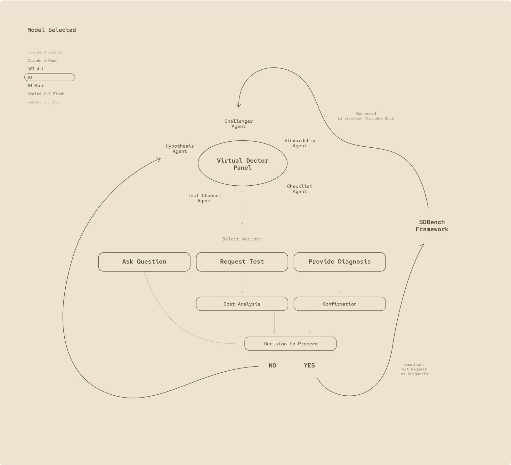
</p>

**Why images sometimes do not show on GitHub**

| Cause | Fix |
|-------|-----|
| WebP in README | GitHub support is inconsistent; this repo displays the **PNG** export |
| Very large PNG | The README uses HTML `width` so the PNG scales in the browser |
| File not on `main` | Images must be committed on the branch you view |
| Broken relative path | Use `./Architecture.png` from README root |

> The mermaid sections below are the live, in-code companion to these two PNGs — they stay in sync with the source tree as agents are added.

---

## A. Bird's-eye views

### 1. System context (level 1) — Bodh in its world

The actors and external systems Bodh exchanges data with.

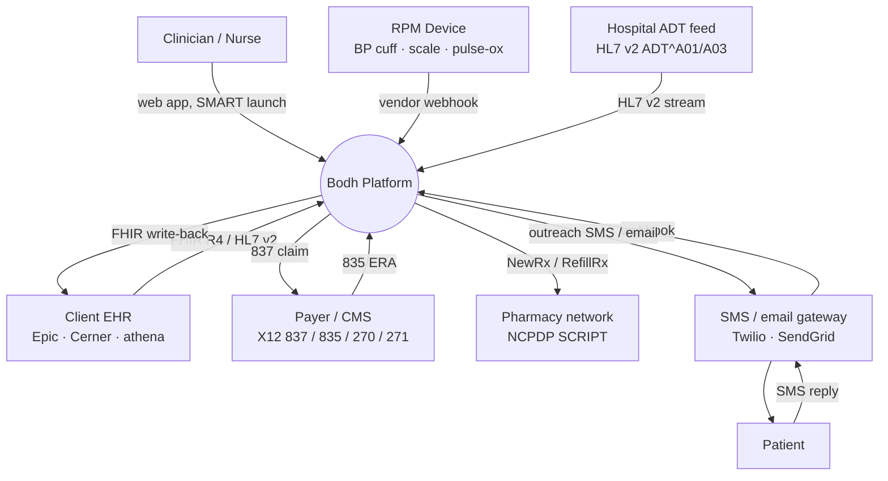

### 2. MARA platform — building blocks → Go packages

Where each MARA concept lives in the codebase.

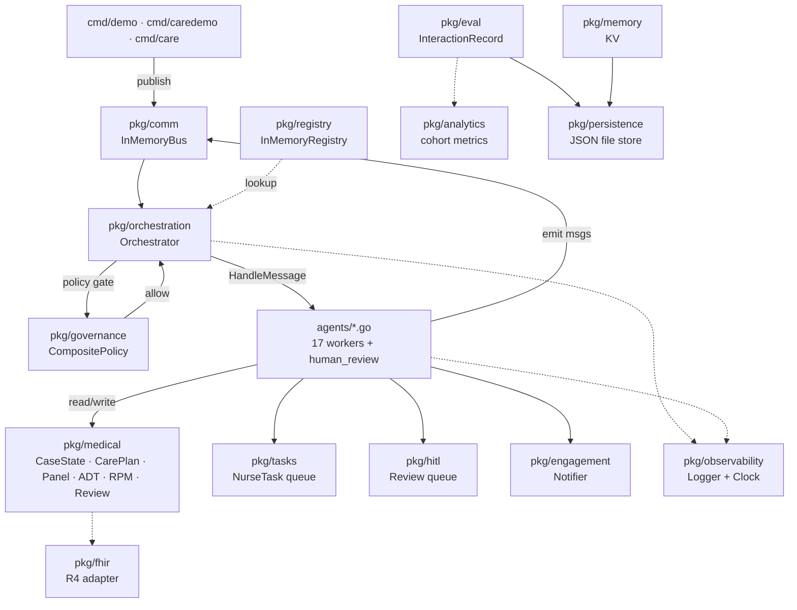

### 3. Logical layers — request through the stack

The same architecture from the message-handling perspective, top-to-bottom.

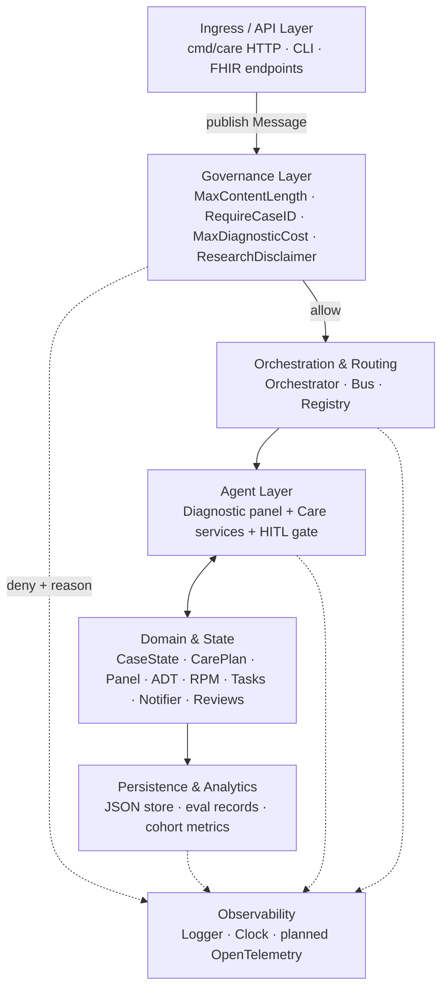

---

## B. Control plane

### 4. Message lifecycle — what happens to one Message

Every interaction in Bodh is a `protocol.Message`. This is its lifecycle.

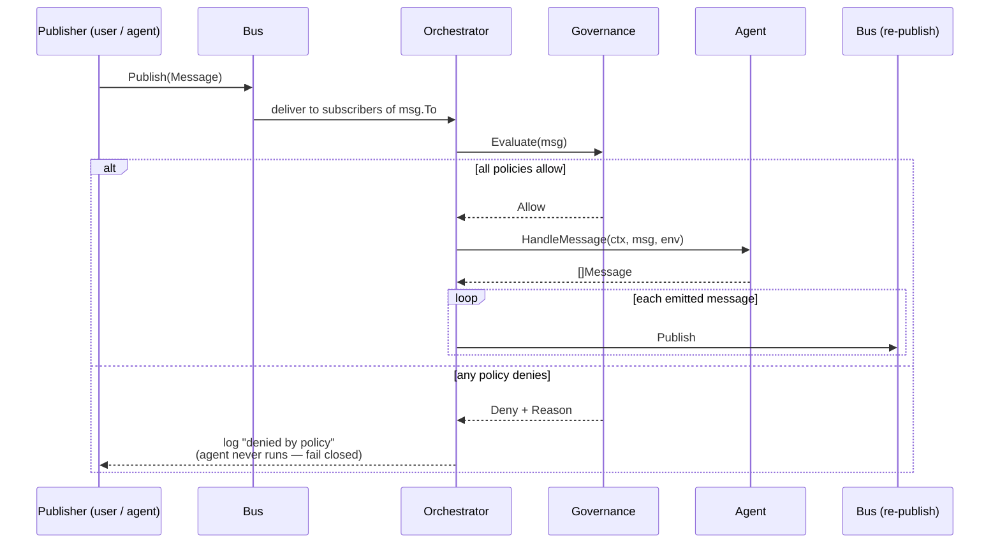

### 5. Governance pipeline — composite policy

How `CompositePolicy` short-circuits on the first deny.

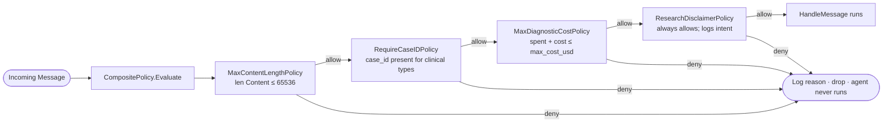

### 6. Package dependency graph

The Go module's actual import structure (no cycles).

```mermaid
flowchart LR
    cmd_demo[cmd/demo]
    cmd_caredemo[cmd/caredemo]
    cmd_care[cmd/care]
    A[agents]
    PA[pkg/agent]
    PProto[pkg/protocol]
    PReg[pkg/registry]
    PComm[pkg/comm]
    POrch[pkg/orchestration]
    PGov[pkg/governance]
    PMed[pkg/medical]
    PTasks[pkg/tasks]
    PEng[pkg/engagement]
    PHitl[pkg/hitl]
    PFhir[pkg/fhir]
    PAnal[pkg/analytics]
    PEval [pkg/eval]
    PPers[pkg/persistence]
    PMem[pkg/memory]
    PObs[pkg/observability]

    cmd_demo --> A
    cmd_caredemo --> A
    cmd_caredemo --> PHitl
    cmd_care --> A
    cmd_care --> PHitl
    A --> PA
    A --> PMed
    A --> PTasks
    A --> PEng
    A --> PHitl
    A --> PEval
    PA --> PProto
    PComm --> PProto
    POrch --> PReg
    POrch --> PComm
    POrch --> PGov
    POrch --> PA
    POrch --> PObs
    PGov --> PProto
    PReg --> PA
    PHitl --> PMed
    PFhir --> PMed
    PAnal --> PMed
    PAnal --> PEval
    PPers --> PEval
```

---

## C. State machines & domain logic

### 7. HITL review lifecycle — state machine

The human-in-the-loop gate from submission to resume.

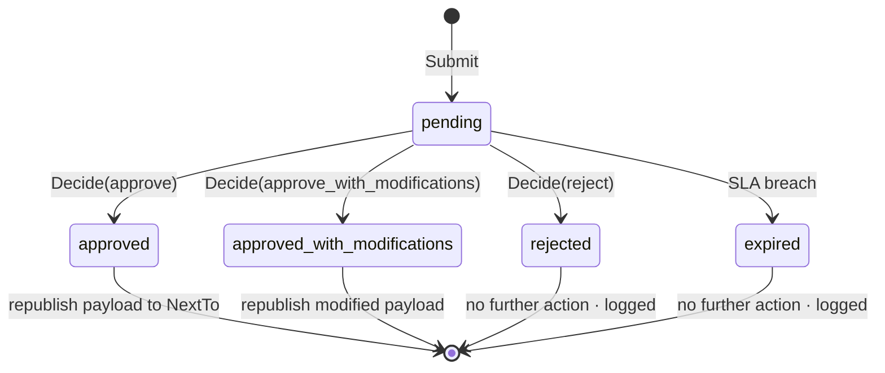

### 8. Billing period state machine (CMS programs)

Care-time accumulation per patient per program per month — the unit of revenue.

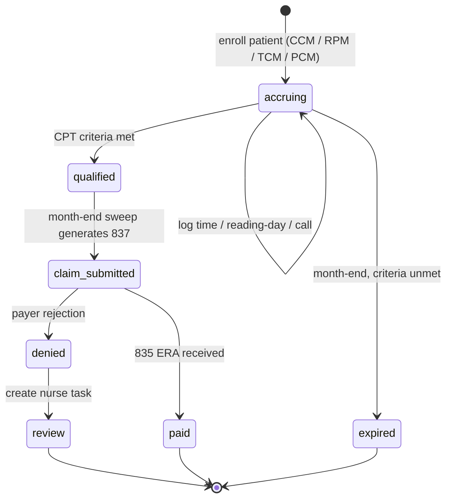

### 9. Nurse task lifecycle (`pkg/tasks`)

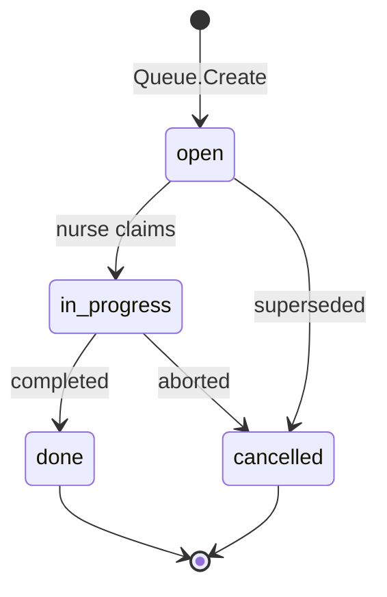

### 10. CarePlan template selection

`medical.BuildCarePlan` is deterministic and reproducible by condition.

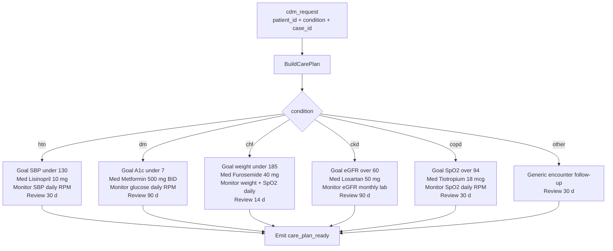

### 11. Master Patient Index — matching pipeline

Three-stage matching (deterministic shortcut → blocking → Fellegi-Sunter scoring → threshold). Safety-critical: a wrong merge blends two patients into one chart.

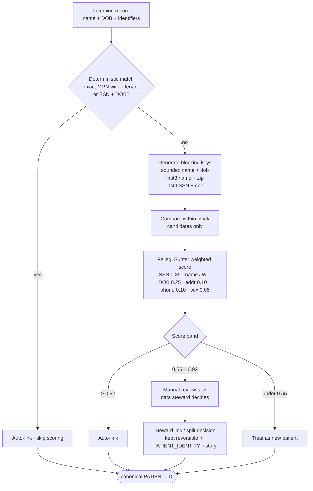

### 12. Inbox triage decision tree (`inbox_triage`)

Classify → route. Refill and PA decisions cascade through HITL when enabled.

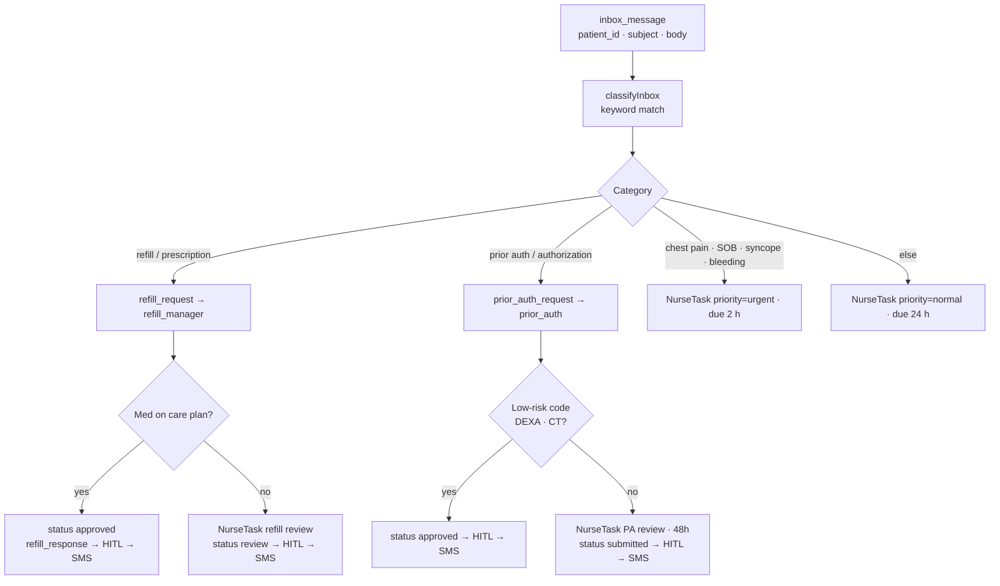

---

## D. Diagnostic flow

### 13. Sequential diagnosis (MAI-DxO panel) — sequence

The eight-agent virtual physician panel.

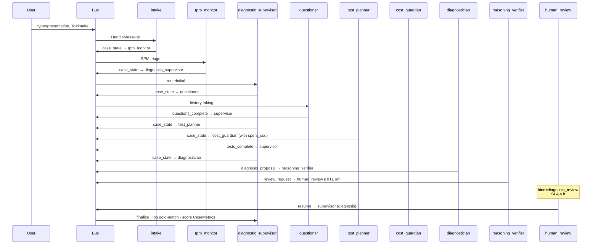

### 14. Cost guardian — budget check decision

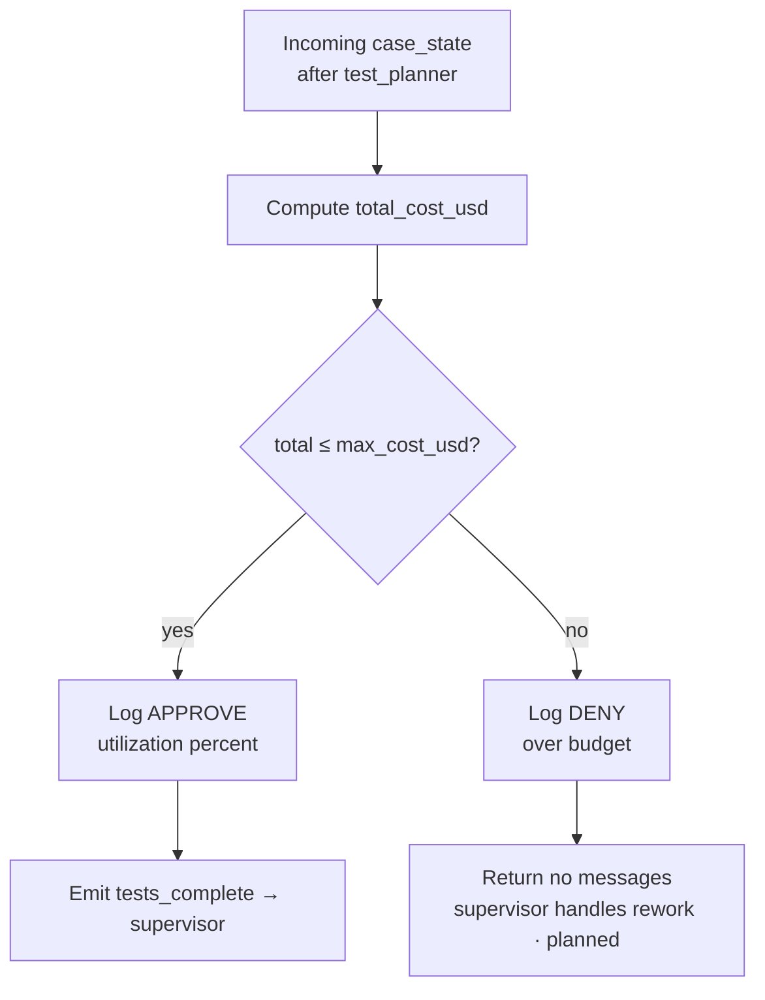

---

## E. Care-services flows

### 15. CDM (chronic disease management) — with HITL

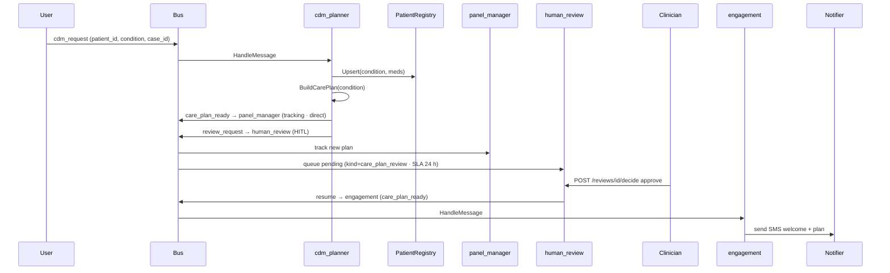

### 16. TCM (transitional care) — full cascade from ADT

The most involved cascade in Bodh: ADT → risk → discharge review → TCM tasks → welcome review → patient SMS.

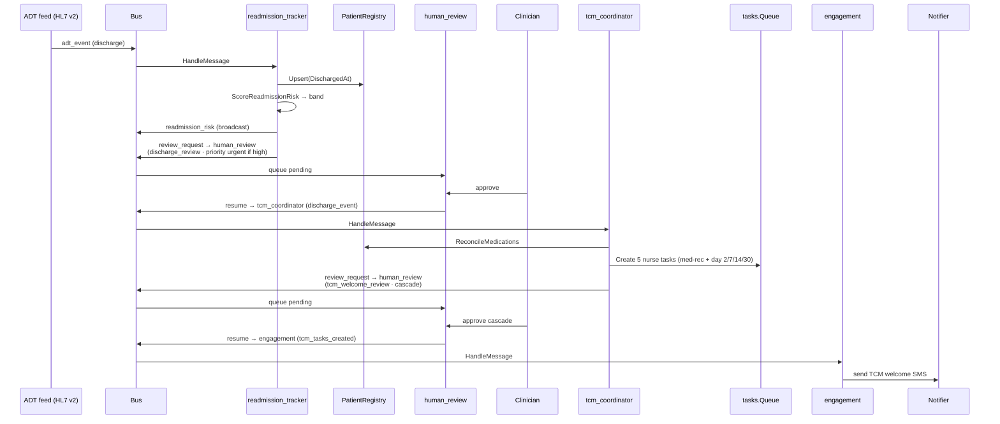

### 17. Panel management — population gap-in-care detection

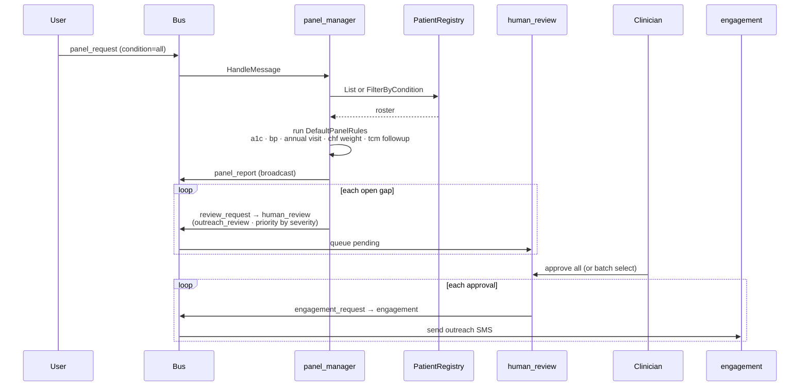

### 18. RPM (remote patient monitoring) real-time pipeline

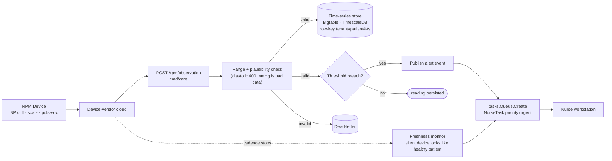

### 19. Readmission risk scoring decision

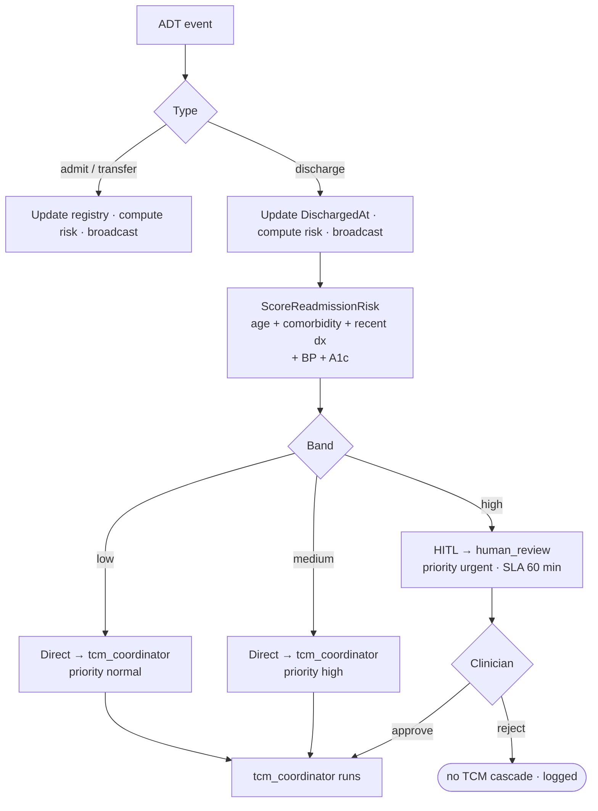

### 20. End-to-end patient journey — one CHF patient over 30 days

A composite scenario showing how multiple flows interact for a real patient.

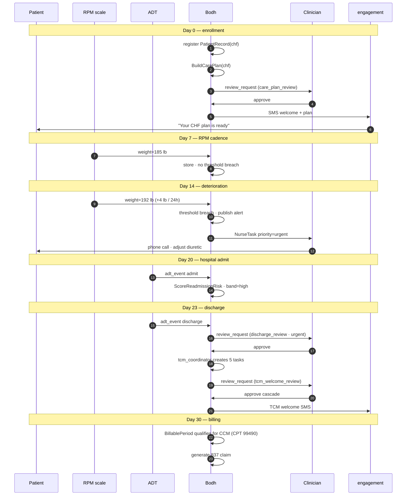

---

## F. Deployment & infrastructure

### 21. GCP deployment topology

Production reference architecture on Google Cloud (BAA, Assured Workloads, VPC Service Controls).

```mermaid
flowchart TB
    subgraph External[External]
        EHR[Client EHRs]
        Device[RPM Devices]
        Nurse[Nurses · browser]
    end

    subgraph GCP[Google Cloud · BAA · VPC Service Controls perimeter]
        subgraph Edge[Edge]
            CA[Cloud Armor WAF]
            LB[Global HTTPS LB]
            APIGW[Apigee API Gateway]
        end
        subgraph Ingestion[Ingestion]
            CHC[Cloud Healthcare API<br/>FHIR + HL7v2 stores]
            PubSub[Pub/Sub]
            Dataflow[Dataflow streaming]
        end
        subgraph Services[Services · stateless]
            GKE[GKE Bodh microservices]
            CR[Cloud Run RPM ingest]
        end
        subgraph Data[Data]
            AlloyDB[(AlloyDB Postgres<br/>operational)]
            Bigtable[(Bigtable<br/>RPM time-series)]
            CS[(Cloud Storage<br/>documents)]
            BQ[(BigQuery<br/>analytics)]
        end
        subgraph Security[Security]
            KMS[Cloud KMS]
            SM[Secret Manager]
            IAM[Cloud IAM + IAP]
        end
    end

    Device -->|webhook| APIGW
    EHR -->|FHIR / HL7| CHC
    Nurse -->|HTTPS + OIDC| CA
    CA --> LB
    LB --> GKE
    APIGW --> PubSub
    APIGW --> CR
    CR --> PubSub
    CHC --> PubSub
    PubSub --> Dataflow
    Dataflow --> AlloyDB
    Dataflow --> Bigtable
    GKE --> AlloyDB
    GKE --> Bigtable
    GKE --> CS
    AlloyDB -.Datastream CDC.-> BQ
    GKE -.-> KMS
    GKE -.-> SM
    GKE -.-> IAM
```

### 22. AWS deployment topology

Parallel reference on AWS (BAA-eligible services, multi-AZ).

```mermaid
flowchart TB
    subgraph ExternalA[External]
        EHRa[Client EHRs]
        DeviceA[RPM Devices]
        NurseA[Nurses · browser]
    end

    subgraph AWS[AWS · BAA · VPC private subnets]
        subgraph EdgeA[Edge]
            WAF[AWS WAF]
            ALB[Application LB]
            APIGW2[API Gateway]
        end
        subgraph IngestA[Ingestion]
            EventBridge[EventBridge]
            Kinesis[Kinesis Firehose]
            Lambda[Lambda parsers]
        end
        subgraph ComputeA[Compute]
            EKS[EKS / ECS Fargate<br/>Bodh microservices]
        end
        subgraph DataA[Data]
            RDS[(RDS Postgres<br/>operational)]
            Timestream[(Timestream<br/>RPM time-series)]
            S3[(S3 KMS-encrypted<br/>documents)]
            Redshift[(Redshift<br/>analytics)]
        end
        KMSA[KMS CMK]
        SMA[Secrets Manager]
        IAMA[IAM + IAM Roles for SA]
        CT[CloudTrail<br/>separate audit account]
    end

    DeviceA --> APIGW2
    EHRa --> APIGW2
    NurseA --> WAF
    WAF --> ALB
    ALB --> EKS
    APIGW2 --> EventBridge
    EventBridge --> Kinesis
    Kinesis --> Lambda
    Lambda --> RDS
    Lambda --> Timestream
    EKS --> RDS
    EKS --> Timestream
    EKS --> S3
    RDS -.DMS CDC.-> Redshift
    EKS -.-> KMSA
    EKS -.-> SMA
    EKS -.-> IAMA
    EKS -.->|all API calls| CT
```

### 23. Multi-tenant isolation

How `tenant_id` enforces blast-radius boundaries across the stack.

```mermaid
flowchart TB
    Req[Client request<br/>tenant claim in JWT] --> GW[API Gateway · validate JWT]
    GW --> Ctx[Set tenant_id in request context]
    Ctx --> AppA[App tier<br/>tenant filter set on every query]
    AppA --> RLS{Row-level security}
    RLS -->|small/medium tenant| Shared[(Shared Postgres<br/>RLS predicate<br/>tenant_id = current_tenant)]
    RLS -->|very large tenant| Dedicated[(Dedicated DB instance<br/>cell isolation)]
    AppA --> BusM[Per-tenant Pub/Sub subscriptions<br/>or ordering keys]
    BusM --> Workers[Worker pool · tenant-tagged]
    Workers --> Quota[Per-tenant Dataflow quota<br/>noisy neighbor cap]
```

### 24. HIPAA security architecture (defense-in-depth)

Where each Security-Rule technical safeguard lives.

```mermaid
flowchart TB
    User[Clinician or patient request] --> IdP[OIDC IdP<br/>SMART on FHIR · OIDC]
    IdP -->|access token + id token| GW[API Gateway<br/>JWT validation · WAF · rate limit · IP allowlist]
    GW -->|mTLS| API[Bodh API · 8088]
    API --> Scope[Scope check<br/>RequireScopePolicy]
    Scope --> Tenant[Tenant check<br/>RequireTenantPolicy]
    Tenant --> Authz[Centralized chokepoint<br/>per-resource RBAC]
    Authz -->|allow| Read[Read PHI]
    Authz -->|allow| Write[Write PHI]
    Read --> AuditL[(Audit log · immutable<br/>separate locked account<br/>WORM 6+ years)]
    Write --> AuditL
    Read --> DB[(DB · TLS in-transit<br/>KMS CMK at-rest<br/>column-level encrypt for PHI)]
    Write --> DB
    DB -.replicated.-> Backup[(Cross-region backup · KMS)]
    Authz -->|deny| AuditL

    style AuditL fill:#fdd,stroke:#900
    style DB fill:#dfd,stroke:#070
```

### 25. CI/CD + delivery pipeline

What runs before code reaches production.

```mermaid
flowchart LR
    Dev[Developer push] --> CI{CI pipeline<br/>Cloud Build · GitHub Actions}
    CI --> UT[go test]
    CI --> Vet[go vet · staticcheck · gosec]
    CI --> Vuln[govulncheck]
    CI --> Pol[Policy-as-code<br/>fail if unencrypted bucket<br/>or public DB]
    CI --> Scan[Container CVE scan]
    UT --> Build[Build container]
    Vet --> Build
    Vuln --> Build
    Pol --> Build
    Scan --> Build
    Build --> Reg[Container registry · signed]
    Reg --> Canary[Canary 5 percent traffic]
    Canary --> SLO{SLO healthy 30 min?}
    SLO -->|yes| Roll[Progressive rollout 100 percent]
    SLO -->|no| RB[Auto-rollback]
    Roll --> Prod[Production]
    RB --> Dev
```

---

> The two PNG references — [Architecture.png](../Architecture.png) (MARA platform) and [architectureflow.png](../architectureflow.png) (sequential diagnosis flow) — are the original Microsoft-style platform views. The mermaid diagrams above are the in-code interactive index that stays in sync with the source tree.
