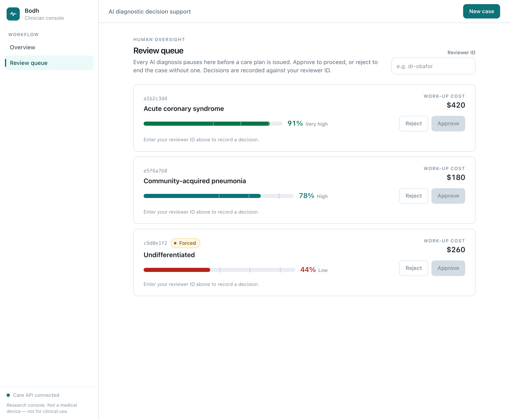
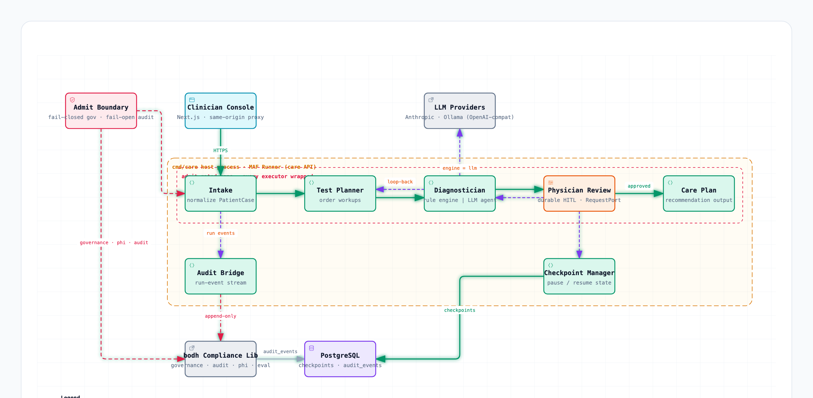
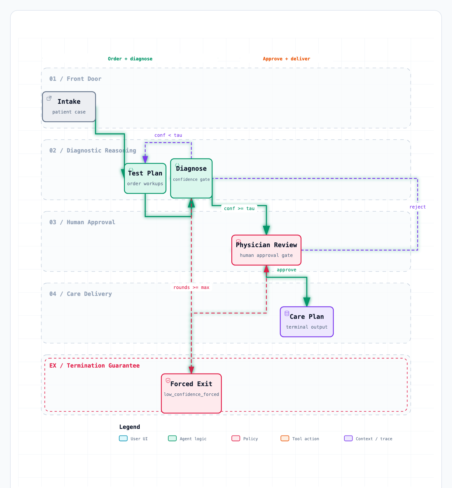
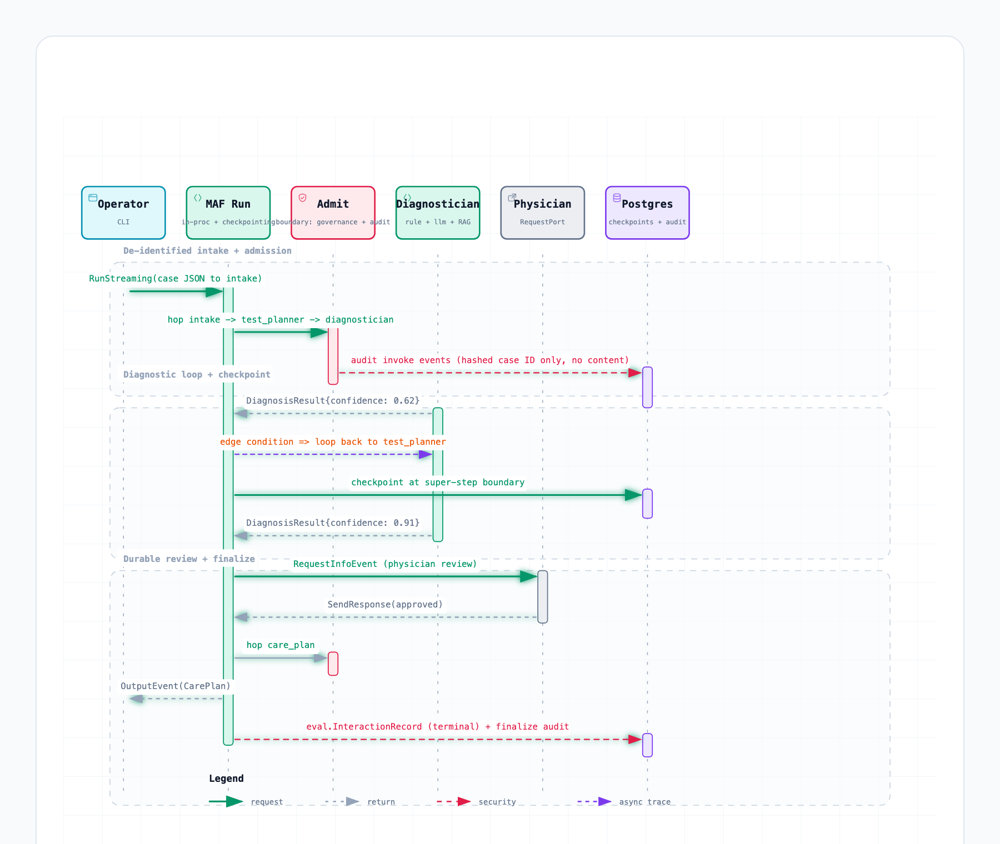
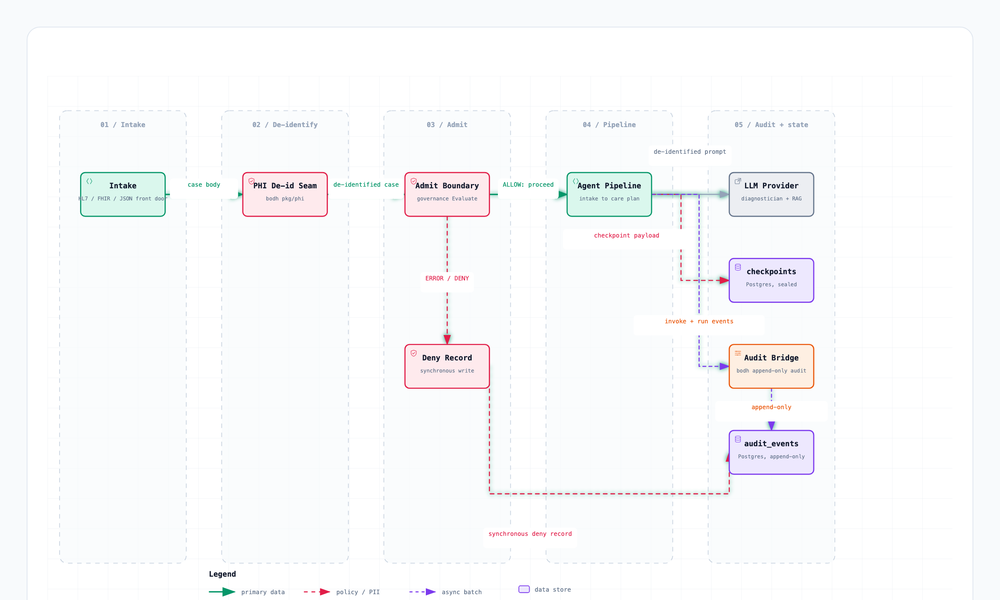

<div align="center">

# Bodh-MAF

**Bodh's clinical-AI pipeline, rebuilt on the [Microsoft Agent Framework for Go](https://github.com/microsoft/agent-framework-go).**


</div>

Bodh-MAF reimplements the smallest clinically meaningful slice of [Bodh](https://github.com/PratikDhanave/bodh)'s diagnostic pipeline — intake → test planning → diagnosis → physician review → care plan — on Microsoft's Agent Framework for Go (MAF-go). It exists to answer one question with tests rather than opinion:

> **Can a general agent framework carry a clinical safety boundary as faithfully as a purpose-built one?**

The answer is measured against five exit criteria (all proven), covering admission control, PHI-free auditing, durable human review, provider swapping, and evaluation.

> [!WARNING]
> **Not a medical device. Not for clinical use.** Research and education only. All example data is synthetic.

<p align="center">
  
  <br />
  <em>The clinician console — every AI diagnosis pauses for physician review before a care plan is issued.</em>
</p>

## Contents

- [Features](#features)
- [Architecture](#architecture)
- [Quickstart](#quickstart)
- [Project structure](#project-structure)
- [Testing &amp; evidence](#testing--evidence)
- [Project status](#project-status)
- [Contributing](#contributing)
- [License &amp; use](#license--use)

## Features

- **A clinical pipeline as an agent graph** — five stages with a diagnostician **loop-back** for more work-ups and a bounded-retry termination guarantee.
- **A safety boundary on every step** — fail-closed governance (a policy error denies), fail-open audit (a failed audit write never blocks care), and PHI stripped before anything reaches an LLM, checkpoint, or log.
- **Durable human review** — the physician-review gate pauses the run and **survives a process restart**, backed by a Postgres checkpoint store.
- **Swappable diagnosis engines** — a deterministic rule engine or an LLM (Anthropic, or Ollama for local models), behind one graph node. Malformed model output can never become a diagnosis.
- **Cost-aware and measurable** — per-case cost is tracked through the pipeline, and an SD-Bench harness gates accuracy and mean cost in CI.
- **Multiple front doors** — native JSON, HL7 v2 / FHIR R4 ingestion, an HTTP **Care API**, and a **Next.js clinician console**.
- **Compliance reused, not re-derived** — Bodh's governance, audit, PHI, and eval packages are imported unchanged.

## Architecture

Four diagrams — authored with [archify](https://github.com/tt-a1i/archify) — describe the system. Sources in [`docs/diagrams/`](docs/diagrams).

**Runtime architecture** — the `cmd/care` host process: the workflow graph wrapped by the admission boundary, with the audit bridge, checkpoint manager, imported compliance library, optional LLM providers, and Postgres.



**Pipeline flow** — the confidence gate (τ = 0.85), the retry loop-back to test planning, the forced-exit termination guarantee, and the physician approve / reject branches.



**Case sequence with durable review** — one case end to end, including PHI de-identification, hashed-ID audit, a checkpoint, and a physician review that survives a restart.



**Admission &amp; PHI-free audit** — the de-identification seam ahead of everything downstream, and the fail-closed / fail-open split at the boundary.



## Quickstart

### Prerequisites

- **Go 1.26.5+** (an older Go with `GOTOOLCHAIN=local` will fail — use `GOTOOLCHAIN=auto` or upgrade)
- Part of the **[Bodh](https://github.com/PratikDhanave/bodh) monorepo** — this nested module builds against the parent (`replace … => ..`); no separate checkout needed
- **Docker** — for the Postgres-backed tests (testcontainers)
- **Node 20+** — only for the web console

### Build and test

```bash
go build ./... && go test ./...
```

### Run a case

```bash
go run ./cmd/slice -verbose                     # native JSON
go run ./cmd/slice -format hl7  -case msg.hl7   # HL7 v2 ADT
go run ./cmd/slice -format fhir -case bundle.json
```

### Serve the Care API and console

```bash
go run ./cmd/care                    # API on http://127.0.0.1:8088 (rule engine)
cd web && npm install && npm run dev # console on http://localhost:3000
```

Add `-db <postgres-url>` to make paused reviews survive a restart, and `-diagnostician=llm-anthropic|llm-ollama` to swap the engine. The API is loopback-only with no auth by design ([ADR-0006](specs)) — front it with authenticated ingress for any real deployment.

### Benchmark

```bash
go run ./cmd/bench -fail-on-regression   # SD-Bench: accuracy + mean cost, gates CI
```

## Project structure

| Path | Purpose |
|------|---------|
| `cmd/slice`, `cmd/care`, `cmd/bench` | CLI, HTTP server, and benchmark entry points |
| `pkg/pipeline` | Graph assembly — edges, loop-back, review gate |
| `pkg/admit` | The admission boundary (governance + audit on every hop) |
| `pkg/agents` | intake, translator, test planner, diagnostician (rule + LLM + RAG), care plan |
| `pkg/intake` | HL7 v2 / FHIR R4 → `PatientCase` front door |
| `pkg/careapi` | HTTP handlers over the pipeline Runner |
| `pkg/auditbridge` | Workflow events → Bodh audit trail |
| `pkg/ckptpg` | Postgres checkpoint store (optional AES-256-GCM at rest) |
| `pkg/evalhook`, `pkg/bench` | Terminal-hop eval records; SD-Bench harness |
| `web/` | Next.js clinician console |
| `specs/`, `docs/` | Spec Kit artifacts; architecture diagrams |

Design details live in [`architecture.md`](architecture.md).

## Testing &amp; evidence

The slice is complete — all five exit criteria are proven by tests. `go test ./...` runs the proof.

| # | Criterion | Proof |
|---|-----------|-------|
| 1 | **Admission fidelity** — a denial blocks the handler, audited, fail-closed | `TestExitCriterion1_AdmissionFidelity` |
| 2 | **Audit parity** — a PHI-free trail reconstructs the case lifecycle | `TestExitCriterion2_AuditParity` |
| 3 | **Durable review** — a paused review survives process death | `pkg/ckptpg.TestKillResume` (Postgres) |
| 4 | **Provider swap** — rule ↔ LLM is a flag, not a graph change | `TestExitCriterion4_EngineSwap` |
| 5 | **Eval mirror** — exactly one eval record per terminal case | `TestExitCriterion5_EvalMirrorClosed` |

## Project status

The safety-boundary slice landed first; the pipeline then grew story by story ([`specs/`](specs)).

| Spec | Story |
|------|-------|
| [`001`](specs/001-slice-safety-boundary) | Safety boundary — graph, admission, durable review, provider swap, eval |
| [`002`](specs/002-fhir-hl7-intake) | FHIR / HL7 ingestion front door |
| [`003`](specs/003-knowledge-rag) | Retrieval-augmented grounding for the LLM diagnostician |
| [`004`](specs/004-care-api-runner) | HTTP Care API |
| [`005`](specs/005-sdbench-harness) | SD-Bench accuracy + regression gate |
| [`006`](specs/006-per-case-cost) | Per-case cost through the pipeline |

**Not planned:** the remaining ~20 diagnostic agents beyond this slice, and cross-process distribution (MAF-go runs in-process).

## Contributing

This is a research codebase, but issues and PRs are welcome. Please:

- Keep changes green — `go build ./... && go test ./...` (and `cd web && npm run build` for UI changes).
- Preserve the safety invariants: fail-closed governance, fail-open audit, and **zero PHI** in audit events, checkpoints, logs, or test assertions.
- Keep executors stateless — checkpoint/resume depends on it.
- Never call real LLM APIs in tests; use the fake providers.

Framework changes (MAF-go is pinned) go in dedicated PRs. See [`CLAUDE.md`](CLAUDE.md) for the full working agreement.

## License &amp; use

Research and education only — **not a medical device and not for clinical use**. No formal open-source license is declared yet; if you'd like to reuse this, please open an issue. Bodh's compliance packages are imported under their own terms — see the [Bodh repository](https://github.com/PratikDhanave/bodh).

---

<div align="center">
<sub>Built on <a href="https://github.com/microsoft/agent-framework-go">agent-framework-go</a> · compliance from <a href="https://github.com/PratikDhanave/bodh">Bodh</a> · diagrams by <a href="https://github.com/tt-a1i/archify">archify</a></sub>
</div>
