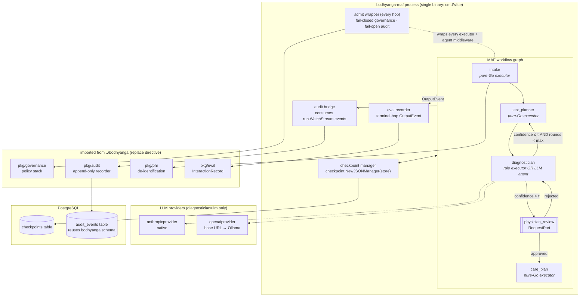
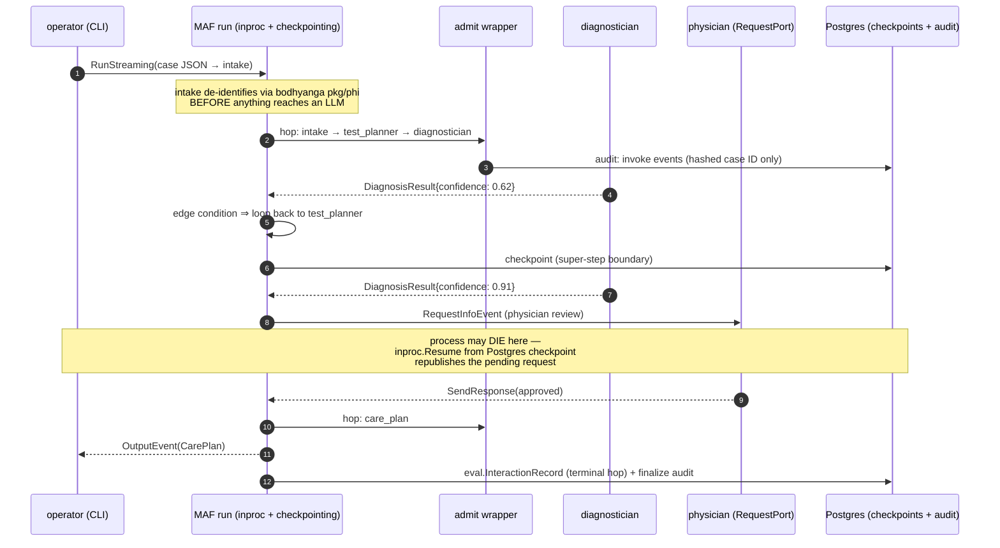

# bodhyanga-maf architecture — MARA vertical slice on MAF-go

**Status: DRAFT — awaiting design approval. No production code exists yet.**

Pinned framework: `github.com/microsoft/agent-framework-go v0.0.0-20260710122455-75d0a647f739`
(public preview; reviewed first-hand 2026-07-11, findings in `../bodhyanga/session.md`).

---

## 1. What this slice is

Bodhyanga's monolith runs every agent behind one orchestrator closure that does five things
per message (`bodhyanga/pkg/orchestration/orchestrator.go`): governance admit, audit, handle,
eval-mirror, fan-out. Bodhyanga's decoupling branch re-builds that closure per agent by hand
(`pkg/gateway`, `pkg/runtime`). This slice tests whether MAF-go's primitives can carry
those five responsibilities instead — on the smallest clinically meaningful pipeline.



### Non-goals (unchanged from README)

No care API/SPA, no FHIR/HL7, no RAG, no full eval harness, no distribution. One binary,
one workflow, four agents, one HITL gate.

---

## 2. The five orchestrator responsibilities, remapped

| Monolith step (`orchestrator.Start`) | bodhyanga decoupling substrate | bodhyanga-maf mechanism |
|---|---|---|
| 1. Governance evaluate/deny | `gateway.Pipeline.Admit` | `admit` wrapper: decorator on every executor handler + `agent.Middleware` on LLM agents (§3) |
| 2. Audit agent invocation | `gateway.Pipeline.Admit` | same wrapper (deny + invoke events); hop telemetry via audit bridge (§4) |
| 3. `agent.HandleMessage` | `runtime.Runtime.handle` | executor handler / agent run |
| 4. Eval-mirror (terminal hop) | **NOT reproduced** (known gap) | eval recorder on `OutputEvent` (§6) — the gap this slice closes |
| 5. Fan-out publish | `runtime` republish loop | graph edges — declarative, checked at `Build()` |

---

## 3. Admission boundary: fail-closed governance, fail-open audit

**The one place MAF doesn't hand us the answer.** `agent.Middleware` guards *agent runs*,
but pure-Go executors (intake, planner, rule diagnostician, care plan) never pass through
an agent. To keep the boundary uniform, admission is a **handler decorator** applied to
every executor at graph-construction time, plus an equivalent `agent.Middleware` for the
LLM diagnostician so its provider call is also guarded:

```go
// pkg/admit — the ONLY place admission semantics live.
func Wrap[In, Out any](agentID string, gov governance.Policy, rec audit.Recorder,
    h func(*workflow.Context, In) (Out, error),
) func(*workflow.Context, In) (Out, error) {
    return func(ctx *workflow.Context, in In) (Out, error) {
        var zero Out
        d, err := gov.Evaluate(ctx.Context(), toEnvelope(agentID, in))
        if err != nil || d.Denied() {          // FAIL-CLOSED: error == denial
            _ = rec.Record(denyEvent(agentID, d, err)) // FAIL-OPEN: audit error logged, not fatal
            return zero, admit.ErrDenied
        }
        _ = rec.Record(invokeEvent(agentID))   // never message content — PHI rule
        out, herr := h(ctx, in)
        if herr != nil {
            _ = rec.Record(errorEvent(agentID, herr))
        }
        return out, herr
    }
}
```

Invariants carried over verbatim from `bodhyanga/pkg/gateway/doc.go`:

- **Fail-closed on governance**: evaluation error ⇒ deny. A denied hop returns
  `admit.ErrDenied`; MAF surfaces it as `ExecutorFailedEvent` and the case halts.
- **Fail-open on audit**: a failed audit write logs loudly but never blocks care flow.
- **Never copy message content into audit events.** Envelopes carry
  `sha256(caseID)[:8]`, agent ID, message type — nothing else. Workflow telemetry keeps
  `EnableSensitiveData=false` (MAF's default) for the same reason.

**Exit-criterion test**: a `deny-all` policy blocks every handler, produces one deny
audit event per attempted hop, and the run terminates without a care plan.

---

## 4. Audit bridge: event stream → bodhyanga's append-only log

A goroutine owned by `cmd/slice` consumes `run.WatchStream(ctx)` and maps workflow
events to `bodhyanga/pkg/audit` events — the same recorder interface the monolith uses, so
**audit parity is testable by diffing trails for the same case**.

| MAF event | audit.Event |
|---|---|
| `ExecutorInvokedEvent` / `ExecutorCompletedEvent` | hop start/finish (agent ID, hashed case ID) |
| `ExecutorFailedEvent` | handler error (or admission denial via §3) |
| `RequestInfoEvent` / response | HITL requested / physician decision |
| `SuperStepCompletedEvent` (has `CheckpointInfo`) | checkpoint written |
| `OutputEvent` | case finalized |
| custom `ctx.AddEvent(...)` domain events | clinical decision points (confidence, loop-back) |

The §3 wrapper writes *admission* events synchronously (deny must be durable even if the
stream consumer lags); the bridge writes *telemetry* events asynchronously. Duplicate
information is acceptable; a missing deny record is not.

---

## 5. Case flow (sequence)



The "process may die here" annotation is exit criterion 3 and the slice's hardest test:
kill the binary while a review is pending, restart, `Resume`, and the physician's answer
still lands. MAF documents pending-request republish on resume; we verify it against a
**Postgres** store, not the in-memory one.

---

## 5b. Translation front door (specs/002)

An **opt-in** hop turns an inbound clinical message (HL7 v2 ADT or FHIR R4 bundle) into a
`PatientCase` before intake, so the graph below the front door is format-agnostic:

```
Inbound ──translator──► PatientCase ──intake──► DiagnosticQuery ──► ... (unchanged)
```

- **`Config.Translate=false` ⇒ the graph is byte-identical** to the JSON-only slice; the
  Runner is fed a `PatientCase`. `true` ⇒ the translator is the start node and the Runner is
  fed an `agents.Inbound` via `RunInbound`; the case token is learned from the first hop.
- The translator sits **inside the admission boundary** (`inbound_message` is a first-class
  admit type — an unlabeled type is denied, fail-closed). A `deny` halts before any case is
  emitted.
- **Import-unchanged:** `bodhyanga/pkg/hl7v2` (ADT parse) and `bodhyanga/pkg/fhir` (R4 resources) are
  used as-is; only a `medical.*→PatientCase` mapper and a minimal FHIR `Bundle` envelope are
  new. `Inbound`/`Format` live in `pkg/agents` (with the other message types) so the
  dependency runs one-way `intake → agents`; `Translate` is injected into the executor.
- **PHI-free rejection taxonomy:** un-translatable input yields a `*RejectError` whose message
  is a category (`malformed`, `unsupported_type`, `unsupported_trigger`, `missing_segment`,
  `missing_resource`, `ambiguous_subject`) — never payload content. The mapping is
  demo-grade: an ADT/FHIR feed carries identifiers and diagnoses, not a symptom workup, so an
  undifferentiated case is a designed outcome, not an error.

---

## 5c. HTTP surface (specs/004)

`cmd/care` serves the pipeline over HTTP; `pkg/careapi` wraps `pipeline.Runner` in a
`net/http` handler. Reads are served from a PHI-free in-memory registry the write paths
populate — no handler re-runs pipeline logic.

| Method + path | Runner call | Purpose |
|---|---|---|
| `POST /v1/cases` | `Run` | submit → `{session_id, case_token, status}`; deny = 201 `denied`, not 500 |
| `GET /v1/cases/{token}` | — (registry) | status + terminal result |
| `GET /v1/reviews` | — (registry) | cases awaiting physician review |
| `POST /v1/reviews/{session}` | `Responder`+`Resume` | answer a review; **durable across restart** with `-db` |
| `GET /v1/cases/{token}/audit` | `Recorder.List` | case-filtered PHI-free trail |
| `GET /healthz`, `/readyz` | — | probes |

Decisions:
- **PHI-free by construction** — every response and registry `Entry` carries only opaque
  fingerprints (case token, session id) and decision-support output (diagnosis, plan steps).
- **Durability lives in the Runner's checkpoint store**, not the API. Paused reviews survive
  restart only with `-db`; on restart the in-memory registry is rebuilt from the store via
  `RecoverPending` (the API persists the session-id set it started, since the store has no
  cross-session "pending" query). Proven by an HTTP restart test — the analog of §5's kill/resume.
- **One `execMu` serializes all executions** (`Run`+`Resume`): the Runner wraps a single
  in-process workflow + checkpoint manager + mutable `Responder`, unsafe for interleaved runs.
  Cases stay independent; parallelism is a future Runner-pool concern.
- **Auth is a non-goal** (ADR-0006): loopback bind + an auth-gap banner; front with
  authenticated ingress for real use.

---

## 6. Component decisions

**Diagnostician duality (exit criterion 4).** `-diagnostician=rule` binds a pure-Go
executor (port of bodhyanga's rule path — the 85.7% SD-Bench configuration).
`-diagnostician=llm-anthropic|llm-ollama` binds the same graph node to a MAF agent
(`anthropicprovider.NewAgent` / `openaiprovider.NewChatCompletionsAgent` with
`option.WithBaseURL(OLLAMA_HOST)`), wrapped via `agentworkflow` with
`WithStructuredOutput(&DiagnosisResult{})` so both emit the identical typed message.
The graph never changes; only the node binding does.

**Loop-back guard.** Conditional edges on `DiagnosisResult.Confidence` (τ = 0.85,
flag-tunable) with a `Rounds` counter in the message; `Rounds >= max` (default 3) forces
the confident path with a `low_confidence_forced` domain event — mirroring bodhyanga's
termination guarantee.

**Postgres checkpoint store (exit criterion 3).** Implement MAF's
`checkpoint.Store[json.RawMessage]` (3 methods) over a `checkpoints` table
(`id, session_id, parent_id, data jsonb, created_at`), append-only per bodhyanga's
persistence discipline. Checkpoint payloads contain workflow state — treated as
PHI-bearing, so the table lives under the same access controls as bodhyanga's clinical
tables, and `data` is never logged.

**Eval mirror (exit criterion 5).** On `OutputEvent`, write one
`eval.InteractionRecord` via bodhyanga's `pkg/eval` store — resolving the
`pkg/runtime/doc.go` gap with its option (b): a single terminal-hop subscriber wired
once per deployment, here the natural owner is the run loop.

**PHI seam.** `pkg/phi` de-identification runs inside the intake executor. Everything
downstream — LLM calls, checkpoints, audit, evals — sees de-identified content only.

---

## 7. Repository layout (target)

```
bodhyanga-maf/
  cmd/slice/            single binary: flags, run loop, event printing (later: audit bridge)
  pkg/pipeline/         graph assembly (testable seam; cmd/slice stays thin)
  pkg/admit/            §3 wrapper + agent.Middleware variant   ← semantics live here
  pkg/agents/           intake, testplanner, diagnostician (rule+llm), careplan
  pkg/auditbridge/      §4 event-stream → bodhyanga audit mapping
  pkg/ckptpg/           Postgres checkpoint.Store[json.RawMessage]
  db/                   migration for checkpoints table
  architecture.md       this file
```

Go 1.26; deps: MAF-go (pinned), bodhyanga via `replace ../bodhyanga` (swap to a tag before any
publish). Test conventions follow bodhyanga: table-driven, `pkg/dbtest.TestDB()`
(testcontainers) for the Postgres store, fixtures in `testdata/`.

## 8. Delivery plan — reviewable PR-sized steps

| # | Step | Proves |
|---|---|---|
| 0 | this document + module scaffold | design approval gate — **approved 2026-07-12** |
| 1 | graph skeleton: 4 pure-Go executors, loop-back, in-memory run, `cmd/slice` | pipeline + loop semantics — **done** |
| 2 | `pkg/admit` + audit bridge (bodhyanga governance/audit wired) | exit criteria 1–2 — **done** (BSP-ordering finding documented) |
| 3 | `RequestPort` + Postgres checkpoint store + kill/resume test | exit criterion 3 — **done** (shared-state-scope finding) |
| 4 | LLM diagnostician (Anthropic + Ollama) behind the flag | exit criterion 4 — **done** (executor-hosted, not agentworkflow — see below) |
| 5 | eval recorder + exit-criteria suite; verdict in `bodhyanga/session.md` | exit criterion 5 + the verdict — **done 2026-07-12** |

**Implementation findings that amend this design** (discovered by tests, all documented
in code and specs/001 contracts):

1. **BSP event batching** (§4 amendment): admission rows are causally ordered; the
   bridge's execution rows lag by a super-step. Audit parity holds per hop, not as one
   global interleaving.
2. **State scopes are per-executor by default**: the review gate and decision executor
   share the pending diagnosis via a NAMED scope (`ReviewState`) — default-scope writes
   are invisible across executors.
3. **`checkpoint.Manager` is opaque**: resume-by-session-ID needs the *store's* index,
   so `Runner.WithCheckpointStore` takes the store, not a manager.
4. **LLM diagnostician is executor-hosted** (amends research R6's agentworkflow plan):
   the graph exchanges typed structs, not chat messages, so the node's handler calls
   `agent.RunText` + structured output itself — identical protocol to the rule engine,
   and both the hop guard and provider middleware apply.
5. **A paused run's stream stays open**: the Runner detaches only after the super-step
   checkpoint capturing the pending request has committed.

Each step lands green (`go test ./...`) before the next starts. After step 5, the
go/no-go decision on reimplementing the wider platform — and the fate of bodhyanga's
specs/002 — is made on evidence.

## 9. Risks

- **Preview churn** — mitigated by the commit pin; upgrades are deliberate PRs.
- **Super-step (BSP) semantics vs bodhyanga's pub/sub** — ordering differences may surface in
  audit-parity diffs (step 2 will tell). If parity is unachievable, that's a finding.
- **Checkpoint payloads carry PHI** — addressed by the intake de-id seam + DB access
  controls; encryption-at-rest is Postgres config, out of slice scope.
- **`replace ../bodhyanga`** — fine for the slice; a version tag on bodhyanga is required before
  bodhyanga-maf is ever published.
